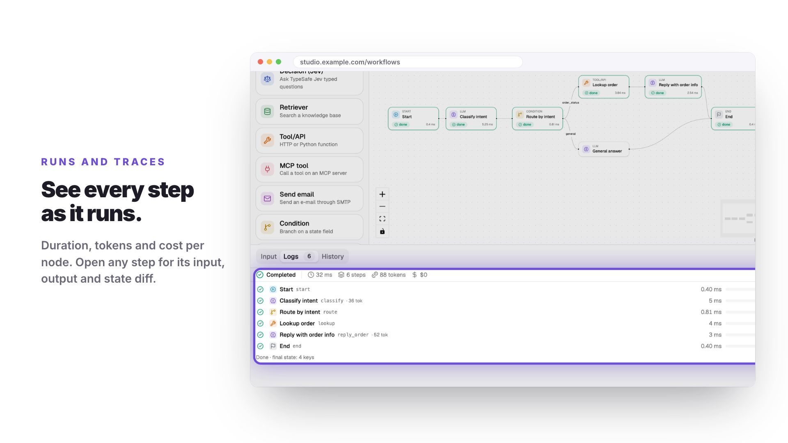

# LangGraph Studio

**English** · [Tiếng Việt](README.vi.md)

A self-hosted workbench for LangGraph. Draw a workflow in the browser,
configure each node, and run it with live per-node events. The FastAPI backend
compiles the saved JSON into a LangGraph `StateGraph`; the same workflow can be
triggered over HTTP, run on a schedule, or paused for a human decision.

[](https://quinguyen1502.github.io/langgraph-studio/#video)

▶ [Watch the intro video](https://quinguyen1502.github.io/langgraph-studio/#video)
([Tiếng Việt](https://quinguyen1502.github.io/langgraph-studio/vi/#video)) ·
📖 **Handbook:** <https://quinguyen1502.github.io/langgraph-studio/>

## What it does

- **Editor:** 13 node types (LLM, Tool, Condition, For each, Join, Subgraph,
  MCP, Retriever, Decision, Send email, Human, …), a typed state with reducers,
  `{{state.field}}` references checked before a run, undo, clipboard, auto
  layout, command palette.
- **Runs:** live trace with duration, tokens and cost per node, state diffs,
  step and run-to-node, cancel, history per version.
- **Operations:** API triggers with signed webhooks, cron schedules, human
  approval in the studio or over Slack, Telegram, WhatsApp, e-mail and Teams,
  checkpoints and effectively-once side effects, versions, roles and sharing.
- **Integrations:** OpenAI, Anthropic, OpenRouter, Ollama, LM Studio and
  OpenAI-compatible servers; knowledge bases with pgvector; MCP servers;
  OpenTelemetry and LangSmith.
- **Sandboxes:** Python code in Tool nodes, and imported LangGraph repos, run in
  locked Docker containers.

## Quick start

```bash
./dev.sh
```

The first run creates `backend/.venv` and installs the frontend. The UI is at
<http://localhost:5173>, the API docs at <http://localhost:8000/docs>. Sign in
with `admin@example.com` / `admin123` (seeded outside production). Without a
model credential, LLM nodes use a deterministic offline mock.

Full stack (Postgres with pgvector, Redis, API, worker, nginx):

```bash
cp .env.example .env   # set JWT_SECRET and POSTGRES_PASSWORD
docker compose up --build   # UI: http://localhost:8080
```

## Documentation

| Topic | Handbook page |
| --- | --- |
| Install and a first workflow | [Getting started](https://quinguyen1502.github.io/langgraph-studio/start/) |
| Editor, nodes, state, Code mode | [Build](https://quinguyen1502.github.io/langgraph-studio/guide/) |
| Traces, approvals, API triggers, schedules | [Run](https://quinguyen1502.github.io/langgraph-studio/run/) |
| Deployment, accounts, roles, providers, channels | [Operate](https://quinguyen1502.github.io/langgraph-studio/operate/) |
| Configuration, HTTP API, error codes, architecture | [Reference](https://quinguyen1502.github.io/langgraph-studio/reference/) |

The handbook source is in [`handbook/`](handbook/README.md). Every variable is
listed in [`.env.example`](.env.example) and every error code in
[`docs/api-errors.md`](docs/api-errors.md).

## Development

```bash
cd backend && .venv/bin/python -m pytest -q
cd frontend && npm run build && npm run lint && npm test
cd frontend && npm run e2e
```

| Path | Contents |
| --- | --- |
| `backend/app/` | FastAPI app: routers → services → repositories and the LangGraph engine ([layers](docs/backend-architecture.md)) |
| `frontend/` | React, TypeScript, Vite, React Flow, Tailwind v4, shadcn/ui ([UI rules](docs/ui-conventions.md)) |
| `handbook/` | The MkDocs handbook |
| `scripts/promo/` | The intro video renderer |
| `.factory-state/` | Requirements, decisions, tasks, reviews and QA ([workflow](AGENTS.md)) |
