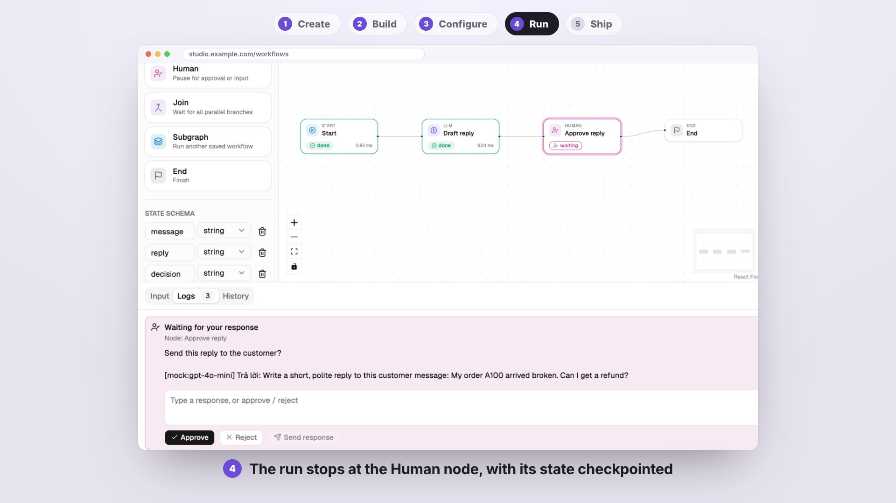
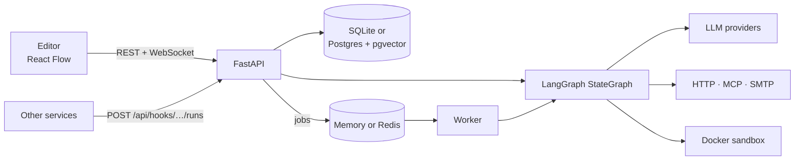

# Superstep

[](https://github.com/quinguyen1502/superstep/actions/workflows/ci.yml)
[](https://quinguyen1502.github.io/superstep/)

**English** · [Tiếng Việt](README.vi.md)

Superstep is a self-hosted platform for building LangGraph workflows in
the browser and running them as services. Workflows are JSON documents that
the FastAPI backend validates and compiles into a LangGraph `StateGraph`. Each
one can run from the editor with a live per-node trace, from another service
over HTTP, on a cron schedule, and pause for a human decision in between.

[](https://quinguyen1502.github.io/superstep/#video)

[Documentation](https://quinguyen1502.github.io/superstep/) ·
[Quickstart](https://quinguyen1502.github.io/superstep/start/quickstart/) ·
[HTTP API](https://quinguyen1502.github.io/superstep/reference/api/) ·
[Architecture](https://quinguyen1502.github.io/superstep/reference/architecture/)

## Quick start

```bash
git clone https://github.com/quinguyen1502/superstep.git
cd superstep && ./dev.sh
```

Open <http://localhost:5173> and create an account with **Sign up**. The API docs are at <http://localhost:8000/docs>.
LLM nodes answer from a deterministic offline mock until you add a model
credential. The [Quickstart](https://quinguyen1502.github.io/superstep/start/quickstart/)
builds, runs, approves and triggers a first workflow in about ten minutes.

The full stack (Postgres with pgvector, Redis, API, worker, nginx):

```bash
cp .env.example .env        # set JWT_SECRET and POSTGRES_PASSWORD
docker compose up --build   # http://localhost:8080
```

## Features

1. **Visual editor:** 13 node types (LLM, Tool, Condition, For each, Join,
   Subgraph, MCP, Retriever, Decision, Send email, Human, Start, End), a typed
   state with reducers, and `{{state.field}}` references checked before a run.
2. **Run traces:** duration, tokens and cost per node, the input, output and
   state diff of every step, step-by-step and run-to-node debugging.
3. **Human in the loop:** a Human node pauses a run from a checkpoint; approve
   in the studio, or from Slack, Telegram, WhatsApp, e-mail or Teams.
4. **Triggers:** per-workflow API tokens, sync and async runs, signed result
   webhooks with retries, cron schedules with time zones, and chat triggers: a
   command to the Slack app or Telegram bot starts a run and the bot replies.
5. **Reliability:** checkpoints in the database, leased worker jobs, and
   effectively-once side effects through idempotency keys and a result ledger.
6. **Models and tools:** OpenAI, Anthropic, OpenRouter, Ollama, LM Studio and
   OpenAI-compatible servers; pgvector knowledge bases; MCP servers; Python
   code in a locked Docker container.
7. **Operations:** immutable versions with diff and restore, admin, editor
   and viewer roles, shares and teams, an audit log, and OpenTelemetry traces
   to OTLP or LangSmith.
8. **Learn LangGraph:** the Code tab shows any workflow as one readable LangGraph
   Python file that runs on its own (offline with a mock model), with the
   selected node's code highlighted.

## How it works



Editor runs execute in the API process and stream events over WebSocket. API
triggers, schedules and recovered runs go through the queue to a worker.
Details: [Architecture](https://quinguyen1502.github.io/superstep/reference/architecture/).

## Documentation

| Topic | Handbook section |
| --- | --- |
| Install, quickstart, concepts | [Get started](https://quinguyen1502.github.io/superstep/start/) |
| Editor, nodes, state, Code mode, knowledge, MCP | [Build](https://quinguyen1502.github.io/superstep/guide/) |
| Traces, human approval, API triggers, schedules, chat triggers | [Run](https://quinguyen1502.github.io/superstep/run/) |
| Deployment, accounts, roles, providers, channels | [Operate](https://quinguyen1502.github.io/superstep/operate/) |
| Configuration, HTTP API, error codes, architecture | [Reference](https://quinguyen1502.github.io/superstep/reference/) |

The handbook source is in [`handbook/`](handbook/README.md). Every variable is
in [`.env.example`](.env.example) and every error code in
[`docs/api-errors.md`](docs/api-errors.md).

## Development

```bash
cd backend && .venv/bin/python -m pytest -q
cd frontend && npm run build && npm run lint && npm test
cd frontend && npm run e2e
```

| Path | Contents |
| --- | --- |
| `backend/app/` | FastAPI app: routers → services → repositories and the LangGraph engine ([layers](docs/backend-architecture.md)) |
| `frontend/` | React, TypeScript, Vite, React Flow, Tailwind v4, shadcn/ui ([UI rules](docs/ui-conventions.md)) |
| `handbook/` | The documentation site (Zensical) |
| `scripts/promo/` | The quickstart video renderer |
| `.factory-state/` | Requirements, decisions, tasks, reviews and QA |

## Contributing

Changes follow the delivery workflow in [`AGENTS.md`](AGENTS.md): a
requirement and a task in `.factory-state/`, a branch
`factory/task-<id>-<name>`, checks, a review, and a merge after human
approval. See [Development](https://quinguyen1502.github.io/superstep/reference/development/)
for the test setup and the conventions each layer follows.
