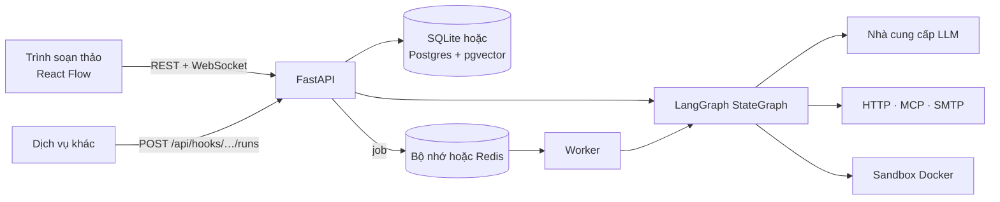

<div align="center">
  <picture>
    <source media="(prefers-color-scheme: dark)" srcset="frontend/public/brand/readme-avatar-dark.svg">
    
  </picture>

  <h3><b>Superstep</b></h3>
  <p>✨ ✨ ✨</p>
  <p>Studio LangGraph trực quan, mã nguồn mở<br>Kéo thả đồ thị • Theo dõi run trực tiếp • Duyệt bởi con người • Node code Python</p>

  <p>
    <a href="https://github.com/quinguyen1502/superstep/stargazers"></a>
    <a href="LICENSE"></a>
    <a href="https://github.com/quinguyen1502/superstep/actions/workflows/ci.yml"></a>
    <a href="https://quinguyen1502.github.io/superstep/vi/"></a>
  </p>

  <a href="README.md">English</a> · <b>Tiếng Việt</b>
</div>

Superstep là nền tảng tự host để xây workflow LangGraph trên trình duyệt
và chạy chúng như một dịch vụ. Workflow là tài liệu JSON được backend FastAPI
kiểm tra và biên dịch thành `StateGraph` của LangGraph. Mỗi workflow chạy được
từ trình soạn thảo kèm trace trực tiếp của từng node, từ dịch vụ khác qua
HTTP, theo lịch cron, và có thể dừng giữa chừng chờ người quyết định.

[](https://quinguyen1502.github.io/superstep/vi/#video)

[Tài liệu](https://quinguyen1502.github.io/superstep/vi/) ·
[Bắt đầu nhanh](https://quinguyen1502.github.io/superstep/vi/start/quickstart/) ·
[HTTP API](https://quinguyen1502.github.io/superstep/vi/reference/api/) ·
[Kiến trúc](https://quinguyen1502.github.io/superstep/vi/reference/architecture/)

## Bắt đầu nhanh

```bash
git clone https://github.com/quinguyen1502/superstep.git
cd superstep && ./dev.sh
```

Mở <http://localhost:5173> và tạo tài khoản bằng **Đăng ký** (ngoài production
còn có sẵn tài khoản demo `admin@example.com` / `admin123`). Tài liệu API ở
<http://localhost:8000/docs>. Node LLM trả lời bằng bản mock offline cố định
cho tới khi bạn thêm credential của model. Phần
[Bắt đầu nhanh](https://quinguyen1502.github.io/superstep/vi/start/quickstart/)
hướng dẫn dựng, chạy, duyệt và gọi workflow đầu tiên trong khoảng mười phút.

Chạy đủ stack (Postgres có pgvector, Redis, API, worker, nginx):

```bash
cp .env.example .env        # đặt JWT_SECRET và POSTGRES_PASSWORD
docker compose up --build   # http://localhost:8080
```

## Tính năng

1. **Trình soạn thảo trực quan:** 13 loại node (LLM, Tool, Condition, For
   each, Join, Subgraph, MCP, Retriever, Decision, Send email, Human, Start,
   End) cùng node Code chỉ đọc từ repo đã import, state có kiểu và reducer,
   tham chiếu `{{state.field}}` được kiểm tra trước khi chạy, và thư viện mẫu
   để bắt đầu nhanh.
2. **Trace của run:** thời gian, token và chi phí từng node, input, output và
   state diff của mỗi bước, debug từng bước và chạy tới node đã chọn. Test
   case kiểm tra kết quả của workflow, và có thể so sánh các run test.
3. **Duyệt giữa chừng (human-in-the-loop):** node Human dừng run tại
   checkpoint; duyệt trong hộp Duyệt của studio, hoặc qua Slack, Telegram,
   WhatsApp, email hay Teams; hạn chờ gửi nhắc, chuyển người duyệt hoặc cho run
   hết hạn.
4. **Trigger:** token API cho từng workflow, run đồng bộ và bất đồng bộ,
   webhook kết quả có chữ ký và retry, lịch cron theo múi giờ, và chạy từ
   chat: một lệnh gửi Slack app hoặc bot Telegram chạy workflow, bot trả lời.
5. **Độ tin cậy:** checkpoint trong database, job của worker có lease, side
   effect thực hiện gần như đúng một lần (effectively-once) nhờ idempotency
   key và sổ ghi kết quả.
6. **Model và công cụ:** OpenAI, Anthropic, OpenRouter, Ollama, LM Studio và
   server tương thích OpenAI; kho tri thức pgvector; máy chủ MCP; code Python
   chạy trong container Docker bị giới hạn chặt.
7. **Vận hành:** phiên bản bất biến có diff và khôi phục, vai trò admin,
   editor và viewer, chia sẻ và nhóm, nhật ký audit, trace OpenTelemetry gửi
   tới OTLP hoặc LangSmith.
8. **Học LangGraph:** tab Code hiện mọi workflow dưới dạng một file Python
   LangGraph dễ đọc, chạy được độc lập (offline với model mock), tô sáng code
   của node đang chọn, và xuất ra để dùng trong dự án của bạn.

## Cách hoạt động



Run khởi chạy từ trình soạn thảo được thực thi ngay trong process API và gửi sự kiện qua
WebSocket. Run gọi qua API, run theo lịch và run được khôi phục đi qua hàng
đợi tới worker. Chi tiết:
[Kiến trúc](https://quinguyen1502.github.io/superstep/vi/reference/architecture/).

## Tài liệu

| Chủ đề | Phần trong handbook |
| --- | --- |
| Cài đặt, bắt đầu nhanh, khái niệm | [Bắt đầu](https://quinguyen1502.github.io/superstep/vi/start/) |
| Trình soạn thảo, node, state, chế độ Code, kho tri thức, MCP | [Xây dựng](https://quinguyen1502.github.io/superstep/vi/guide/) |
| Trace, test, duyệt giữa chừng, API trigger, lịch chạy, chạy từ chat | [Chạy](https://quinguyen1502.github.io/superstep/vi/run/) |
| Triển khai, tài khoản, vai trò, nhà cung cấp, kênh duyệt | [Vận hành](https://quinguyen1502.github.io/superstep/vi/operate/) |
| Cấu hình, HTTP API, mã lỗi, kiến trúc | [Tham chiếu](https://quinguyen1502.github.io/superstep/vi/reference/) |

Mã nguồn handbook nằm ở [`handbook/`](handbook/README.md). Mọi biến môi trường
có trong [`.env.example`](.env.example) và mọi mã lỗi trong
[`docs/api-errors.md`](docs/api-errors.md).

## Phát triển

```bash
cd backend && .venv/bin/python -m pytest -q
cd frontend && npm run build && npm run lint && npm test
cd frontend && npm run e2e
```

| Đường dẫn | Nội dung |
| --- | --- |
| `backend/app/` | App FastAPI: router → service → repository và engine LangGraph ([các lớp](docs/backend-architecture.md)) |
| `frontend/` | React, TypeScript, Vite, React Flow, Tailwind v4, shadcn/ui ([quy tắc UI](docs/ui-conventions.md)) |
| `handbook/` | Site tài liệu (Zensical) |
| `scripts/promo/` | Công cụ render video bắt đầu nhanh |
| `.factory-state/` | Requirement, decision, task, review và QA |

## Đóng góp

Thay đổi đi theo quy trình trong [`AGENTS.md`](AGENTS.md): một requirement và
một task trong `.factory-state/`, branch `factory/task-<id>-<name>`, kiểm tra,
review, và merge sau khi có người duyệt. Xem
[Phát triển](https://quinguyen1502.github.io/superstep/vi/reference/development/)
để biết cách cài môi trường test và quy ước của từng lớp.

## Giấy phép

[MIT](LICENSE)
