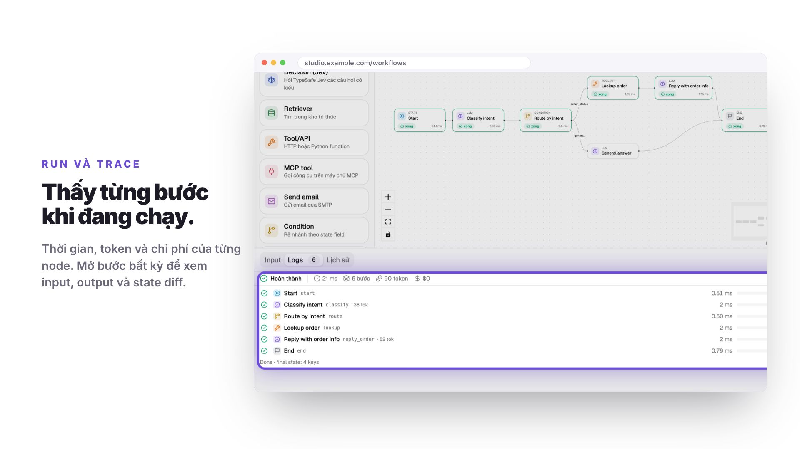

# LangGraph Studio

[English](README.md) · **Tiếng Việt**

Bàn làm việc tự host cho LangGraph. Vẽ workflow trên trình duyệt, cấu hình
từng node, rồi chạy và xem sự kiện của từng node theo thời gian thực. Backend
FastAPI biên dịch JSON đã lưu thành `StateGraph` của LangGraph; cùng một
workflow có thể được gọi qua HTTP, chạy theo lịch, hoặc dừng lại chờ người
duyệt.

[](https://quinguyen1502.github.io/langgraph-studio/vi/#video)

▶ [Xem video giới thiệu](https://quinguyen1502.github.io/langgraph-studio/vi/#video)
([English](https://quinguyen1502.github.io/langgraph-studio/#video)) ·
📖 **Handbook:** <https://quinguyen1502.github.io/langgraph-studio/vi/>

## Làm được gì

- **Trình soạn thảo:** 13 loại node (LLM, Tool, Condition, For each, Join,
  Subgraph, MCP, Retriever, Decision, Send email, Human, …), state có kiểu và
  reducer, tham chiếu `{{state.field}}` được kiểm tra trước khi chạy, undo,
  clipboard, tự sắp xếp bố cục, bảng lệnh.
- **Run:** trace trực tiếp có thời gian, token và chi phí của từng node, state
  diff, chạy từng bước và chạy tới một node, huỷ, lịch sử theo phiên bản.
- **Vận hành:** API trigger với webhook có chữ ký, lịch cron, duyệt bởi người
  trong studio hoặc qua Slack, Telegram, WhatsApp, e-mail và Teams, checkpoint
  và side effect gần như đúng một lần, phiên bản, vai trò và chia sẻ.
- **Tích hợp:** OpenAI, Anthropic, OpenRouter, Ollama, LM Studio và các server
  tương thích OpenAI; kho tri thức với pgvector; máy chủ MCP; OpenTelemetry và
  LangSmith.
- **Sandbox:** code Python trong node Tool, và repo LangGraph được import, chạy
  trong container Docker khoá chặt.

## Chạy nhanh

```bash
./dev.sh
```

Lần chạy đầu tạo `backend/.venv` và cài frontend. UI ở <http://localhost:5173>,
tài liệu API ở <http://localhost:8000/docs>. Đăng nhập bằng
`admin@example.com` / `admin123` (chỉ tạo ngoài production). Chưa có
credential của model thì node LLM dùng bản mock offline cho kết quả cố định.

Đủ bộ dịch vụ (Postgres có pgvector, Redis, API, worker, nginx):

```bash
cp .env.example .env   # đặt JWT_SECRET và POSTGRES_PASSWORD
docker compose up --build   # UI: http://localhost:8080
```

## Tài liệu

| Chủ đề | Trang handbook |
| --- | --- |
| Cài đặt và workflow đầu tiên | [Bắt đầu](https://quinguyen1502.github.io/langgraph-studio/vi/start/) |
| Trình soạn thảo, node, state, chế độ Code | [Xây dựng](https://quinguyen1502.github.io/langgraph-studio/vi/guide/) |
| Trace, duyệt, API trigger, lịch chạy | [Chạy](https://quinguyen1502.github.io/langgraph-studio/vi/run/) |
| Triển khai, tài khoản, vai trò, nhà cung cấp, kênh | [Vận hành](https://quinguyen1502.github.io/langgraph-studio/vi/operate/) |
| Cấu hình, HTTP API, mã lỗi, kiến trúc | [Tham chiếu](https://quinguyen1502.github.io/langgraph-studio/vi/reference/) |

Mã nguồn handbook ở [`handbook/`](handbook/README.md). Mọi biến có trong
[`.env.example`](.env.example), mọi mã lỗi có trong
[`docs/api-errors.md`](docs/api-errors.md).

## Phát triển

```bash
cd backend && .venv/bin/python -m pytest -q
cd frontend && npm run build && npm run lint && npm test
cd frontend && npm run e2e
```

| Đường dẫn | Nội dung |
| --- | --- |
| `backend/app/` | App FastAPI: router → service → repository và engine LangGraph ([các lớp](docs/backend-architecture.md)) |
| `frontend/` | React, TypeScript, Vite, React Flow, Tailwind v4, shadcn/ui ([quy tắc UI](docs/ui-conventions.md)) |
| `handbook/` | Handbook MkDocs |
| `scripts/promo/` | Công cụ render video giới thiệu |
| `.factory-state/` | Requirement, decision, task, review và QA ([quy trình](AGENTS.md)) |
