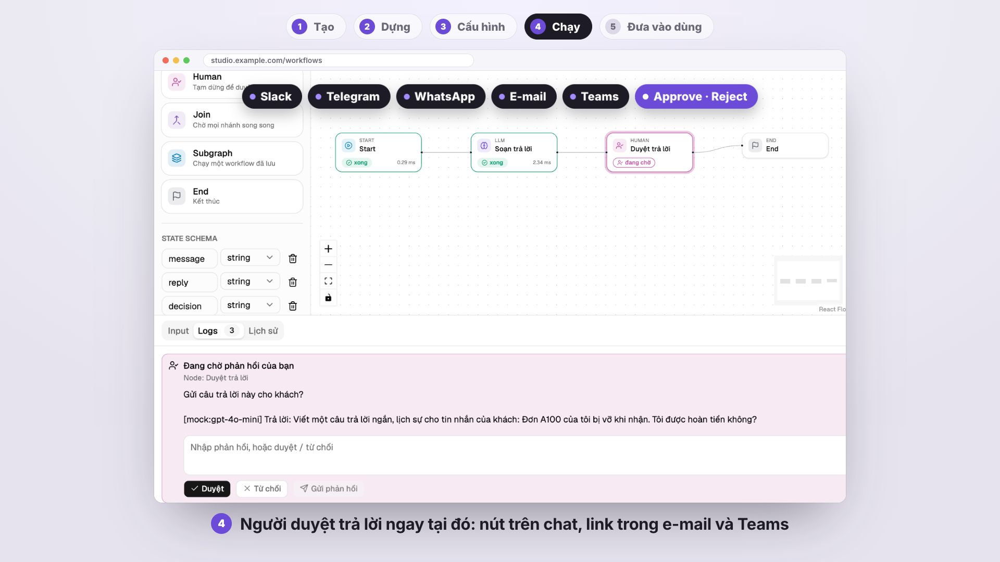
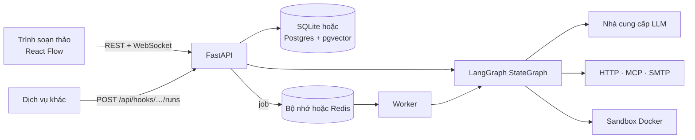

# LangGraph Studio

[](https://github.com/quinguyen1502/langgraph-studio/actions/workflows/ci.yml)
[](https://quinguyen1502.github.io/langgraph-studio/vi/)

[English](README.md) · **Tiếng Việt**

LangGraph Studio là nền tảng tự host để xây workflow LangGraph trên trình duyệt
và chạy chúng như một dịch vụ. Workflow là tài liệu JSON được backend FastAPI
kiểm tra và biên dịch thành `StateGraph` của LangGraph. Mỗi workflow chạy được
từ trình soạn thảo kèm trace trực tiếp của từng node, từ dịch vụ khác qua
HTTP, theo lịch cron, và có thể dừng giữa chừng chờ người quyết định.

[](https://quinguyen1502.github.io/langgraph-studio/vi/#video)

[Tài liệu](https://quinguyen1502.github.io/langgraph-studio/vi/) ·
[Bắt đầu nhanh](https://quinguyen1502.github.io/langgraph-studio/vi/start/quickstart/) ·
[HTTP API](https://quinguyen1502.github.io/langgraph-studio/vi/reference/api/) ·
[Kiến trúc](https://quinguyen1502.github.io/langgraph-studio/vi/reference/architecture/)

## Bắt đầu nhanh

```bash
git clone https://github.com/quinguyen1502/langgraph-studio.git
cd langgraph-studio && ./dev.sh
```

Mở <http://localhost:5173> và đăng nhập bằng `admin@example.com` /
`admin123` (chỉ có khi không chạy production). Tài liệu API ở
<http://localhost:8000/docs>. Node LLM trả lời bằng bản mock offline cố định
cho tới khi bạn thêm credential của model. Phần
[Bắt đầu nhanh](https://quinguyen1502.github.io/langgraph-studio/vi/start/quickstart/)
dựng, chạy, duyệt và gọi workflow đầu tiên trong khoảng mười phút.

Chạy đủ stack (Postgres có pgvector, Redis, API, worker, nginx):

```bash
cp .env.example .env        # đặt JWT_SECRET và POSTGRES_PASSWORD
docker compose up --build   # http://localhost:8080
```

## Tính năng

1. **Trình soạn thảo trực quan:** 13 loại node (LLM, Tool, Condition, For
   each, Join, Subgraph, MCP, Retriever, Decision, Send email, Human, Start,
   End), state có kiểu và reducer, tham chiếu `{{state.field}}` được kiểm tra
   trước khi chạy.
2. **Trace của run:** thời gian, token và chi phí từng node, input, output và
   state diff của mỗi bước, debug từng bước và chạy tới node đã chọn.
3. **Người trong vòng lặp:** node Human dừng run tại checkpoint; duyệt trong
   studio, hoặc qua Slack, Telegram, WhatsApp, e-mail hay Teams.
4. **Trigger:** token API cho từng workflow, run đồng bộ và bất đồng bộ,
   webhook kết quả có chữ ký và retry, lịch cron theo múi giờ.
5. **Độ tin cậy:** checkpoint trong database, job của worker có lease, side
   effect gần như đúng một lần nhờ idempotency key và sổ ghi kết quả.
6. **Model và công cụ:** OpenAI, Anthropic, OpenRouter, Ollama, LM Studio và
   server tương thích OpenAI; kho tri thức pgvector; máy chủ MCP; code Python
   chạy trong container Docker khoá chặt.
7. **Vận hành:** phiên bản bất biến có diff và khôi phục, vai trò admin,
   editor và viewer, chia sẻ và nhóm, nhật ký audit, trace OpenTelemetry gửi
   tới OTLP hoặc LangSmith.

## Cách hoạt động



Run chạy từ trình soạn thảo thực thi trong process API và gửi sự kiện qua
WebSocket. Run gọi qua API, run theo lịch và run được khôi phục đi qua hàng
đợi tới worker. Chi tiết:
[Kiến trúc](https://quinguyen1502.github.io/langgraph-studio/vi/reference/architecture/).

## Tài liệu

| Chủ đề | Phần trong handbook |
| --- | --- |
| Cài đặt, bắt đầu nhanh, khái niệm | [Bắt đầu](https://quinguyen1502.github.io/langgraph-studio/vi/start/) |
| Trình soạn thảo, node, state, chế độ Code, kho tri thức, MCP | [Xây dựng](https://quinguyen1502.github.io/langgraph-studio/vi/guide/) |
| Trace, duyệt bởi người, API trigger, lịch chạy | [Chạy](https://quinguyen1502.github.io/langgraph-studio/vi/run/) |
| Triển khai, tài khoản, vai trò, nhà cung cấp, kênh duyệt | [Vận hành](https://quinguyen1502.github.io/langgraph-studio/vi/operate/) |
| Cấu hình, HTTP API, mã lỗi, kiến trúc | [Tham chiếu](https://quinguyen1502.github.io/langgraph-studio/vi/reference/) |

Mã nguồn handbook nằm ở [`handbook/`](handbook/README.md). Mọi biến môi trường
có trong [`.env.example`](.env.example) và mọi mã lỗi trong
[`docs/api-errors.md`](docs/api-errors.md).

## Phát triển

```bash
cd backend && .venv/bin/python -m pytest -q
cd frontend && npm run build && npm run lint && npm test
cd frontend && npm run e2e
```

| Đường dẫn | Nội dung |
| --- | --- |
| `backend/app/` | App FastAPI: router → service → repository và engine LangGraph ([các lớp](docs/backend-architecture.md)) |
| `frontend/` | React, TypeScript, Vite, React Flow, Tailwind v4, shadcn/ui ([quy tắc UI](docs/ui-conventions.md)) |
| `handbook/` | Site tài liệu (Zensical) |
| `scripts/promo/` | Công cụ render video bắt đầu nhanh |
| `.factory-state/` | Requirement, decision, task, review và QA |

## Đóng góp

Thay đổi đi theo quy trình trong [`AGENTS.md`](AGENTS.md): một requirement và
một task trong `.factory-state/`, branch `factory/task-<id>-<name>`, kiểm tra,
review, và merge sau khi có người duyệt. Xem
[Phát triển](https://quinguyen1502.github.io/langgraph-studio/vi/reference/development/)
để biết cách cài môi trường test và quy ước của từng lớp.
