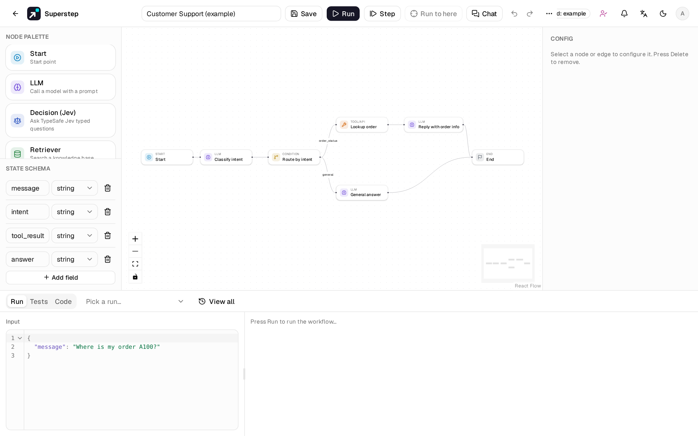
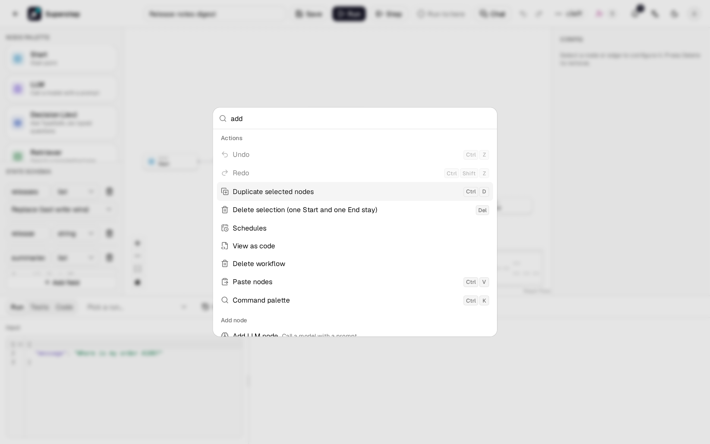
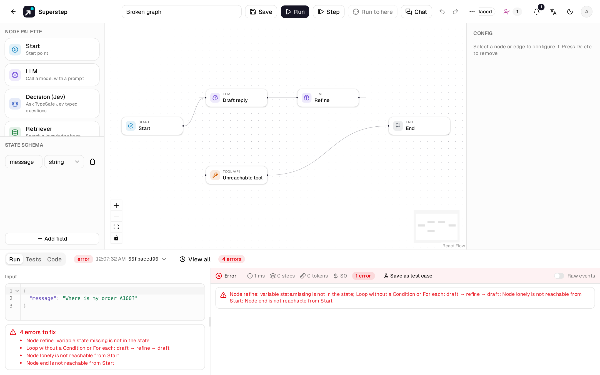
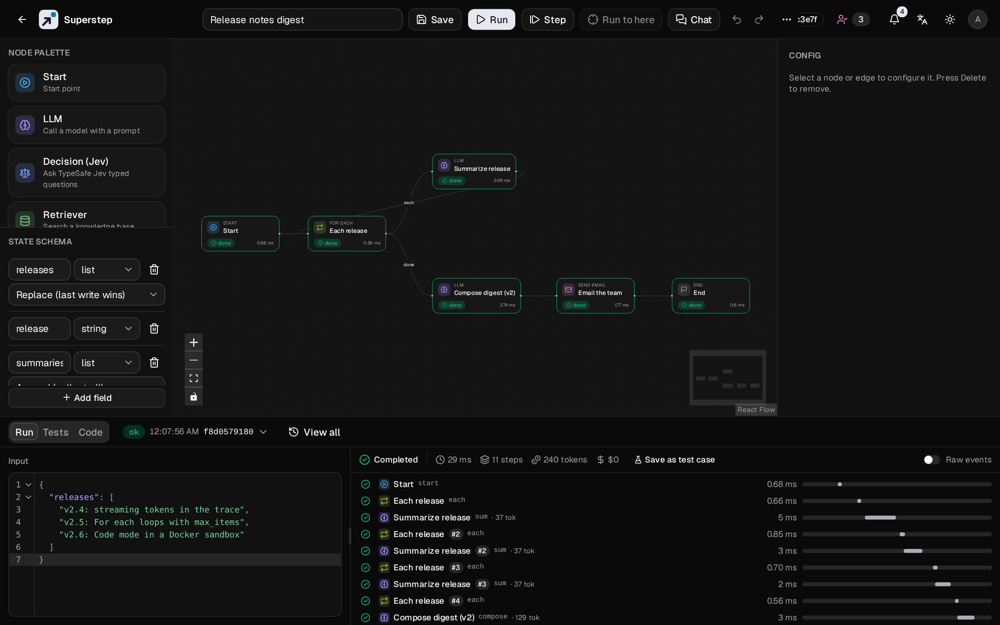

# The editor

## Layout

| Area | What it holds |
| --- | --- |
| Top bar | Name, **Save**, **Run**, **Step**, **Run to here**, [**Chat**](../run/chat.md), undo and redo. Everything else is in the **⋯** (More actions) menu: layout, versions, schedules, API, share, save as template, workflow JSON, view as code, transfer, delete. |
| Left | **Node palette** and the **State schema** editor. |
| Centre | The React Flow canvas. |
| Right | **Config** for the selected node or edge. |
| Bottom | Three tabs. **Run**: the input (JSON) and the logs (the live trace) side by side, a picker with the last 10 runs and **View all** for the whole run history. [**Tests**](../run/tests.md). [**Code**](python-export.md) (the workflow as LangGraph Python or TypeScript). |
| Far right | The [**Chat**](../run/chat.md) panel, when it is open. |

Drag the border of the left, right or bottom panel to resize it. The
minimums are 180 px, 260 px and 140 px, and the canvas keeps at least
280 × 160 px. Sizes are stored in this browser (`localStorage.lgs.editorPanels`),
not in the workflow. The border between the input and the logs drags too.

On a narrow screen (less than 1100 px left for the editor once the chat panel
is open) **Config** folds away while nothing is selected and comes back when you
select a node or an edge.

## Editing the canvas

- **Add a node:** drag it from the palette onto the canvas, or press
  ++ctrl+k++ and type **Add …**.
- **Connect:** drag from a node's right handle to another node's left handle.
- **Edge label:** select the edge and type the label in the right panel.
  Labels matter on Condition and For each edges.
- **Delete:** ++delete++ or ++backspace++ removes the selection. Start and End
  cannot be deleted.
- **Note:** right-click the canvas and choose **Add note** for a sticky note.
  It is saved with the workflow, layout leaves it in place, and a run ignores it.

## Undo and the clipboard

++ctrl+z++ undoes and ++ctrl+shift+z++ or ++ctrl+y++ redoes, up to 100 steps.
One drag is one step, and continuous typing in the same node is one step.
Text fields keep the browser's own undo. The **Unsaved changes** badge clears
when you undo back to the saved graph.

++ctrl+c++, ++ctrl+x++, ++ctrl+v++ and ++ctrl+d++ copy, cut, paste and duplicate
nodes. Only edges between selected nodes travel with them, and pasted nodes
get new ids. Start and End are never copied. The clipboard lives in
`localStorage` (`superstep/nodes` v1), so you can paste into another
workflow in the same browser. A credential you cannot use is cleared on paste.

## Layout

**Tidy up** in the **⋯** menu, or ++shift+l++, lays the graph out with dagre at
the real node sizes. The arrow beside it switches between left-to-right and
top-to-bottom. The top-left of the graph stays where it was, and one layout is
one undo step. ++shift+1++ fits the graph in the view.

## Command palette

++ctrl+k++ opens the command palette on every page, including from inside a
text field. It fuzzy-finds editor actions, **Add node**, **Jump to node**,
**Open workflow**, **New workflow** and Settings pages. English keywords such
as `retriever` or `mcp` match in both languages.

++question++ or ++ctrl+slash++ opens the shortcut sheet. The full list is in
[Keyboard shortcuts](../reference/shortcuts.md).

## Validation

Save and Run both validate the graph. The validator rejects:

- edges to missing nodes, duplicate ids, and more than one Start;
- a self-edge (except on a Condition);
- a cycle that does not pass through a Condition or a For each;
- unreachable nodes;
- a state field written by parallel branches without a reducer;
- a `{{state.x}}` reference to a field that does not exist, or an unknown filter.

Problems appear under the input in the **Run** tab.

## Theme and language

The moon and sun button stores the theme in `localStorage`; `?theme=dark`
forces dark mode. The language button stores the choice in
`localStorage.lang`; the default follows the browser. API errors are
translated by their `error.code`.

