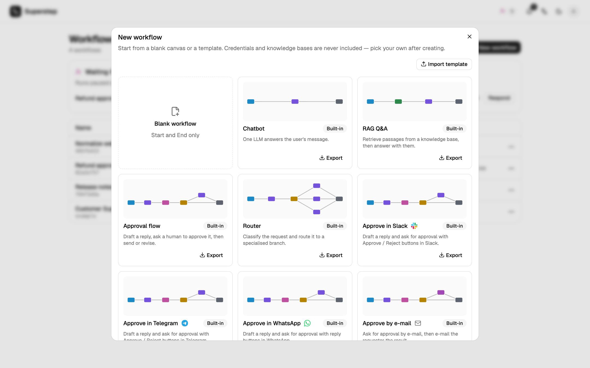

# Workflow templates

**New workflow** opens the template gallery.



| Group | Contents |
| --- | --- |
| Blank workflow | Start and End only. |
| Built-in | The twelve templates below. |
| Only me | Templates you saved. |
| Organisation | Templates shared with everyone. |

Each card has a preview of the graph, and the logo of each approval channel the
template uses. Creating from a template copies it into a new workflow you own.
Built-in names and descriptions follow the UI language.

## Built-in templates

| Template | What it does |
| --- | --- |
| **Chatbot** | One LLM answers the user's message. |
| **RAG Q&A** | Retrieves passages from a knowledge base, then answers with them. |
| **Approval flow** | Drafts a reply, asks a person to approve it in the studio, then polishes it or stops. |
| **Router** | Classifies the request and routes it to a specialised branch. |
| **Approve in Slack** | The approval flow, with Approve / Reject buttons in Slack. |
| **Approve in Telegram** | The same, with buttons in Telegram. |
| **Approve in WhatsApp** | The same, with reply buttons in WhatsApp. |
| **Approve by e-mail** | Asks for approval by e-mail, then e-mails the requester the result with a Send email node. |
| **Approve in Microsoft Teams** | The same, with an Adaptive Card in Teams. |
| **Two-level approval** | A team lead approves in Slack, then a manager approves by e-mail. |
| **Support with escalation** | Answers from a knowledge base; a Decision node sends unsure answers to a person. |
| **Batch processing** | A For each loop summarises every item of a list, then one LLM combines the summaries. |

A channel template names only the channel. After creating it, pick the
connection, the target and the approvers on the Human node (see
[Approval channels](../operate/channels.md)). Until then a run waits at the
Human node and can be answered in the studio. **RAG Q&A** and **Support with
escalation** need a knowledge base before they run.

## Save a template

**⋯ → Save as template** copies the **last saved version** of the workflow
(save first to include unsaved edits). Choose a name, a description and who
sees it. Organisation scope needs `org.manage`.

Templates never carry credentials, knowledge bases, MCP servers, approval
connections, targets or approvers, subgraph links, headers or API keys. Those
fields are emptied, so pick your own after creating. A Human node keeps only
the kind of channel it uses.

## Export and import

**Export** on a card writes a `*.template.json` file:

```json
{"format": "superstep/template", "version": 1,
 "name": "…", "description": "…", "workflow": {"state": [], "nodes": [], "edges": []}}
```

**Import template** in the gallery reads one back. A template that contains a
Code node needs `code.write` to import or use.

Deleting a template asks you to type its name. Workflows created from it are
not affected.
