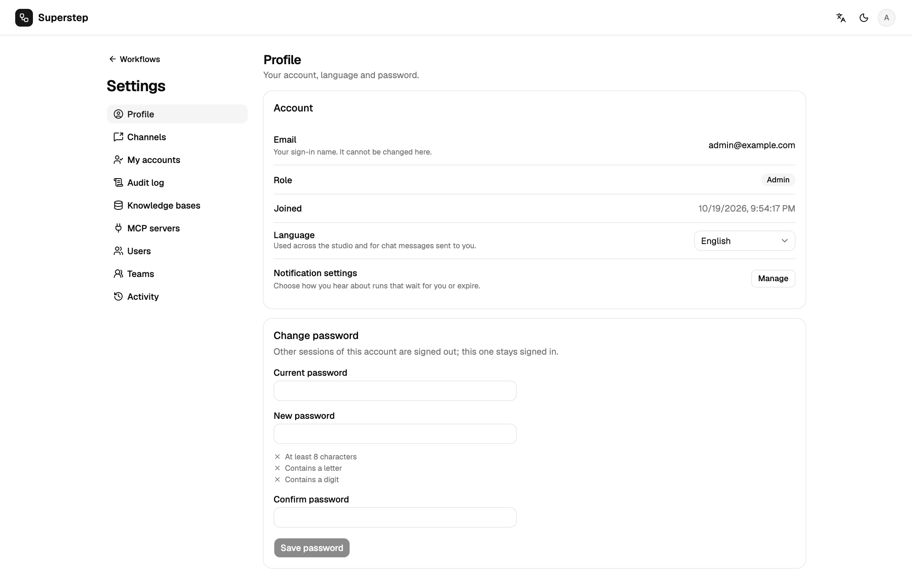

# Accounts and security

## Sign-in and sessions

Passwords are hashed with PBKDF2-SHA256 (200 000 rounds, a unique salt). Login
returns an HS256 JWT that lasts `JWT_TTL_SECONDS` (default 86400, 24 hours).

| Client | Sends | Notes |
| --- | --- | --- |
| Browser | HttpOnly cookie `studio_session` (`SameSite=Lax`, `Secure` in production or with `STUDIO_COOKIE_SECURE`) | Page scripts cannot read it. Writes must send `X-Requested-With: studio`, which `lib/api.ts` does. Sockets use the same cookie and must come from the server's own host. |
| API client | `Authorization: Bearer <token>` | No CSRF header needed. Sockets: `ws://…/ws/run?token=<token>`; uvicorn logs show it as `token=***`. |

Login and registration return `token` and `expires_at` in the body.
`POST /api/auth/logout` clears the cookie. An expired or invalid token signs
the UI out and returns to `/login?expired=1&next=…`.

## Registration

Passwords are 8–128 characters with at least one letter and one digit. Email
is trimmed and lower-cased. A new account gets a copy of the example workflow
and the role in `STUDIO_DEFAULT_ROLE` (`editor` unless set to `viewer`).
Workflows belong to the user who created them.

## Lockout

Five failed sign-ins within 15 minutes lock that e-mail for 15 minutes, even
with the right password (`AUTH_LOCKED`). Unknown addresses count the same way,
so a lockout does not reveal whether an account exists. A bad login always
says the e-mail or password is wrong.

| Variable | Default |
| --- | --- |
| `STUDIO_LOGIN_MAX_FAILURES` | 5 |
| `STUDIO_LOGIN_WINDOW` | 900 s |
| `STUDIO_LOGIN_LOCK` | 900 s |

## Password reset

An admin opens **Settings → Users** and makes a one-time link (the key icon),
then sends it to the user. With `SMTP_HOST` and `STUDIO_PUBLIC_URL` set,
**Forgot password?** on the sign-in page e-mails the link instead, and answers
the same way for every address. A link works once, for
`STUDIO_PASSWORD_RESET_TTL` seconds (default 3600). Setting a new password
signs out every older session of that account and clears its lockout.

## Profile and password change

**Settings → Profile** (also in the user menu) shows the e-mail, role, join
date, language and notification settings.

**Change password** needs the current password. A wrong current password
counts toward the lockout (`AUTH_PASSWORD_WRONG`, then `AUTH_LOCKED`), and the
new one must follow the rules and differ from the old one
(`AUTH_PASSWORD_SAME`). The change signs out every other session, keeps this
browser signed in with a new session, cancels open reset links, and is
recorded in the activity log as `user.password_changed`. The e-mail address
cannot be changed.

## Production

With `STUDIO_ENV=production` the backend refuses to start while `JWT_SECRET`
is still the placeholder (outside production it only logs a warning). The demo
account is not created; if it already exists with the demo password it is
deactivated at start-up. Use `STUDIO_ADMIN_EMAILS` to bootstrap an admin.

## CORS

`STUDIO_CORS_ORIGINS` (comma-separated) lists the browser origins allowed to
call the API. Unset, development allows `*` and production allows none,
because the UI is served from the same origin.

## Secrets at rest

Provider keys, SMTP passwords, MCP headers and channel tokens are encrypted
with Fernet (`STUDIO_SECRET_KEY`, or a generated
`~/.superstep/secret.key` / `STUDIO_SECRET_KEY_FILE`, mode 0600). The
API returns only the last four characters of a key.
