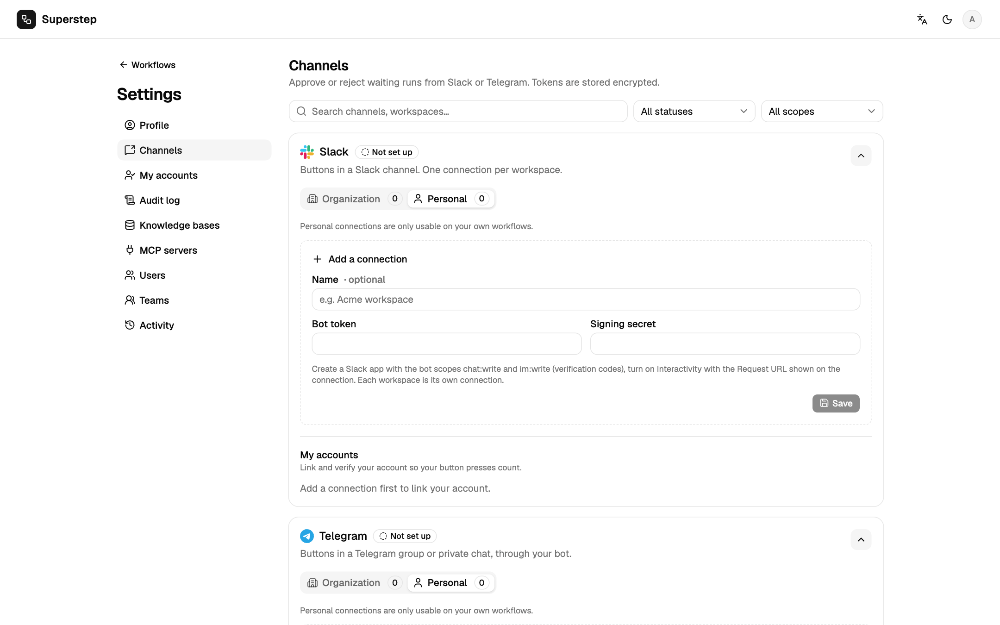

# Approval channels

Approval channels carry a Human node's request outside the studio. Set them up
under **Settings → Channels**; each person links their own chat account under
**Settings → My accounts**. Each channel shows its platform's logo there, in the
Human node's channel list and in **Settings → Audit log**.

| Channel | Kind | Needs |
| --- | --- | --- |
| Slack | Buttons | Public HTTPS `STUDIO_PUBLIC_URL`, a Slack app |
| Telegram | Buttons | Public HTTPS `STUDIO_PUBLIC_URL`, a bot |
| WhatsApp | Reply buttons | Public HTTPS `STUDIO_PUBLIC_URL`, a Meta app with WhatsApp |
| E-mail | Links | `STUDIO_PUBLIC_URL`, `SMTP_HOST` |
| Microsoft Teams | Links in an Adaptive Card | `STUDIO_PUBLIC_URL`, a Workflows webhook |

A connection is personal (usable on your own workflows) or organisation-wide
(admins create those). For local development, a tunnel such as
`cloudflared tunnel --url http://localhost:8000` or `ngrok http 8000` gives a
public HTTPS URL.

## Slack

1. Create an app at <https://api.slack.com/apps>. Bot scopes: `chat:write`,
   `im:write`, and `chat:write.public` if the bot should post in public
   channels it has not joined.
2. Install it and copy the bot token (`xoxb-…`) and the signing secret.
3. In **Settings → Channels**, paste both and save.
4. Copy the request URL into **Interactivity & Shortcuts**:
   `POST {STUDIO_PUBLIC_URL}/api/approvals/callback/slack` (routed by
   `team_id`, so one person can connect several workspaces).
5. Invite the bot to the channel and use the channel id (`C…`) on the node.
6. Each approver copies their Slack member id, receives a 6-digit code by DM,
   and verifies it under **My accounts**.

`SLACK_CLIENT_ID`, `SLACK_CLIENT_SECRET` and `SLACK_SIGNING_SECRET` enable
**Add to Slack** (OAuth). The redirect URL is
`{STUDIO_PUBLIC_URL}/api/approvals/slack/oauth/callback`. Pasting a bot token
still works when those are empty.

## Telegram

1. Create a bot with `/newbot` at @BotFather and paste the token. Save.
2. **Register webhook** calls `setWebhook` for
   `{STUDIO_PUBLIC_URL}/api/approvals/callback/telegram/{channel_id}`
   (`STUDIO_PUBLIC_URL` must be HTTPS).
3. Add the bot to the chat and use that chat id on the node.
4. Each approver presses **Start** in the bot, then verifies their Telegram
   user id with a code.

The webhook is checked with `X-Telegram-Bot-Api-Secret-Token`.

## WhatsApp (Cloud API)

1. In a Meta app with the WhatsApp product, paste the access token, the phone
   number ID, the app secret, and a verify token you choose.
2. In the Meta dashboard set the webhook to
   `{STUDIO_PUBLIC_URL}/api/approvals/callback/whatsapp/{channel_id}` with that
   verify token (Meta checks it with a GET), and subscribe to `messages`.
3. The node's target is a phone number in international form, digits only.

Callbacks are checked with `X-Hub-Signature-256`. WhatsApp delivers button and
text messages only within 24 hours of the person's last message to the number.
Outside that window, set **Template name** (and language) to an approved
template with body variable `{{1}}` and two quick-reply buttons (Approve,
Reject). Approvers verify their number with a code, which also arrives only
inside the 24-hour window. WhatsApp cannot edit a message, so the outcome is a
reply to the request.

## E-mail and Microsoft Teams

These are link channels: the message has Approve and Reject links to
`/approve?token=…`. The person signs in to the studio and confirms there, so
there is no chat account to link, and opening a link (for example by a mail
scanner) decides nothing.

- **E-mail** uses the studio's SMTP settings (`SMTP_HOST`, …). The node's
  target is one or more comma-separated addresses.
- **Teams:** in the channel, add the Workflows template "Post to a channel when
  a webhook request is received", then paste its HTTPS URL. The node needs no
  target. The request is an Adaptive Card, and the outcome is posted as a
  second card.

## Verification and limits

Clicks from unverified accounts are rejected (`APPROVAL_IDENTITY_UNKNOWN`). One
verified studio user owns a chat identity.

| Variable | Default | Meaning |
| --- | --- | --- |
| `STUDIO_IDENTITY_CODE_TTL` | 600 s | Lifetime of a verification code |
| `STUDIO_IDENTITY_CODE_ATTEMPTS` | 5 | Tries per code |
| `STUDIO_IDENTITY_CODE_RESEND` | 30 s | Wait before a code can be resent |
| `STUDIO_APPROVAL_TTL` | 86400 s | Lifetime of a request's buttons and links |
| `STUDIO_CALLBACK_RATE_LIMIT_IP` | 60 | Public callbacks per IP per window |
| `STUDIO_CALLBACK_RATE_LIMIT_CHANNEL` | 300 | Public callbacks per connection per window |
| `STUDIO_CALLBACK_RATE_WINDOW` | 60 s | The window |

Behind a proxy, `STUDIO_TRUSTED_PROXIES` lists the proxy CIDRs.
`X-Forwarded-For` is read from the right, skipping trusted hops, and only when
the direct peer is a trusted proxy.
