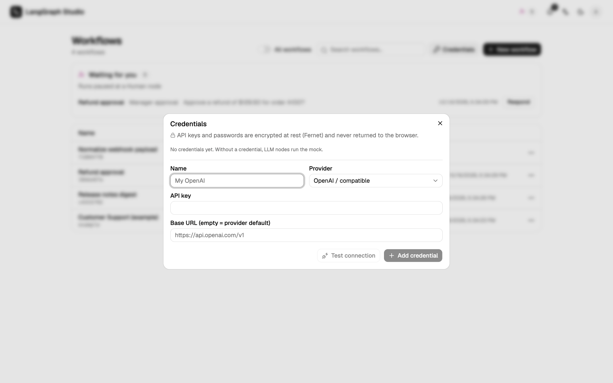

# LLM providers

**Credentials** (on the workflow list) stores provider keys. Each provider is
a small class in `backend/app/engine/providers.py`.

| Provider | Default base URL | API key | Model list |
| --- | --- | --- | --- |
| Ollama | `http://localhost:11434` | not required | `/api/tags` |
| LM Studio | `http://localhost:1234/v1` | not required | `/v1/models` |
| OpenAI-compatible (vLLM, llama.cpp, LocalAI) | `http://localhost:8000/v1` | depends on the server | `/v1/models` |
| OpenRouter | `https://openrouter.ai/api/v1` | required, plus optional `HTTP-Referer` and `X-Title` | `/api/v1/models` |
| OpenAI | provider default | required | `/models` |
| Anthropic | provider default | required | `/v1/models` |
| TypeSafe (Jev), for Decision nodes | `https://api.typesafe.ai` | required | none: **Test connection** sends one tiny question |
| SMTP, for Send email nodes | host, port and security in the form, with presets for Gmail, Outlook, SendGrid, Resend and Mailgun | the password, optional | none: **Test connection** signs in and quits without sending |

## Add a credential

1. Open **Credentials** and choose **Add credential**.
2. Pick the provider. The provider cannot be changed after create.
3. Fill in the base URL and the key.
4. **Test connection** lists the models, before or after save.
5. Select the credential on LLM nodes (or on a knowledge base for embeddings).

Leaving the key blank in the edit form keeps the stored key.

## Fallbacks

| Node has | Uses |
| --- | --- |
| A credential | That provider |
| No credential, `OPENAI_API_KEY` set | OpenAI (optional `OPENAI_BASE_URL`) |
| Neither | The deterministic offline mock |

`GET /api/health` reports `llm_mode`.

## Errors

| Code | When |
| --- | --- |
| `PROVIDER_UNREACHABLE` | The base URL does not answer. |
| `PROVIDER_AUTH_FAILED` | The key was refused. Returned as HTTP 400, so the UI does not treat it as an expired session. |
| `PROVIDER_BAD_RESPONSE` | The server answered with something unexpected. |
| `MODEL_NOT_FOUND` | The model is not on the server. |

During a run, a provider failure becomes the node's `error` event.

## How chat calls are made

Chat uses LangChain (`ChatOllama`, or `ChatOpenAI` with `base_url`), so
streaming and tool calling work where the model supports them. OpenAI and
Anthropic chat use their plain HTTP path.

## Local models

Inside Compose, use `http://host.docker.internal:11434` for Ollama and
`http://host.docker.internal:1234/v1` for LM Studio. See
[Deploy with Compose](deploy.md#local-models-from-compose).

## Embeddings

Knowledge-base embeddings use the same credentials. **Test embedding** reports
the vector size. The default local model for Ollama is `nomic-embed-text`.
Anthropic does not support embeddings. See [Knowledge bases](../guide/knowledge.md).

## Key storage

Keys are encrypted with Fernet (`STUDIO_SECRET_KEY`, or a generated
`~/.langgraph-studio/secret.key` / `STUDIO_SECRET_KEY_FILE`, mode 0600). The
API returns only the last four characters. Losing the key makes old
credentials unreadable.
