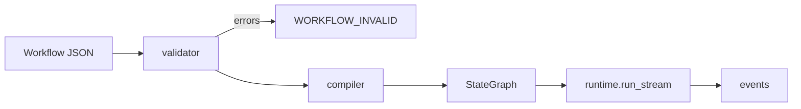
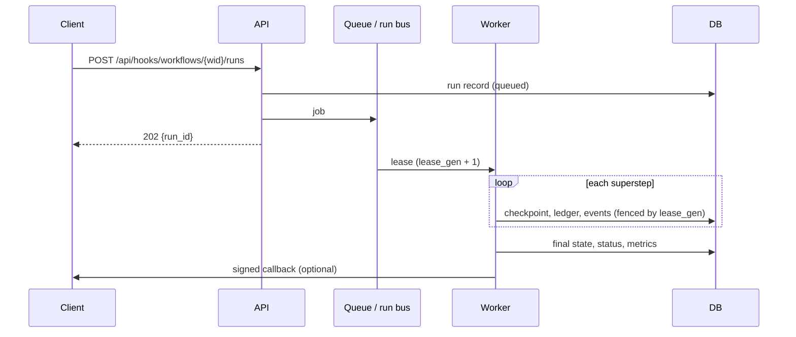

# Architecture

## Backend layers

```text
            HTTP / WebSocket
                  │
   api/routes/*        controllers: parse the request, call a service, shape the response
   api/deps.py         dependency injection: database, services, current user, body limit
   api/error_handlers  DomainError → HTTP status, readable 422
                  │
   services/*          business rules: ownership, auth, run lifecycle, import, schedules
        │                         │
   repositories/*            engine/*   LangGraph: validator, compiler, nodes, providers,
   SQLAlchemy queries                   tools, runtime, limits, sandbox
        │
   models/*            SQLAlchemy 2.0 typed models; migrations/ (Alembic)
                  │
   core/*              config, security, errors catalogue, permissions, logging
   schemas/*           Pydantic DTOs
```

`backend/tests/test_layers.py` enforces the import rules:

| Layer | May import | Must not import |
| --- | --- | --- |
| `core` | stdlib, jwt | anything else in `app`, FastAPI |
| `engine` | `core` | models, repositories, services, api, FastAPI |
| `models` | `core` | repositories, services, api, engine |
| `schemas` | pydantic | models, repositories, services, api |
| `repositories` | `models`, `core` | services, api, FastAPI |
| `services` | repositories, engine, models, core | api, FastAPI |
| `api` | everything | — |

Services raise `AppError("CODE", …)`; codes and messages live only in
`core/errors.py` `CATALOG`, and only `api/error_handlers.py` builds error
responses. Repositories hold no rules, and each method opens its own short
session, so they are safe from the run worker thread.

## From JSON to a graph



1. The **validator** checks structure (ids, edges, one Start, reachability,
   loops through a Condition or For each), state references, reducers for
   parallel writes, subgraph depth, and whether the server can run what the
   graph needs (Code mode, for example).
2. The **compiler** builds a LangGraph `StateGraph`: each node becomes a node
   function; edges become `add_edge`; a Condition or For each becomes
   `add_conditional_edges` with its label mapping; several edges into a Join
   become a single fan-in edge. State fields get their reducers.
3. The **runtime** streams the graph and turns LangGraph updates into studio
   events (`node_started`, `node_token`, `node_finished`, …), applying the
   event and run size limits.

## Run lifecycle

| Started from | Executes in | Events reach |
| --- | --- | --- |
| Editor (`/ws/run`) | The API process that holds the socket | That socket |
| API trigger, schedule, recovery | A worker, through the job queue | The run record, callbacks and other listeners through the run bus |



The run bus is in memory for one process, or Redis for several; with Redis a
job whose worker died is leased again and continues from its last checkpoint.

## Effectively-once side effects

| Mechanism | What it prevents |
| --- | --- |
| Idempotency key per run, node and iteration | A retried HTTP call or tool being applied twice by the receiver (`Idempotency-Key`, `X-Studio-Run-Id`, `X-Studio-Attempt` headers; `idempotency_key` for Python tools) |
| Node-result ledger | A recovered run repeating a finished LLM, Tool, Decision or Send email call (`reused` in the trace) |
| Lease fencing (`runs.lease_gen`) | A worker that lost its lease writing over the new owner's progress |
| Checkpoints per superstep | A crash or restart losing completed steps |

The ledger is deleted when the run ends. The node that was in flight when a
worker died may run again, so HTTP and tool endpoints should accept the
idempotency key.

## Frontend

React, TypeScript and Vite, with React Flow for the canvas, shadcn/ui on
Tailwind v4 for components, and CodeMirror for JSON and Python. The UI calls
the API only through `lib/api.ts`, which unwraps the envelope, and shows
errors by translating `error.code`. Every string lives in
`src/locales/en.json` and `vi.json` with identical keys.
