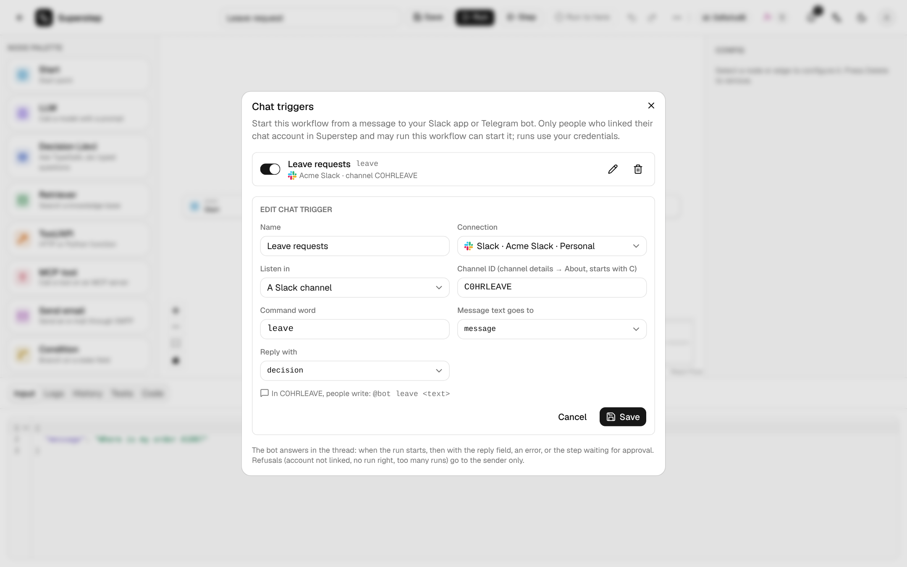

# Chat triggers

**⋯ → Chat triggers** in the editor starts the workflow from a message to your
Slack app or Telegram bot. A command word picks the workflow, the rest of the
message fills one input field, and the bot answers in the thread with one state
field.



```text
@bot leave 2 days off next week for a family trip
     ^^^^^ ^^^^^^^^^^^^^^^^^^^^^^^^^^^^^^^^^^^^^^^^
   command  goes into the input field
```

## Before you begin

- Owner access to the workflow (its owner, or an admin).
- A Slack or Telegram connection under **Settings → Channels** that you may use
  (your own, or an organisation one when your role may use those). See
  [Approval channels](../operate/channels.md).
- A public HTTPS `STUDIO_PUBLIC_URL` and the worker running: messages are
  queued as jobs.
- Everyone who will write to the bot links and verifies their chat account
  under **Settings → My accounts**, and may run the workflow: its owner, an
  admin, or someone it is shared with (see
  [Roles and sharing](../operate/access.md)).

## Set up Slack

A connection made before chat triggers existed needs these steps once.

1. In the app's **OAuth & Permissions**, add the bot scopes
   `app_mentions:read` (mentions in channels) and `im:history` (direct
   messages). **Add to Slack** asks for them already.
2. In **Event Subscriptions**, turn events on and paste the **Event
   Subscriptions Request URL** shown on the connection under **Settings →
   Channels**: `{STUDIO_PUBLIC_URL}/api/channels/events/slack`. Slack checks it
   at once. One URL serves every workspace (routed by `team_id`).
3. Under **Subscribe to bot events**, add `app_mention` and `message.im`.
4. For direct messages, in **App Home** allow users to send messages from the
   Messages tab.
5. Reinstall the app to the workspace, then press **Test connection**. When
   the test finds a scope missing, the connection shows a warning, and
   triggers on it can only be saved turned off.
6. Invite the bot to each channel it should listen in.

## Set up Telegram

1. Press **Register webhook** on the connection again. The bot then receives
   messages as well as button clicks, at the same callback URL.
2. In a group, the bot only sees messages that start with `/` (privacy mode).
   People write `/leave …`, or you turn privacy mode off with
   `/setprivacy` at @BotFather.
3. Add the bot to the group. The group id is negative (for example
   `-1001234567890`): open the group in Telegram Web, and it is the number after
   `#` in the address.

## Add a trigger

| Field | Meaning |
| --- | --- |
| Name | Shown in the list and in History. |
| Connection | A Slack app or Telegram bot from **Settings → Channels**. |
| Listen in | **Direct messages to the bot**, **A Slack channel** (its id, `C…`, from the channel details → About) or **A Telegram group** (its id, `-…`). |
| Command word | One word: letters, digits, `-` or `_`, up to 32 characters. Not case-sensitive; a leading `/` is dropped. |
| Message text goes to | The input field that receives the rest of the message. A list field gets a one-item list. |
| Reply with | The state field the bot shows when the run ends. |

The dialog shows what people will write. One command answers once per place:
the same word on the same connection and place is refused
(`CHAT_TRIGGER_COMMAND_TAKEN`), but it may be used in another channel, group,
or connection. The switch on each row turns a trigger off without deleting it.
A workflow has at most 20 chat triggers.

## What people write

| Where | Message |
| --- | --- |
| Slack channel | `@bot leave 2 days off next week` |
| Slack DM | `leave 2 days off next week` |
| Telegram group | `/leave 2 days off next week` (or `/leave@your_bot …`) |
| Telegram DM | `leave 2 days off next week` or `/leave …` |

A colon or comma after the command works too (`leave: 2 days`). Messages from
bots, edits, joins and files are ignored, as are messages whose first word is
not a command of this place.

## What the bot replies

In the message's thread (in a Slack DM, in the conversation; in Telegram, as a
reply to it):

- **Started:** `▶️ Started Leave request (run 1a2b3c4d5e)` as soon as the run is
  queued.
- **Finished:** `✅ Leave request finished: …` with the reply field, shortened
  to 3000 characters.
- **Failed:** `❌ … failed: …` with the error message.
- **Waiting:** `⏸ … is waiting for approval at Manager review` when a Human node
  pauses the run. The approval itself goes where the node sends it; after it,
  the bot answers again with the result.
- **Stopped:** `⏹ … stopped (cancelled)`.

Each reply links to the run when `STUDIO_PUBLIC_URL` is set. The run appears in
History with a **Chat** badge, the platform's logo, the sender and the
trigger's name. The bot writes in the language of the sender's studio account.

## Refusals

A refused message starts nothing. The reason goes to the sender only: a Slack
message only they see, or a Telegram direct message (in the group if they never
started the bot). Each refusal is written to **Settings → Audit log** as
`chat_refused`; started runs as `chat_started`.

| Reason | Code |
| --- | --- |
| The chat account is not linked | `CHAT_IDENTITY_UNKNOWN` |
| The chat account is linked but not verified | `CHAT_IDENTITY_UNVERIFIED` |
| The linked user may not run the workflow | `CHAT_FORBIDDEN` |
| The trigger is off | `CHAT_TRIGGER_OFF` |
| Too many runs from this sender with this command | `RATE_LIMITED` |
| The message is larger than `STUDIO_INPUT_MAX_BYTES` | `RUN_INPUT_TOO_LARGE` |
| The workflow was deleted | `WORKFLOW_NOT_FOUND` |

## Security and limits

- **Who may run:** only senders whose chat account is linked and verified, and
  whose studio user has the run right. The run is owned by that user.
- **Whose resources:** the run uses the workflow owner's credentials, knowledge
  bases and MCP servers, as every run of a saved workflow does.
- **Requests:** Slack events are checked with the signing secret, Telegram
  updates with the webhook's secret token. A delivery retried by the platform
  starts nothing new.
- **Rate limit:** `STUDIO_CHAT_TRIGGER_RATE_LIMIT` runs per sender and trigger
  (default 60, `0` off) per `STUDIO_TRIGGER_RATE_WINDOW` seconds (default 60).
- **Stopping:** deleting the connection turns its triggers off; a trigger also
  turns itself off when its creator can no longer manage the workflow. Deleting
  the workflow deletes its triggers.

## API

```text
GET|POST     /api/workflows/{wid}/chat-triggers
PATCH|DELETE /api/workflows/{wid}/chat-triggers/{tid}
POST         /api/channels/events/slack
```
