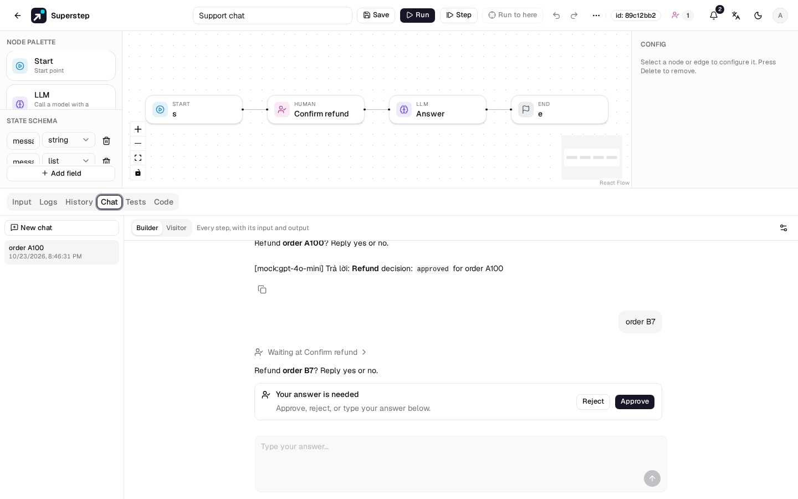
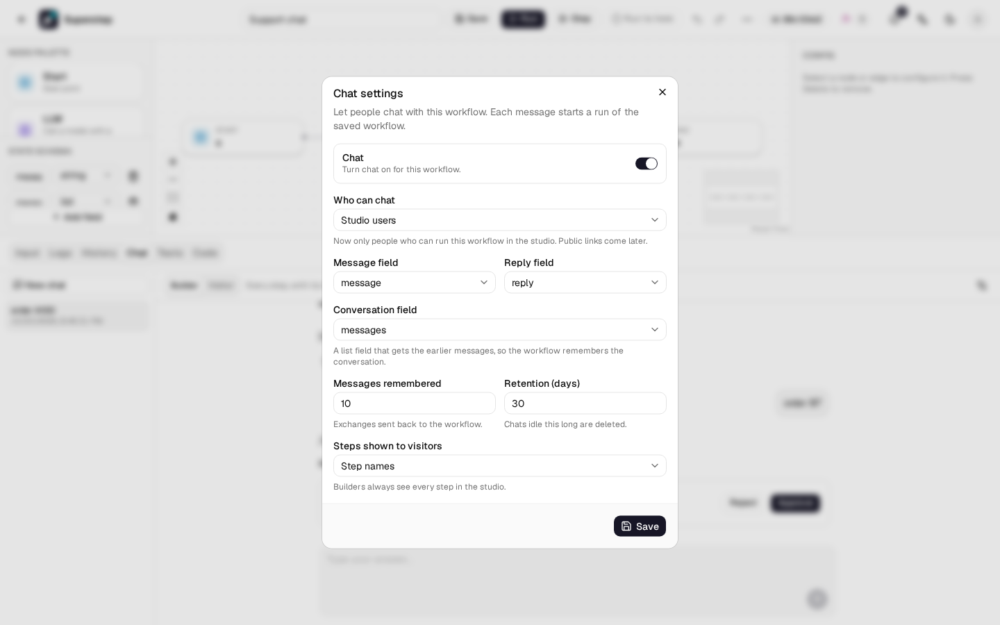

# Chat

The **Chat** tab in the editor's bottom panel lets you talk to a workflow the way
a person chatting with it would. Each message starts a run of the **saved**
workflow; the steps and the reply stream in as it runs, and the conversation is
kept so the workflow can remember it.



!!! note "Phase 1"
    Chat works inside the studio for people who may run the workflow. Public
    chat links, signed-in visitors, attachments and an embeddable widget come
    later; the settings already reserve room for them.

## Turn chat on

1. Open the workflow and choose **⋯ → Chat settings**, or the gear in the Chat
   tab. You need owner access to change them (its owner, or an admin).
2. Turn **Chat** on and check the fields:
    - **Message field**: the state field that gets each message (`string` or `list`).
    - **Reply field**: the state field shown as the answer.
    - **Conversation field**: a `list` field that gets the earlier messages (see
      [Memory](#memory)). Choose **None** for a chat without memory.
3. Save. Saving checks that the fields exist in the workflow's state.



| Setting | What it does | Default |
|---|---|---|
| Who can chat | **Studio users** only for now. *Anyone with the link* and *Signed-in users* are shown but not available yet. | Studio users |
| Messages remembered | How many earlier exchanges (one message and its answer) go to the conversation field. | 10 |
| Steps shown to visitors | **None**, **Step names** or **Full** (with each step's input and output). | Step names |
| Retention (days) | Chats with no new message for this long are deleted. | 30 |

## Chat

Type a message and press ++enter++ (++shift+enter++ adds a line). Answers are
Markdown: lists, tables, links and code blocks show formatted; raw HTML and
images from other sites are not shown, and links open in a new tab.

- **New chat** starts a conversation without memory. Your earlier chats stay in
  the list, newest first, named after their first message.
- **Builder / Visitor** at the top switches the view. *Builder* shows every step
  with its input and output (click a step to open it); *Visitor* shows only what
  **Steps shown to visitors** allows.
- Each message is a run in **History** with the *Chat* badge, so you can open
  its full trace there.
- Chat uses the saved workflow: save your changes before you try them.

## Memory

With a conversation field set, each run gets the last *n* exchanges plus the
new message in that field, as a list of `{"role": "user" | "assistant",
"content": "…"}` items. Use it in a prompt, for example:

```text
Conversation so far:
{{state.messages}}

Answer the last user message.
```

## Human nodes in a chat

A Human node's **Answered by** option decides who answers it when the workflow
runs from a chat:

- **The person chatting** (default): the question appears in the chat with
  **Approve** and **Reject**; or type your answer in the message box. The answer goes to the node's
  output field and the run goes on.
- **A reviewer**: the chat says it is waiting for approval, and the question
  goes to the [Approvals](human-approval.md) page (and its channels) as usual.
  The chat shows the answer once the run goes on.

A new message cannot be sent while the chat waits for an answer. The node's
[deadline](human-approval.md#deadlines) applies in both cases; when it passes,
its timeout action decides what happens.

## Errors

| Code | Meaning |
|---|---|
| `CHAT_NOT_ENABLED` | Chat is off for this workflow. |
| `CHAT_SETTINGS_INVALID` | A setting is wrong; `field` names it. |
| `CHAT_ACCESS_NOT_AVAILABLE` | That *Who can chat* option is not available yet. |
| `CHAT_SESSION_NOT_FOUND` | The chat does not exist, or is not yours. |
| `CHAT_MESSAGE_EMPTY` / `CHAT_MESSAGE_TOO_LONG` | The message is empty, or over 4000 characters. |
| `CHAT_RUN_WAITING` | The chat waits for a Human node's answer. |
| `CHAT_ANSWER_BY_REVIEWER` | A reviewer answers this step, in Approvals. |

See also [Chat triggers](chat-triggers.md) for Slack and Telegram.
