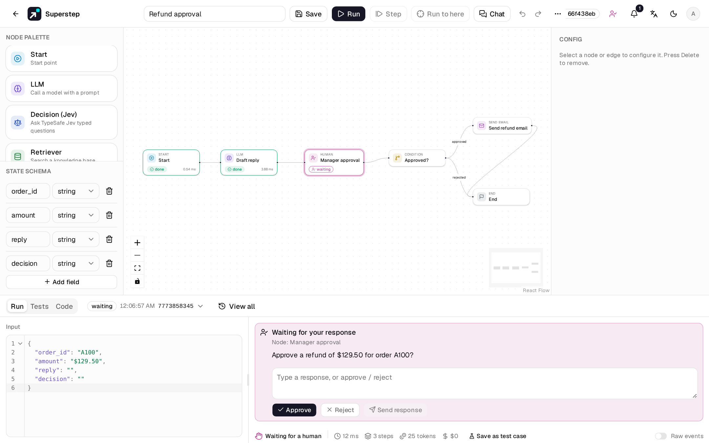
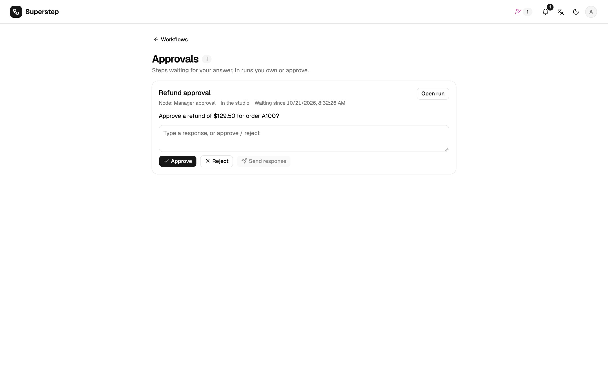
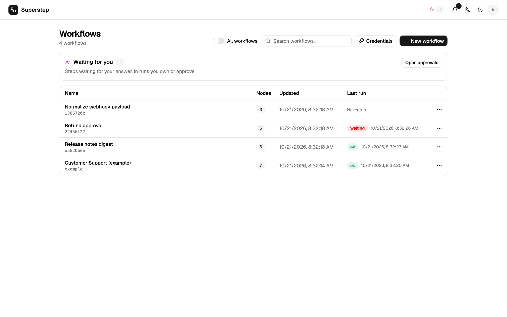

# Human approval

A **Human** node pauses the run in status `waiting` and asks its `prompt`.
The answer goes to the node's `output_field`, so a Condition after it can
branch on it.



## Answer in the studio

The Logs tab shows the question with **Approve** (`approved`), **Reject**
(`rejected`), or a free-text **Send response**. Only the run's owner can open,
answer or cancel the run here.

## The Approvals page

**Approvals** (`/approvals`, the person icon in the header) lists every step
waiting for you, across all workflows: runs you own, and runs where you are an
**approver** of the waiting Human node. Each row shows the workflow, the step,
the question, who started the run, how long it has waited and the channel the
request went to. Answer with **Approve**, **Reject** or a text reply, right in
the row.



- Name approvers by e-mail in the Human node's **Approvers** field. It works with
  or without an approval channel. Each address must belong to a studio account.
- An approver sees only the request: not the workflow, the run trace or its
  data. **Open run** shows only for the run's owner, and for the workflow's
  owner or an admin.
- The first answer wins, wherever it comes from: the editor, the Approvals page
  or a chat button. Later answers are refused. An answer here closes the chat
  request and edits its message.
- The header badge counts the steps waiting for you, and **Workflows** shows a
  link to the page while any are waiting.



Checkpoints live in the database, so a restart resumes the run where it
stopped. Waiting time does not count toward the run's duration. A wait longer
than `STUDIO_WAIT_TTL` seconds (default 7 days; `0` never expires) becomes
`expired`, and resuming then returns `410 RUN_EXPIRED`.

```text
GET  /api/approvals/inbox                       # steps waiting for you, owner or approver
POST /api/approvals/inbox/{run_id}  {"response": "approved"}
GET  /api/runs/pending                          # your own waiting runs
WS   /ws/run   {"resume_run_id": "…", "response": "approved"}
POST /api/runs/{id}/cancel
```

## Notifications

The bell lists unread notifications and receives them live on
`/ws/notifications`, with a 30 s poll as fallback. Each user picks what they
receive under **Settings → Profile**.

| Channel | Set up |
| --- | --- |
| In-app bell | Always on |
| E-mail | `SMTP_HOST` (and `SMTP_PORT`, `SMTP_USER`, `SMTP_PASSWORD`, `SMTP_FROM`, `SMTP_STARTTLS` or `SMTP_SSL`); links use `STUDIO_PUBLIC_URL` |
| Webhook | `STUDIO_NOTIFY_WEBHOOK_URL` posts JSON for each `waiting` or `expired` run, signed with `STUDIO_NOTIFY_WEBHOOK_SECRET` when set |

## Approve from chat

A Human node can also send the request to an **approval channel**:

| Channel | Carries | The answer |
| --- | --- | --- |
| Slack | Approve / Reject buttons | a button press by a verified Slack account |
| Telegram | Approve / Reject buttons | a button press by a verified Telegram account |
| WhatsApp | Two reply buttons | a reply by a verified phone number |
| E-mail | Approve / Reject links to `/approve?token=…` | confirmed in the studio after sign-in |
| Microsoft Teams | An Adaptive Card with links | confirmed in the studio after sign-in |

The same rules apply everywhere: only the run owner or an approver listed on
the node, one answer, and an expiry (`STUDIO_APPROVAL_TTL`, default 86400 s).
Button tokens are HMAC-signed and single-use. Messages follow the run owner's
language. Answering in the studio disables the chat buttons; cancel and expiry
close the request. With no channel configured, nothing is sent.

Setting up each channel is in [Approval channels](../operate/channels.md).

## A typical pattern

```text
Start → LLM (draft a reply) → Human (approve the draft?) → Condition on decision
      ├─ approved → Send email → End
      └─ rejected → End
```

The **Approval flow** starter template has this shape.
