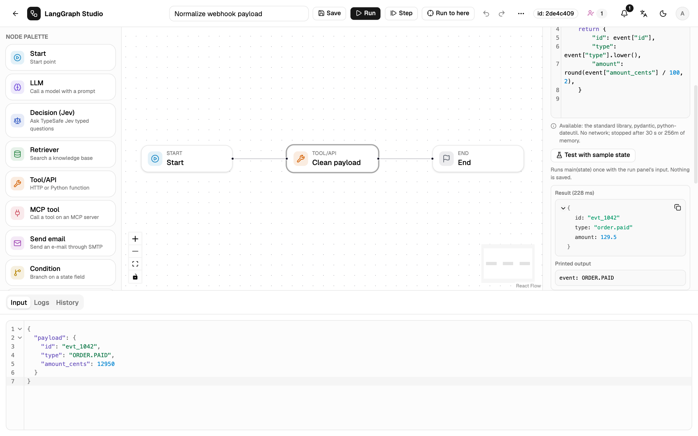

# Code mode

A Tool node in **Python code** mode runs Python you write in the node. The
code defines `main(state)`; its return value goes to the node's
`output_field`.

```python
def main(state):
    print("seen:", state["message"])   # shown in the trace, not stored in the state
    return state["message"].upper()
```



!!! info "Before you start"
    Code mode is off until the server sets `STUDIO_ENABLE_CODE_NODES=1` and
    has the sandbox image. An admin sets that up: see
    [Code runtime](../operate/code-runtime.md). While it is off, a workflow
    with a Code node fails validation and says why.

## Write and test

1. Select a Tool node and set **Mode** to **Python code**. The field starts
   with a `main(state)` stub and highlights Python.
2. Below the editor, the node lists the packages in the image and the limits.
3. Put sample input in the run panel's **Input** tab.
4. Press **Test with sample state**. It runs `main(state)` once with that
   input and saves nothing. The result shows the returned value, the printed
   output and, on failure, the traceback with your own frames only.
5. Save and run as usual.

Tests go through `POST /api/code/test`, limited to
`STUDIO_CODE_TEST_PER_MINUTE` calls per user per minute (default 20).

## The contract

| Rule | Detail |
| --- | --- |
| Entry point | A function named `main` that takes one argument, the state. |
| Input | A JSON copy of the state. Changing it does not change the run. |
| Output | The return value, which must be JSON: a dict, list, string, number, bool or `None`. |
| Printed output | `print()` and stderr go to the trace, at most 64 KB (longer output is cut). |
| Size | Source at most 64 KB; state and result at most 1 MB each. |
| Packages | The standard library plus what the image has: `pydantic` and `python-dateutil` in the default image. |
| Network, files | None. The container has no network, a read-only root and a 64 MB `/tmp`. |
| Time | The node's timeout, capped by the server's maximum (30 s by default). |

The code changes the run only through its return value.

## Failures

| Code | When |
| --- | --- |
| `CODE_INVALID` | Syntax error, or no callable `main`. |
| `CODE_FAILED` | `main` raised. The trace shows the traceback. |
| `CODE_RESULT_NOT_JSON` | The return value is not JSON. |
| `CODE_TIMEOUT` | The call ran past its time limit. |
| `CODE_MEMORY` | The container hit its memory limit. |
| `CODE_TOO_LARGE` | Source, state or result over the size limits. |
| `CODE_RUNTIME_OFF`, `CODE_RUNTIME_UNAVAILABLE` | Code mode is off, or Docker or the image is missing. |
| `CODE_WRITE_FORBIDDEN` | You lack `code.write`. |

The node's retry settings apply to failures. A cancelled run kills its
container.

## Who may write code

Only roles with `code.write` (admins, by default) may add a Code node or
change its code, whether by a save, a version restore, or a template import
or use. Editors can still open, run, move, rename and delete Code nodes and
duplicate a workflow that has one; for them the code is read-only and the
test button is hidden.

## In the trace

The node's row carries `code_output`: the printed output, the runtime and
the duration. A failure shows the traceback. A call takes about 0.3 s on a
warm image.
