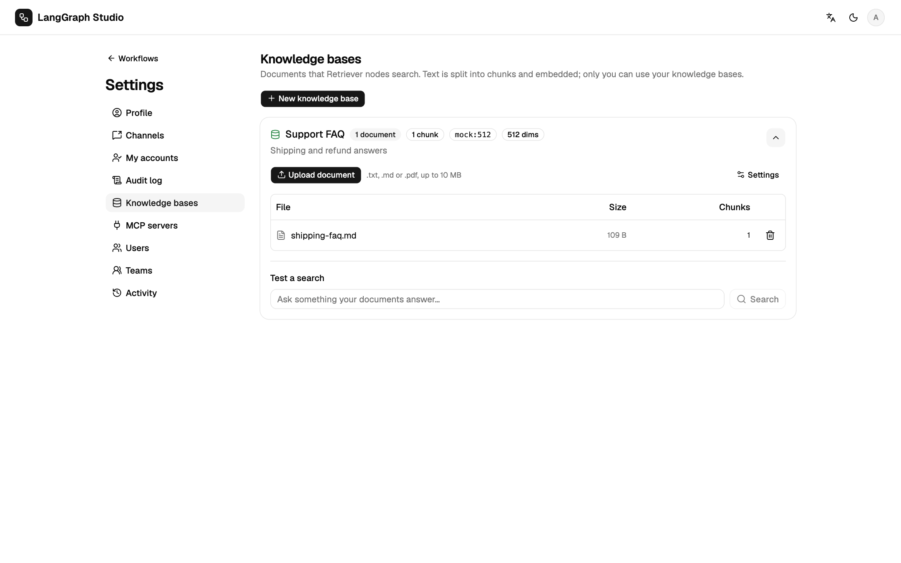

# Knowledge bases

A knowledge base is a set of documents split into chunks and embedded, so a
[Retriever](nodes.md#retriever) node can search them.



## Create one

1. Open **Settings → Knowledge bases** and choose **New knowledge base**.
2. Give it a name and choose **Create**. **Settings** on the card picks the
   **Embedding model** and the **Embedding key** (a credential).
3. **Upload document** accepts `.txt`, `.md` and `.pdf` up to 10 MB each.
4. Use **Test a search** on the card to check what a query returns.

## Embeddings

Embeddings use the knowledge base's credential, then `OPENAI_API_KEY`, then a
fixed offline mock (`mock:512`). The default OpenAI model is
`text-embedding-3-small`. For Ollama the default local model is
`nomic-embed-text` (`ollama pull nomic-embed-text`). Anthropic has no
embeddings API.

**Test embedding** on a credential reports the vector size. Each knowledge
base stores its `dims`. A vector of another size fails with
`KB_EMBEDDING_DIMENSION_MISMATCH`; re-index the base to adopt the new size.
After changing the model or the key in **Settings**, use **Re-index**.

## Storage and search

| Database | Search |
| --- | --- |
| Postgres with pgvector (the Compose image `pgvector/pgvector:pg17`) | In SQL |
| Plain Postgres, SQLite | Vectors stored as JSON, cosine similarity in Python |

Only the owner can use a knowledge base in a run. Error codes are `KB_*` in
[Error codes](../reference/errors.md).

## Use it in a graph

```text
Start → Retriever (query: {{state.message}}, top_k: 4, output: context)
      → LLM (prompt: Answer {{state.message}} using {{state.context | json}})
      → End
```

The **RAG Q&A** starter template has this shape.
