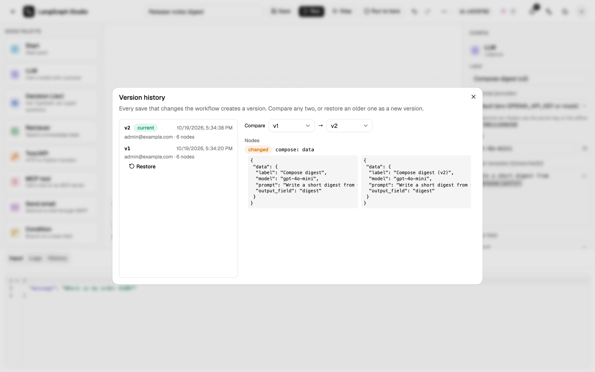

# Versions

A save that changes the graph, a rename, a duplicate or an import writes an
immutable version with its author and time. A save with no change writes
nothing, and moving a node without changing the graph is not a change.
Graphs that existed before versions shipped are v1.



## Compare and restore

**⋯ → Versions** lists the versions. **Compare** diffs any two. **Restore**
copies the old graph forward as a new latest version and keeps the current
name; the old versions stay. Restoring content that already matches does
nothing.

## Runs and versions

Each run in **History** is labelled `vN`, or **unsaved** when the editor had
edits that were not saved yet. A version that a run used is never deleted.

## Retention

`STUDIO_VERSION_KEEP=N` keeps the newest N versions (0, the default, keeps
all). Versions used by runs are kept regardless.

## API

```text
GET  /api/workflows/{wid}/versions?limit=50&offset=0
GET  /api/workflows/{wid}/versions/{n}
GET  /api/workflows/{wid}/versions/diff?a=1&b=2
POST /api/workflows/{wid}/versions/{n}/restore
```

A missing version is `404 VERSION_NOT_FOUND`.
