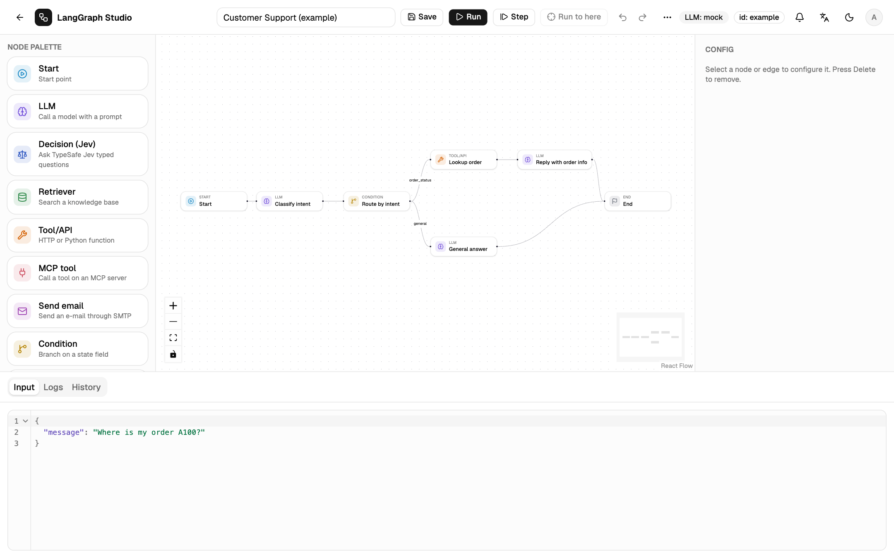
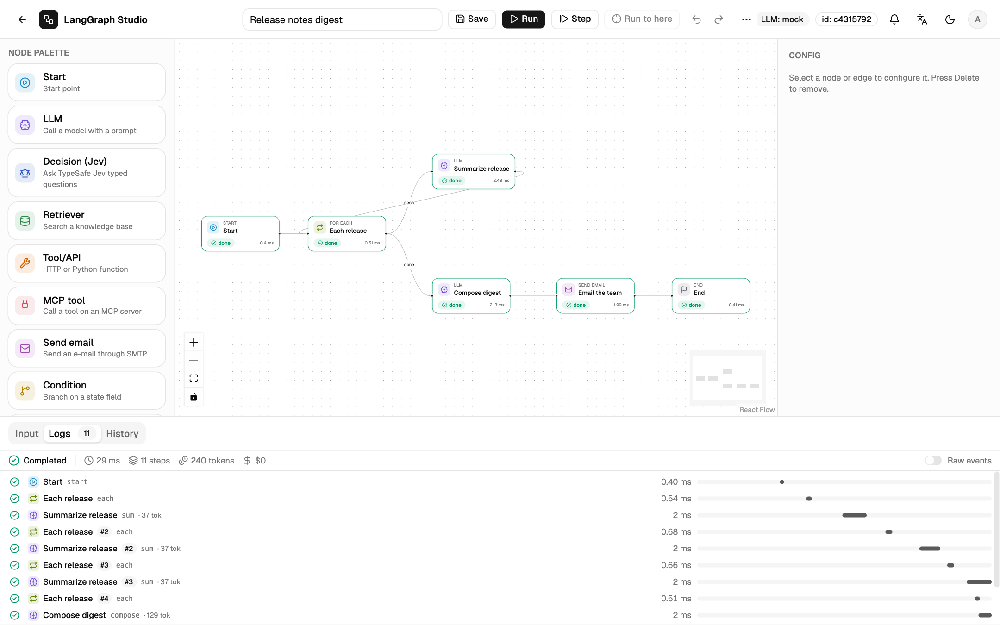
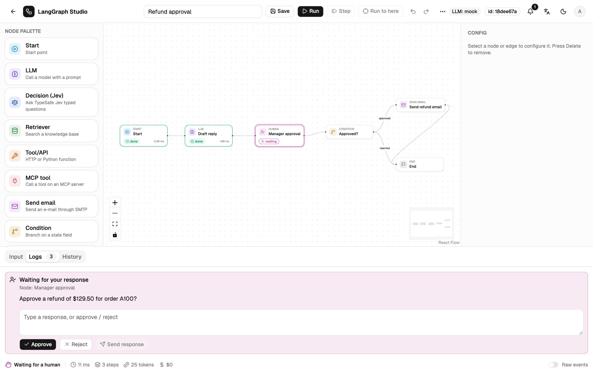

<video id="video" class="home-video" controls playsinline preload="none" poster="assets/video/studio-intro-en.jpg" aria-label="LangGraph Studio intro video">
  <source src="assets/video/studio-intro-en.mp4" type="video/mp4">
</video>

# Build LangGraph workflows on a canvas. Run them in production.

LangGraph Studio is a self-hosted workbench for LangGraph. Draw the graph,
configure each node, and run it with live per-node events. The FastAPI
backend compiles the saved JSON into a LangGraph `StateGraph`, and the same
workflow can be triggered over HTTP, on a schedule, or paused for a human
decision.

[Install](start/install.md){ .md-button .md-button--primary }
[Build your first workflow](start/first-workflow.md){ .md-button }

LangGraph StateGraphFastAPI + React FlowPostgres · Redis · pgvectorOpenTelemetryDocker sandbox

## From graph to running service { #features }

One tool covers design, debugging and the operational
parts that usually get written by hand around an agent: triggers, approvals,
retries, versioning and tracing.

Editor

### A graph you can read, saved as JSON

Thirteen node types, a typed state schema with reducers, and `{{state.field}}`
references that are checked before a run. Undo, copy and paste between
workflows, auto layout and a command palette.

[The editor :octicons-arrow-right-24:](guide/editor.md)

Runs and traces

### Every node step, with its state diff

A waterfall per run with duration, tokens and cost. Open any step for its
input, output, state diff and raw events. Step one superstep at a time or
run to a selected node.

[Runs and traces :octicons-arrow-right-24:](run/traces.md)

Human approval

### Pause for a person, resume from a checkpoint

A Human node stops the run in `waiting`. Approve in the studio, from Slack,
Telegram or WhatsApp buttons, or from e-mail and Teams links. Checkpoints
live in the database, so a restart resumes the run.

[Human approval :octicons-arrow-right-24:](run/human-approval.md)

Code mode

### Python in the node, in a locked container

`main(state)` runs in a fresh Docker container with no network, a read-only
root and no server secrets. Test it with sample state before you save.

[Code mode :octicons-arrow-right-24:](guide/code-mode.md)

## Built for the parts around the graph { #platform }

-   :material-api:{ .lg .middle } **API triggers and webhooks**

    ---

    Per-workflow tokens, sync or async runs, signed result callbacks with
    retries and a delivery log.

    [:octicons-arrow-right-24: API triggers](run/api-triggers.md)

-   :material-calendar-clock:{ .lg .middle } **Schedules**

    ---

    Cron timetables per workflow with time zones and DST handling, fired
    once even with several API processes.

    [:octicons-arrow-right-24: Schedules](run/schedules.md)

-   :material-database-search:{ .lg .middle } **Knowledge and MCP**

    ---

    Upload documents for Retriever nodes, and call tools on Streamable HTTP
    or stdio MCP servers.

    [:octicons-arrow-right-24: Knowledge bases](guide/knowledge.md)

-   :material-source-branch:{ .lg .middle } **Versions**

    ---

    Every change is an immutable version. Diff any two, restore one, and see
    which version each run used.

    [:octicons-arrow-right-24: Versions](guide/versions.md)

-   :material-chart-timeline-variant:{ .lg .middle } **Observability**

    ---

    One OpenTelemetry trace per run and one span per node, exported to OTLP
    or LangSmith, plus run metrics.

    [:octicons-arrow-right-24: Observability](operate/observability.md)

-   :material-shield-account:{ .lg .middle } **Roles and sharing**

    ---

    Admin, editor and viewer roles, per-workflow shares and teams, an audit
    log, and ownership transfer.

    [:octicons-arrow-right-24: Roles and sharing](operate/access.md)

-   :material-server-network:{ .lg .middle } **Any model**

    ---

    OpenAI, Anthropic, OpenRouter, Ollama, LM Studio and OpenAI-compatible
    servers, with encrypted credentials.

    [:octicons-arrow-right-24: LLM providers](operate/providers.md)

-   :material-repeat:{ .lg .middle } **Effectively-once side effects**

    ---

    Idempotency keys, a node-result ledger and lease fencing, so a recovered
    run does not repeat what already happened.

    [:octicons-arrow-right-24: Architecture](reference/architecture.md)

## Run it in three steps { #getting-started }

-   **Start the stack**

    `./dev.sh` for development, or `docker compose up --build` for Postgres,
    Redis, the API, a worker and nginx.

    [Install](start/install.md)

-   **Add a model**

    Open **Credentials** and add a provider. Without one, LLM nodes use a
    deterministic offline mock.

    [LLM providers](operate/providers.md)

-   **Build and run**

    Start from a template or a blank graph, then run it with JSON input and
    read the trace.

    [Your first workflow](start/first-workflow.md)

## Read the handbook

Start with the concepts, then follow the editor, run and operate guides.

[Concepts](start/concepts.md){ .md-button .md-button--primary }
[Configuration reference](reference/configuration.md){ .md-button }

