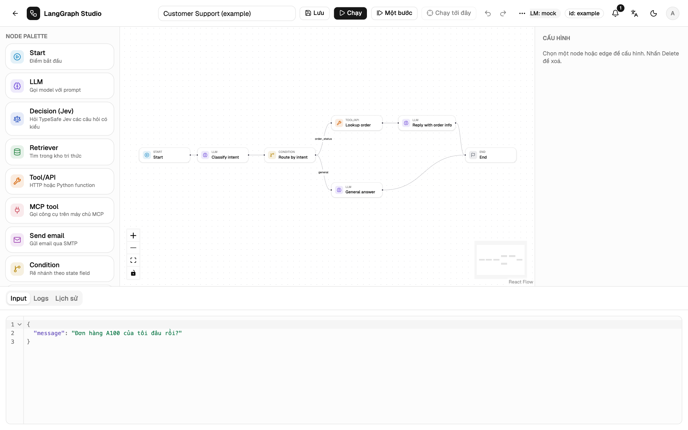
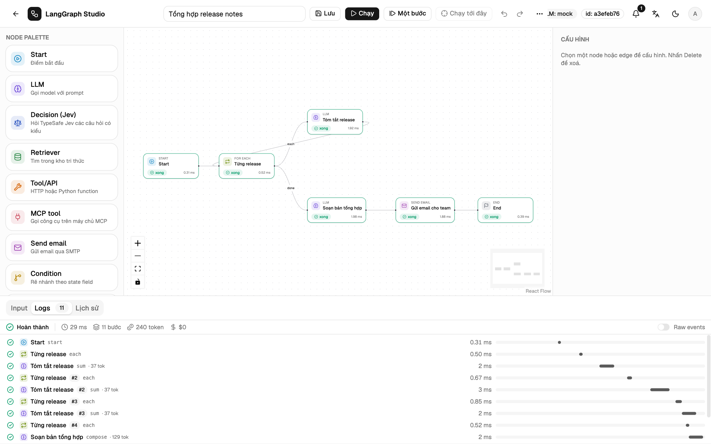
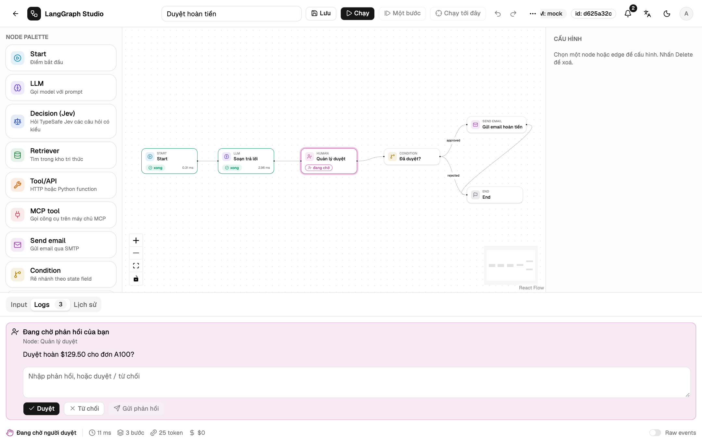
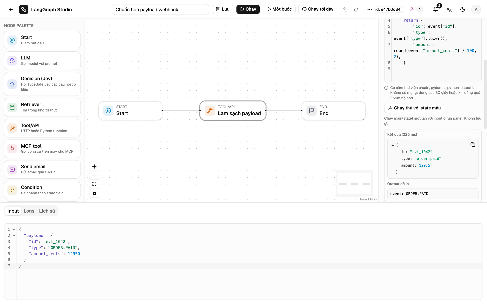

<video id="video" class="home-video" controls playsinline preload="none" poster="../assets/video/studio-intro-vi.jpg" aria-label="Video giới thiệu LangGraph Studio">
  <source src="../assets/video/studio-intro-vi.mp4" type="video/mp4">
</video>

# Vẽ workflow LangGraph trên canvas. Chạy thật trong production.

LangGraph Studio là bàn làm việc tự host cho LangGraph. Vẽ graph, cấu hình
từng node, rồi chạy và xem sự kiện của từng node theo thời gian thực. Backend
FastAPI biên dịch JSON đã lưu thành `StateGraph` của LangGraph. Cùng một
workflow có thể được gọi qua HTTP, chạy theo lịch, hoặc dừng lại chờ người
duyệt.

[Cài đặt](start/install.md){ .md-button .md-button--primary }
[Làm workflow đầu tiên](start/first-workflow.md){ .md-button }

LangGraph StateGraphFastAPI + React FlowPostgres · Redis · pgvectorOpenTelemetryDocker sandbox

## Từ graph tới dịch vụ đang chạy { #features }

Một công cụ lo cả thiết kế, debug và những phần vận
hành thường phải tự viết quanh một agent: trigger, duyệt, retry, phiên bản
và trace.

Trình soạn thảo

### Graph dễ đọc, lưu thành JSON

Mười ba loại node, state schema có kiểu và reducer, tham chiếu
`{{state.field}}` được kiểm tra trước khi chạy. Có undo, copy và paste giữa
các workflow, tự sắp xếp bố cục và bảng lệnh.

[Trình soạn thảo :octicons-arrow-right-24:](guide/editor.md)

Run và trace

### Từng bước của node, kèm state diff

Biểu đồ thác nước cho mỗi run với thời gian, token và chi phí. Mở bước bất
kỳ để xem input, output, state diff và raw event. Chạy từng superstep, hoặc
chạy tới một node đã chọn.

[Run và trace :octicons-arrow-right-24:](run/traces.md)

Duyệt bởi người

### Dừng chờ người, chạy tiếp từ checkpoint

Node Human dừng run ở trạng thái `waiting`. Duyệt trong studio, bằng nút trên
Slack, Telegram, WhatsApp, hoặc bằng link trong e-mail và Teams. Checkpoint
nằm trong database nên khởi động lại vẫn chạy tiếp được.

[Duyệt bởi người :octicons-arrow-right-24:](run/human-approval.md)

Chế độ Code

### Python ngay trong node, chạy trong container khoá chặt

`main(state)` chạy trong một container Docker mới: không mạng, root chỉ đọc,
không có secret của server. Chạy thử với state mẫu trước khi lưu.

[Chế độ Code :octicons-arrow-right-24:](guide/code-mode.md)

## Lo luôn những phần quanh graph { #platform }

-   :material-api:{ .lg .middle } **API trigger và webhook**

    ---

    Token riêng cho từng workflow, chạy sync hoặc async, callback kết quả có
    chữ ký, retry và nhật ký gửi.

    [:octicons-arrow-right-24: API trigger](run/api-triggers.md)

-   :material-calendar-clock:{ .lg .middle } **Lịch chạy**

    ---

    Lịch cron cho từng workflow, có múi giờ và xử lý giờ mùa hè, mỗi mốc chỉ
    chạy một lần dù có nhiều process API.

    [:octicons-arrow-right-24: Lịch chạy](run/schedules.md)

-   :material-database-search:{ .lg .middle } **Tri thức và MCP**

    ---

    Tải tài liệu lên cho node Retriever, và gọi tool trên máy chủ MCP qua
    Streamable HTTP hoặc stdio.

    [:octicons-arrow-right-24: Kho tri thức](guide/knowledge.md)

-   :material-source-branch:{ .lg .middle } **Phiên bản**

    ---

    Mỗi thay đổi là một phiên bản bất biến. So sánh hai bản bất kỳ, khôi
    phục, và biết mỗi run đã dùng bản nào.

    [:octicons-arrow-right-24: Phiên bản](guide/versions.md)

-   :material-chart-timeline-variant:{ .lg .middle } **Quan sát hệ thống**

    ---

    Một trace OpenTelemetry cho mỗi run, một span cho mỗi node, xuất ra OTLP
    hoặc LangSmith, kèm metric.

    [:octicons-arrow-right-24: Quan sát hệ thống](operate/observability.md)

-   :material-shield-account:{ .lg .middle } **Vai trò và chia sẻ**

    ---

    Vai trò admin, editor, viewer, chia sẻ theo workflow và theo nhóm, nhật
    ký hoạt động, chuyển quyền sở hữu.

    [:octicons-arrow-right-24: Vai trò và chia sẻ](operate/access.md)

-   :material-server-network:{ .lg .middle } **Model nào cũng được**

    ---

    OpenAI, Anthropic, OpenRouter, Ollama, LM Studio và các server tương
    thích OpenAI, credential được mã hoá.

    [:octicons-arrow-right-24: Nhà cung cấp LLM](operate/providers.md)

-   :material-repeat:{ .lg .middle } **Side effect gần như đúng một lần**

    ---

    Idempotency key, sổ kết quả node và fencing token, nên run được khôi
    phục không lặp lại việc đã làm.

    [:octicons-arrow-right-24: Kiến trúc](reference/architecture.md)

## Chạy trong ba bước { #getting-started }

-   **Khởi động**

    `./dev.sh` khi phát triển, hoặc `docker compose up --build` để có
    Postgres, Redis, API, worker và nginx.

    [Cài đặt](start/install.md)

-   **Thêm model**

    Mở **Credentials** và thêm một nhà cung cấp. Chưa có thì node LLM dùng
    bản mock offline cho kết quả cố định.

    [Nhà cung cấp LLM](operate/providers.md)

-   **Dựng và chạy**

    Bắt đầu từ một mẫu hoặc graph trống, chạy với input JSON rồi đọc trace.

    [Workflow đầu tiên](start/first-workflow.md)

## Đọc handbook

Bắt đầu từ phần khái niệm, rồi đi qua các hướng dẫn xây dựng, chạy và vận
hành.

[Khái niệm](start/concepts.md){ .md-button .md-button--primary }
[Tham chiếu cấu hình](reference/configuration.md){ .md-button }

