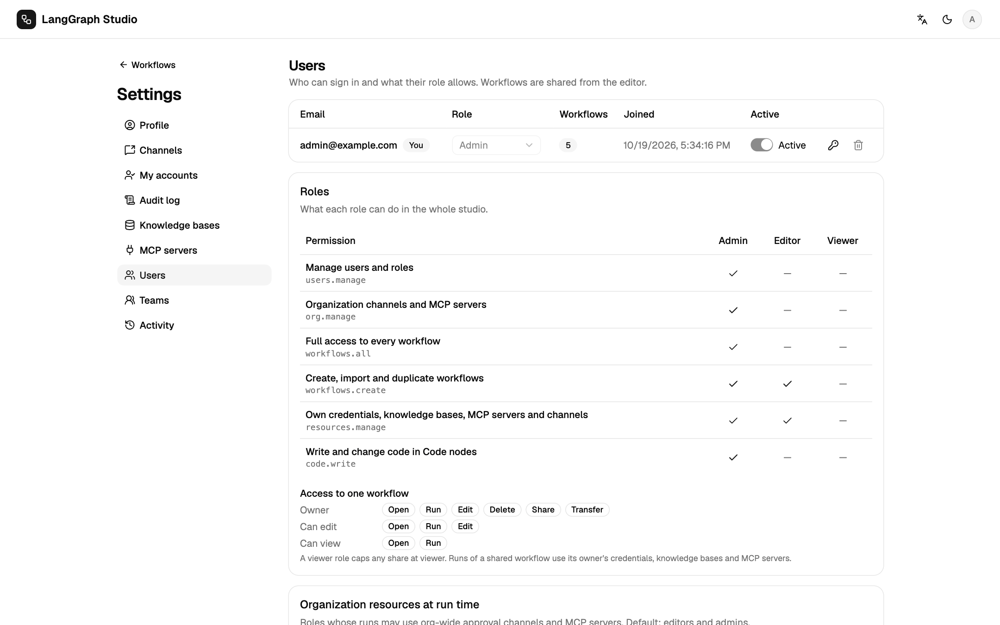

# Roles and sharing

## Roles

| Role | Can |
| --- | --- |
| `admin` | Everything, including users, roles, teams, the activity log, organisation templates and channels, and Code nodes (`code.write`). |
| `editor` | The default. Create workflows, credentials, knowledge bases, MCP servers and personal channels. |
| `viewer` | Open and run what was shared with them. |

**Settings → Users** shows the full permission matrix and changes roles.

- Role changes and disabling an account apply at once, including open sockets.
- You cannot change your own role or disable yourself, and one active admin
  must remain.
- `STUDIO_ADMIN_EMAILS` is only a bootstrap: those addresses become admin at
  sign-up, and at start-up only when no active admin remains.
- `STUDIO_DEFAULT_ROLE=viewer` makes new accounts view-only.
- There is no SSO.

## Sharing a workflow

**⋯ → Share** (owner or admin) adds an e-mail as viewer or editor, or shares
with a whole team (**Settings → Teams**). The effective right is the highest
of the direct share and the team shares.

| Right | Open | Run | Edit | Delete | Share | Transfer |
| --- | --- | --- | --- | --- | --- | --- |
| Owner | ✓ | ✓ | ✓ | ✓ | ✓ | ✓ |
| Editor share | ✓ | ✓ | ✓ | | | |
| Viewer share | ✓ | ✓ | | | | |

Admins act as owner on every workflow. A user whose global role is `viewer`
never edits, even with an editor share. Viewers see a read-only editor. A shared run uses the **owner's** credentials,
knowledge bases, MCP servers and subgraphs. The owner and admins see every
run; everyone else sees their own.

## Transfer ownership

**⋯ → Transfer ownership** requires the recipient to be an editor or admin.
Resources the recipient cannot use (credentials, knowledge bases, MCP servers,
channels) can be reassigned, or kept and flagged.

## Organisation resources

Admins choose which roles may use organisation approval channels and
organisation MCP servers at run time (admins and editors by default).
Creating them, and registering stdio MCP servers, needs `org.manage`.

## Activity log

**Settings → Activity** is the admin audit log: role changes, shares,
transfers, password changes, and system events such as the first unisolated
Code call after a start.

## Deleting a user

Deleting a user anonymises them and keeps their runs, or deletes the runs
too. Their workflows must be transferred first.
