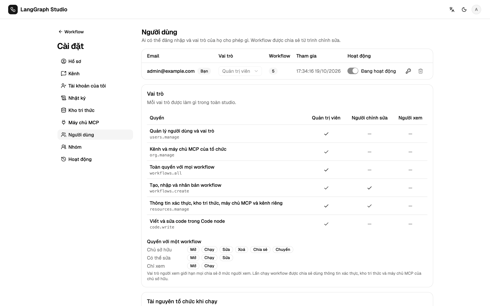

# Vai trò và chia sẻ

## Vai trò

| Vai trò | Được làm |
| --- | --- |
| `admin` | Mọi việc, kể cả người dùng, vai trò, nhóm, nhật ký hoạt động, mẫu và kênh của tổ chức, và node Code (`code.write`). |
| `editor` | Mặc định. Tạo workflow, credential, kho tri thức, máy chủ MCP và kênh cá nhân. |
| `viewer` | Mở và chạy những gì được chia sẻ. |

**Cài đặt → Người dùng** hiện đầy đủ bảng quyền và cho đổi vai trò.

- Đổi vai trò và vô hiệu hoá tài khoản có hiệu lực ngay, kể cả với socket đang
  mở.
- Không tự đổi vai trò hay tự vô hiệu hoá được, và luôn phải còn một admin
  đang hoạt động.
- `STUDIO_ADMIN_EMAILS` chỉ để khởi tạo: các địa chỉ đó thành admin khi đăng
  ký, và khi khởi động chỉ khi không còn admin nào hoạt động.
- `STUDIO_DEFAULT_ROLE=viewer` khiến tài khoản mới chỉ có quyền xem.
- Chưa có SSO.

## Chia sẻ workflow

**⋯ → Chia sẻ** (chủ hoặc admin) thêm một email với quyền viewer hoặc editor,
hoặc chia sẻ cho cả một nhóm (**Cài đặt → Nhóm**). Quyền thực tế là quyền cao
nhất giữa chia sẻ trực tiếp và chia sẻ qua nhóm.

| Quyền | Mở | Chạy | Sửa | Xoá | Chia sẻ | Chuyển quyền |
| --- | --- | --- | --- | --- | --- | --- |
| Chủ | ✓ | ✓ | ✓ | ✓ | ✓ | ✓ |
| Chia sẻ editor | ✓ | ✓ | ✓ | | | |
| Chia sẻ viewer | ✓ | ✓ | | | | |

Admin có quyền như chủ trên mọi workflow. Người có vai trò toàn cục `viewer`
không bao giờ sửa được, kể cả khi được chia sẻ quyền editor. Viewer thấy trình
soạn thảo ở chế độ chỉ đọc. Run của workflow được chia sẻ dùng credential, kho
tri thức, máy chủ MCP và subgraph của **chủ** workflow. Chủ và admin thấy mọi
run; người khác chỉ thấy run của mình.

## Chuyển quyền sở hữu

**⋯ → Chuyển quyền sở hữu** yêu cầu người nhận là editor hoặc admin. Tài
nguyên người nhận không dùng được (credential, kho tri thức, máy chủ MCP, kênh)
có thể gán lại, hoặc giữ nguyên và gắn cờ.

## Tài nguyên của tổ chức

Admin chọn vai trò nào được dùng kênh duyệt và máy chủ MCP của tổ chức khi
chạy (mặc định là admin và editor). Tạo các tài nguyên này, và đăng ký máy chủ
MCP stdio, cần quyền `org.manage`.

## Nhật ký hoạt động

**Cài đặt → Hoạt động** là nhật ký kiểm tra cho admin: đổi vai trò, chia sẻ,
chuyển quyền, đổi mật khẩu, và các sự kiện hệ thống như lần gọi Code không
cách ly đầu tiên sau khi khởi động.

## Xoá người dùng

Xoá người dùng sẽ ẩn danh họ và giữ lại run, hoặc xoá luôn run. Workflow của họ
phải được chuyển cho người khác trước.
