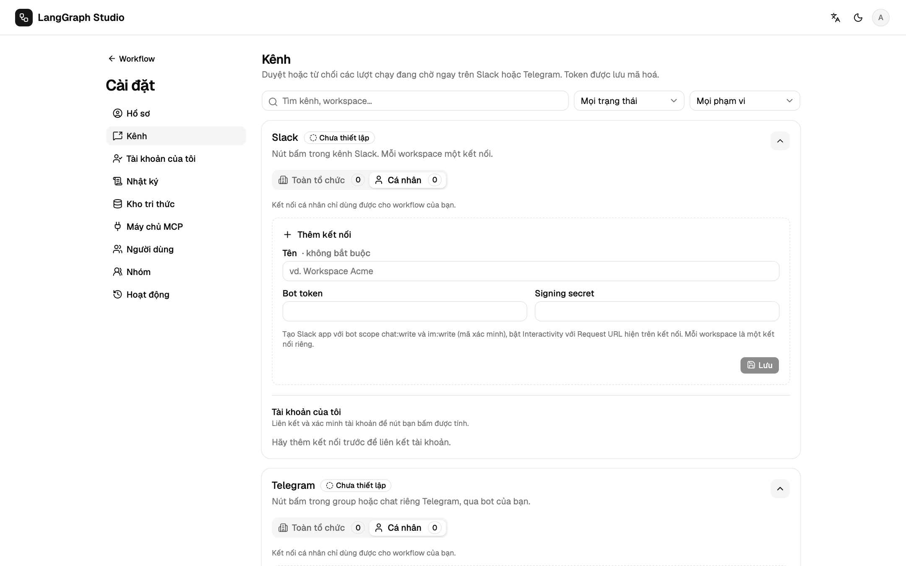

# Kênh duyệt

Kênh duyệt mang yêu cầu của node Human ra ngoài studio. Thiết lập ở **Cài đặt
→ Kênh**; mỗi người tự liên kết tài khoản chat của mình ở **Cài đặt → Tài
khoản của tôi**.

| Kênh | Kiểu | Cần |
| --- | --- | --- |
| Slack | Nút bấm | `STUDIO_PUBLIC_URL` HTTPS công khai, một Slack app |
| Telegram | Nút bấm | `STUDIO_PUBLIC_URL` HTTPS công khai, một bot |
| WhatsApp | Nút trả lời | `STUDIO_PUBLIC_URL` HTTPS công khai, một Meta app có WhatsApp |
| E-mail | Link | `STUDIO_PUBLIC_URL`, `SMTP_HOST` |
| Microsoft Teams | Link trong Adaptive Card | `STUDIO_PUBLIC_URL`, một webhook của Workflows |

Mỗi kết nối là cá nhân (dùng cho workflow của bạn) hoặc toàn tổ chức (do
admin tạo). Khi phát triển ở máy, một tunnel như
`cloudflared tunnel --url http://localhost:8000` hoặc `ngrok http 8000` cho
bạn URL HTTPS công khai.

## Slack

1. Tạo app ở <https://api.slack.com/apps>. Bot scope: `chat:write`,
   `im:write`, và `chat:write.public` nếu bot cần đăng vào kênh công khai mà nó
   chưa tham gia.
2. Cài app, copy bot token (`xoxb-…`) và signing secret.
3. Trong **Cài đặt → Kênh**, dán cả hai rồi lưu.
4. Copy request URL vào **Interactivity & Shortcuts**:
   `POST {STUDIO_PUBLIC_URL}/api/approvals/callback/slack` (định tuyến theo
   `team_id`, nên một người kết nối được nhiều workspace).
5. Mời bot vào kênh và dùng id của kênh (`C…`) trên node.
6. Mỗi người duyệt copy Slack member id của mình, nhận mã 6 chữ số qua DM, và
   xác minh ở **Tài khoản của tôi**.

`SLACK_CLIENT_ID`, `SLACK_CLIENT_SECRET` và `SLACK_SIGNING_SECRET` bật **Add
to Slack** (OAuth). Redirect URL là
`{STUDIO_PUBLIC_URL}/api/approvals/slack/oauth/callback`. Khi để trống các biến
đó, dán bot token vẫn dùng được.

## Telegram

1. Tạo bot bằng `/newbot` với @BotFather rồi dán token. Lưu.
2. **Đăng ký webhook** gọi `setWebhook` cho
   `{STUDIO_PUBLIC_URL}/api/approvals/callback/telegram/{channel_id}`
   (`STUDIO_PUBLIC_URL` phải là HTTPS).
3. Thêm bot vào nhóm chat và dùng chat id đó trên node.
4. Mỗi người duyệt bấm **Start** trong bot, rồi xác minh Telegram user id của
   mình bằng mã.

Webhook được kiểm tra bằng `X-Telegram-Bot-Api-Secret-Token`.

## WhatsApp (Cloud API)

1. Trong một Meta app có sản phẩm WhatsApp, dán access token, phone number ID,
   app secret, và một verify token tuỳ bạn chọn.
2. Trong dashboard của Meta, đặt webhook là
   `{STUDIO_PUBLIC_URL}/api/approvals/callback/whatsapp/{channel_id}` với
   verify token đó (Meta kiểm tra bằng một GET), và đăng ký `messages`.
3. Đích của node là số điện thoại dạng quốc tế, chỉ gồm chữ số.

Callback được kiểm tra bằng `X-Hub-Signature-256`. WhatsApp chỉ gửi tin có nút
và tin văn bản trong vòng 24 giờ kể từ tin nhắn cuối của người đó tới số này.
Ngoài khoảng đó, đặt **Template name** (và ngôn ngữ) là một template đã được
duyệt, có biến `{{1}}` trong body và hai nút trả lời nhanh (Approve, Reject).
Người duyệt xác minh số của mình bằng mã, mã cũng chỉ tới được trong khoảng 24
giờ đó. WhatsApp không sửa được tin đã gửi, nên kết quả được gửi thành tin trả
lời yêu cầu.

## E-mail và Microsoft Teams

Đây là kênh dạng link: tin nhắn có link Duyệt và Từ chối tới
`/approve?token=…`. Người nhận đăng nhập studio và xác nhận ở đó, nên không cần
liên kết tài khoản chat, và việc mở link (ví dụ do trình quét thư) không quyết
định gì.

- **E-mail** dùng cấu hình SMTP của studio (`SMTP_HOST`, …). Đích của node là
  một hoặc nhiều địa chỉ, cách nhau bằng dấu phẩy.
- **Teams:** trong kênh, thêm template của Workflows "Post to a channel when a
  webhook request is received", rồi dán URL HTTPS của nó. Node không cần đích.
  Yêu cầu là một Adaptive Card, kết quả được đăng thành card thứ hai.

## Xác minh và giới hạn

Lượt bấm từ tài khoản chưa xác minh bị từ chối (`APPROVAL_IDENTITY_UNKNOWN`).
Mỗi danh tính chat thuộc về một người dùng studio đã xác minh.

| Biến | Mặc định | Nghĩa |
| --- | --- | --- |
| `STUDIO_IDENTITY_CODE_TTL` | 600 giây | Thời hạn của mã xác minh |
| `STUDIO_IDENTITY_CODE_ATTEMPTS` | 5 | Số lần thử cho mỗi mã |
| `STUDIO_IDENTITY_CODE_RESEND` | 30 giây | Thời gian chờ trước khi gửi lại mã |
| `STUDIO_APPROVAL_TTL` | 86400 giây | Thời hạn của nút và link trong một yêu cầu |
| `STUDIO_CALLBACK_RATE_LIMIT_IP` | 60 | Số callback công khai cho mỗi IP trong một khung |
| `STUDIO_CALLBACK_RATE_LIMIT_CHANNEL` | 300 | Số callback công khai cho mỗi kết nối trong một khung |
| `STUDIO_CALLBACK_RATE_WINDOW` | 60 giây | Độ dài khung |

Đứng sau proxy, `STUDIO_TRUSTED_PROXIES` liệt kê CIDR của proxy.
`X-Forwarded-For` được đọc từ phải sang, bỏ qua các hop tin cậy, và chỉ khi
peer trực tiếp là proxy tin cậy.
