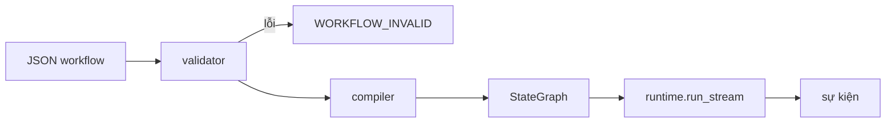
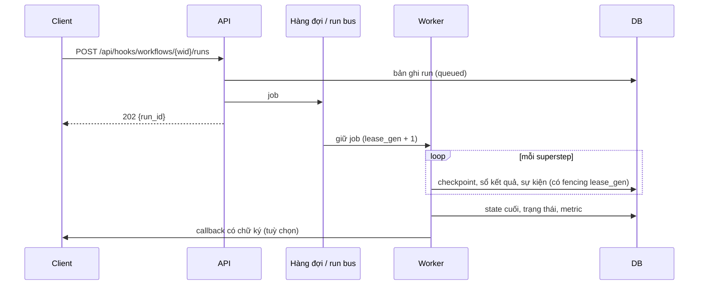

# Kiến trúc

## Các lớp của backend

```text
            HTTP / WebSocket
                  │
   api/routes/*        controller: đọc request, gọi service, định dạng response
   api/deps.py         dependency injection: database, service, người dùng hiện tại, giới hạn body
   api/error_handlers  DomainError → mã HTTP, lỗi 422 dễ đọc
                  │
   services/*          luật nghiệp vụ: quyền sở hữu, xác thực, vòng đời run, import, lịch chạy
        │                         │
   repositories/*            engine/*   LangGraph: validator, compiler, node, nhà cung cấp,
   truy vấn SQLAlchemy                  tool, runtime, giới hạn, sandbox
        │
   models/*            model SQLAlchemy 2.0 có kiểu; migrations/ (Alembic)
                  │
   core/*              cấu hình, bảo mật, danh mục lỗi, phân quyền, log
   schemas/*           DTO Pydantic
```

`backend/tests/test_layers.py` bắt buộc các quy tắc import:

| Lớp | Được import | Không được import |
| --- | --- | --- |
| `core` | stdlib, jwt | mọi thứ khác trong `app`, FastAPI |
| `engine` | `core` | models, repositories, services, api, FastAPI |
| `models` | `core` | repositories, services, api, engine |
| `schemas` | pydantic | models, repositories, services, api |
| `repositories` | `models`, `core` | services, api, FastAPI |
| `services` | repositories, engine, models, core | api, FastAPI |
| `api` | mọi thứ | — |

Service ném `AppError("CODE", …)`; mã và thông điệp chỉ nằm trong `CATALOG` của
`core/errors.py`, và chỉ `api/error_handlers.py` dựng response lỗi.
Repository không chứa luật, mỗi method mở một session ngắn riêng, nên dùng an
toàn từ thread của worker.

## Từ JSON thành graph



1. **Validator** kiểm tra cấu trúc (id, edge, một Start, tới được mọi node,
   vòng lặp phải qua Condition hoặc For each), tham chiếu state, reducer cho
   phần ghi song song, độ sâu subgraph, và server có chạy được những gì graph
   cần không (ví dụ chế độ Code).
2. **Compiler** dựng `StateGraph` của LangGraph: mỗi node thành một hàm node;
   edge thành `add_edge`; Condition hoặc For each thành `add_conditional_edges`
   với bảng nhãn; nhiều edge đi vào Join thành một edge gom. Field của state
   được gắn reducer.
3. **Runtime** stream graph và chuyển các cập nhật của LangGraph thành sự kiện
   của studio (`node_started`, `node_token`, `node_finished`, …), áp các giới
   hạn kích thước sự kiện và run.

## Vòng đời run

| Bắt đầu từ | Chạy ở đâu | Sự kiện tới |
| --- | --- | --- |
| Trình soạn thảo (`/ws/run`) | Process API đang giữ socket | Chính socket đó |
| API trigger, lịch chạy, khôi phục | Một worker, qua hàng đợi job | Bản ghi run, callback và các bên đang nghe qua run bus |



Run bus nằm trong bộ nhớ khi chỉ có một process, hoặc trên Redis khi có nhiều
process; với Redis, job có worker bị chết sẽ được giữ lại bởi worker khác và chạy
tiếp từ checkpoint cuối.

## Side effect gần như đúng một lần

| Cơ chế | Ngăn điều gì |
| --- | --- |
| Idempotency key theo run, node và lượt lặp | Bên nhận áp dụng hai lần một lời gọi HTTP hay tool bị retry (header `Idempotency-Key`, `X-Studio-Run-Id`, `X-Studio-Attempt`; `idempotency_key` cho tool Python) |
| Sổ kết quả node | Run được khôi phục lặp lại lời gọi LLM, Tool, Decision hay Send email đã xong (`reused` trong trace) |
| Fencing theo lease (`runs.lease_gen`) | Worker đã mất quyền giữ ghi đè lên tiến độ của worker mới |
| Checkpoint mỗi superstep | Sập hoặc khởi động lại làm mất các bước đã xong |

Sổ kết quả được xoá khi run kết thúc. Node đang chạy dở lúc worker chết có thể
chạy lại, nên endpoint HTTP và tool nên chấp nhận idempotency key.

## Frontend

React, TypeScript và Vite, React Flow cho canvas, shadcn/ui trên Tailwind v4
cho component, CodeMirror cho JSON và Python. UI chỉ gọi API qua `lib/api.ts`
(hàm này bóc envelope), và hiện lỗi bằng cách dịch `error.code`. Mọi chuỗi giao
diện nằm trong `src/locales/en.json` và `vi.json` với bộ key giống hệt nhau.
