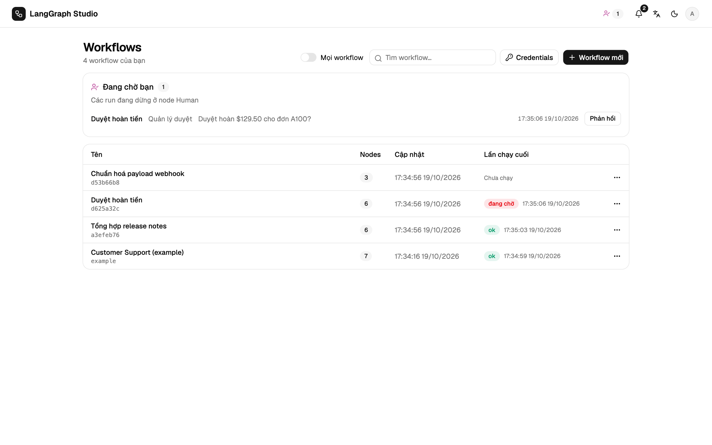

# Duyệt bởi người

Node **Human** dừng run ở trạng thái `waiting` và đặt câu hỏi trong `prompt`.
Câu trả lời ghi vào `output_field` của node, nên Condition phía sau có thể rẽ
nhánh theo nó.


## Trả lời trong studio

Tab Logs hiện câu hỏi kèm **Duyệt** (`approved`), **Từ chối** (`rejected`),
hoặc **Gửi phản hồi** bằng văn bản tự do. Ở đây chỉ chủ của run mới trả lời
hoặc huỷ được; người duyệt có tên trên node trả lời qua
[kênh duyệt](#duyet-qua-chat).

Các run đang chờ bạn hiện ở đầu trang **Workflows**, mục **Đang chờ bạn**, và
nhãn trên thanh trên đếm số run đó. **Phản hồi** mở run.



Checkpoint nằm trong database, nên khởi động lại server vẫn chạy tiếp run từ
chỗ đã dừng. Thời gian chờ không tính vào thời gian chạy của run. Chờ lâu hơn
`STUDIO_WAIT_TTL` giây (mặc định 7 ngày; `0` là không bao giờ hết hạn) thì run
thành `expired`, và tiếp tục khi đó trả về `410 RUN_EXPIRED`.

```text
GET  /api/runs/pending
WS   /ws/run   {"resume_run_id": "…", "response": "approved"}
POST /api/runs/{id}/cancel
```

## Thông báo

Chuông liệt kê thông báo chưa đọc và nhận thông báo trực tiếp qua
`/ws/notifications`, dự phòng bằng cách hỏi lại mỗi 30 giây. Mỗi người tự chọn
loại thông báo ở **Cài đặt → Hồ sơ**.

| Kênh | Thiết lập |
| --- | --- |
| Chuông trong app | Luôn bật |
| E-mail | `SMTP_HOST` (và `SMTP_PORT`, `SMTP_USER`, `SMTP_PASSWORD`, `SMTP_FROM`, `SMTP_STARTTLS` hoặc `SMTP_SSL`); link dùng `STUDIO_PUBLIC_URL` |
| Webhook | `STUDIO_NOTIFY_WEBHOOK_URL` nhận JSON cho mỗi run `waiting` hoặc `expired`, có chữ ký bằng `STUDIO_NOTIFY_WEBHOOK_SECRET` nếu đặt |

## Duyệt qua chat

Node Human cũng có thể gửi yêu cầu tới một **kênh duyệt**:

| Kênh | Mang theo | Câu trả lời |
| --- | --- | --- |
| Slack | Nút Duyệt / Từ chối | bấm nút bằng tài khoản Slack đã xác minh |
| Telegram | Nút Duyệt / Từ chối | bấm nút bằng tài khoản Telegram đã xác minh |
| WhatsApp | Hai nút trả lời | trả lời từ số điện thoại đã xác minh |
| E-mail | Link Duyệt / Từ chối tới `/approve?token=…` | xác nhận trong studio sau khi đăng nhập |
| Microsoft Teams | Adaptive Card có link | xác nhận trong studio sau khi đăng nhập |

Quy tắc giống nhau ở mọi kênh: chỉ chủ run hoặc người duyệt có tên trên node,
mỗi yêu cầu một câu trả lời, và có hạn (`STUDIO_APPROVAL_TTL`, mặc định 86400
giây). Token của nút được ký HMAC và chỉ dùng một lần. Tin nhắn theo ngôn ngữ
của chủ run. Trả lời trong studio sẽ vô hiệu hoá nút trên chat; huỷ hoặc hết
hạn sẽ đóng yêu cầu. Chưa cấu hình kênh nào thì không gửi gì.

Cách thiết lập từng kênh ở [Kênh duyệt](../operate/channels.md).

## Mẫu thường gặp

```text
Start → LLM (soạn trả lời) → Human (duyệt bản nháp?) → Condition theo decision
      ├─ approved → Send email → End
      └─ rejected → End
```

Mẫu khởi đầu **Approval flow** có sẵn hình dạng này.
