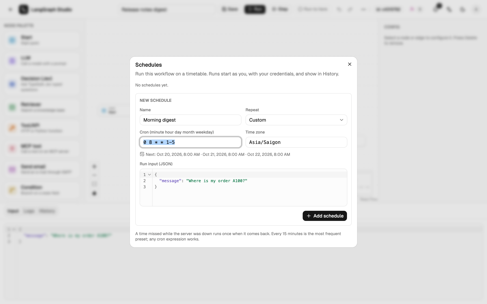

# Schedules

**⋯ → Schedules** in the editor runs the workflow on a cron timetable. The
workflow's owner sets the schedules.



## Cron syntax

Five fields: `minute hour day-of-month month day-of-week`.

| Form | Example | Meaning |
| --- | --- | --- |
| `*` | `* * * * *` | every minute |
| Range | `0 9-17 * * *` | on the hour, 09:00 to 17:00 |
| List | `0 8,12,18 * * *` | at 08:00, 12:00 and 18:00 |
| Step | `*/15 * * * *` | every 15 minutes |
| Names | `0 8 * * mon-fri` | weekdays at 08:00 |
| Shortcuts | `@hourly`, `@daily`, `@weekly`, `@monthly`, `@yearly` | |

When both day fields are set, a day matches if either does. The dialog shows
the next run times as you type.

## Time zones and DST

Each schedule has an IANA time zone (the browser's by default). A wall-clock
time skipped by a daylight-saving change runs an hour later; a repeated one
runs once.

## How schedules run

- Each schedule has a JSON run input.
- Runs start as the schedule's creator, go through the same job queue as API
  runs, and appear in History with a **Schedule** badge.
- A time missed while no worker was running fires once when one comes back.
- Several API processes never fire the same time twice.
- A schedule turns itself off if its creator loses the right to manage the
  workflow, and is removed the next time it is due after its workflow was
  deleted.
- Up to 20 schedules per workflow.

## API

```text
GET|POST     /api/workflows/{wid}/schedules
PATCH|DELETE /api/workflows/{wid}/schedules/{sid}
POST         /api/schedules/preview
```
