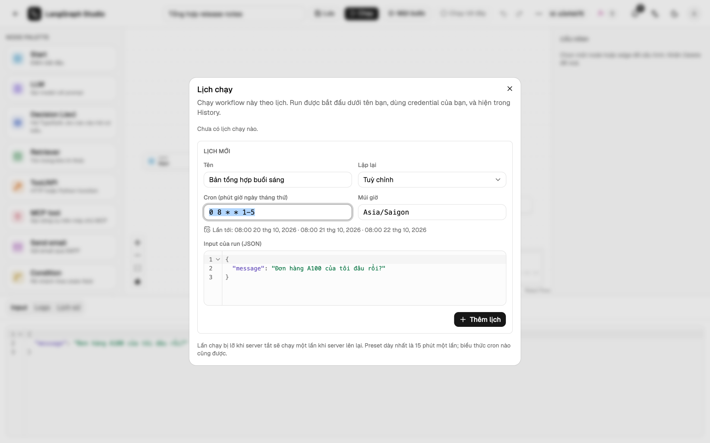

# Lịch chạy

**⋯ → Lịch chạy** trong trình soạn thảo chạy workflow theo lịch cron. Chủ
workflow là người đặt lịch.



## Cú pháp cron

Năm trường: `phút giờ ngày-trong-tháng tháng thứ-trong-tuần`.

| Dạng | Ví dụ | Nghĩa |
| --- | --- | --- |
| `*` | `* * * * *` | mỗi phút |
| Khoảng | `0 9-17 * * *` | đầu mỗi giờ, từ 09:00 tới 17:00 |
| Danh sách | `0 8,12,18 * * *` | lúc 08:00, 12:00 và 18:00 |
| Bước | `*/15 * * * *` | mỗi 15 phút |
| Tên | `0 8 * * mon-fri` | các ngày trong tuần lúc 08:00 |
| Viết tắt | `@hourly`, `@daily`, `@weekly`, `@monthly`, `@yearly` | |

Khi cả hai trường ngày đều được đặt, một ngày khớp nếu khớp một trong hai.
Hộp thoại hiện các lần chạy kế tiếp ngay khi bạn gõ.

## Múi giờ và giờ mùa hè

Mỗi lịch có một múi giờ IANA (mặc định theo trình duyệt). Giờ bị bỏ qua khi
chuyển sang giờ mùa hè sẽ chạy muộn một giờ; giờ bị lặp lại chỉ chạy một lần.

## Lịch chạy thế nào

- Mỗi lịch có một input JSON cho run.
- Run chạy dưới tên người tạo lịch, đi qua cùng hàng đợi với run gọi qua API,
  và hiện trong Lịch sử với nhãn **Lịch**.
- Mốc bị lỡ khi không có worker nào chạy sẽ chạy một lần khi worker trở lại.
- Nhiều process API không bao giờ chạy trùng một mốc.
- Lịch tự tắt khi người tạo mất quyền quản lý workflow, và bị xoá ở lần tới
  hạn kế tiếp sau khi workflow bị xoá.
- Tối đa 20 lịch cho mỗi workflow.

## API

```text
GET|POST     /api/workflows/{wid}/schedules
PATCH|DELETE /api/workflows/{wid}/schedules/{sid}
POST         /api/schedules/preview
```
