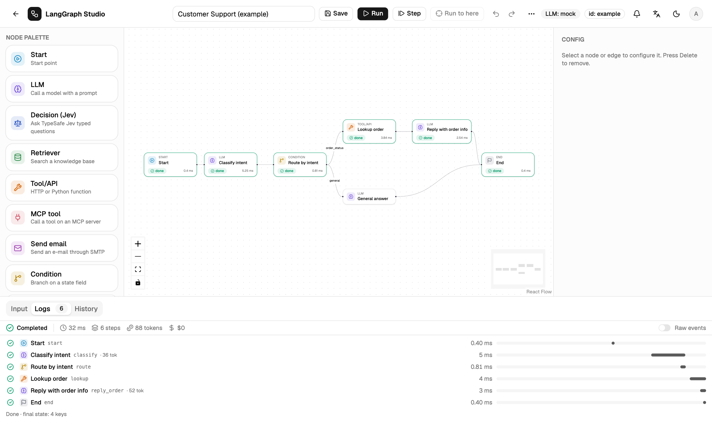
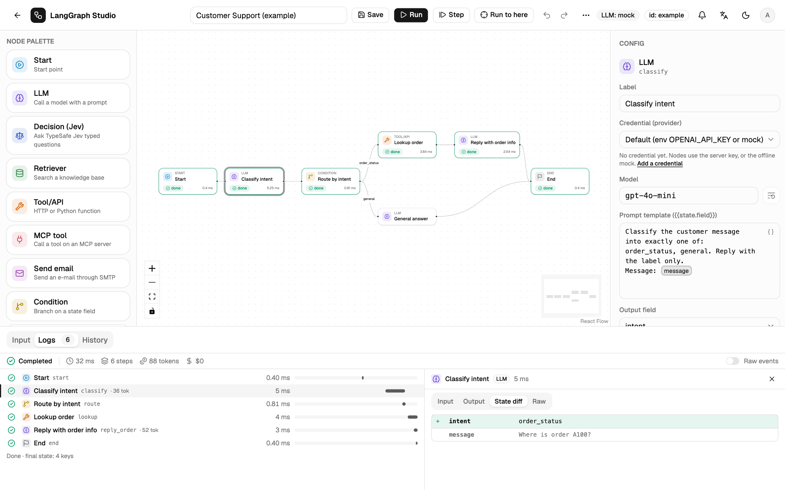

# Runs and traces

## The Logs timeline

The **Logs** tab has one row per node step: status, name, kind, duration, a
waterfall bar, and tokens when the model reports them. Loops show `#2`, `#3`
and so on. The summary line shows the run status, duration, steps, input and
output tokens, cost and error count.

Click a row, or a node on the canvas, to open its detail:

| Tab | Shows |
| --- | --- |
| Input | The state the node received |
| Output | What it returned (streamed tokens for an LLM node while it runs) |
| State diff | Fields added, changed or removed by this step |
| Raw | The step's original events |

**Raw events** switches the whole tab to the original event stream.
**History** replays any earlier run on the same timeline, labelled with its
version.

## Stepping

| Control | Effect |
| --- | --- |
| **Step** | Runs one superstep, then pauses the same run (status `paused`). |
| **Continue** | Runs the rest. |
| **Run to here** | Select a node first. Runs until that node finishes, then pauses. If the path never reaches it, the run finishes and says so. |

A pause is not a human approval. A superstep that is only Start does not use
up the step.

## Cancel

**Cancel** (++ctrl+period++) sends `{"type": "cancel"}`. Closing the tab also
cancels. Cancel is cooperative: it stops between steps, so an LLM or HTTP call
already in flight may finish. A Code node's container is killed.

## Statuses

| Status | Meaning |
| --- | --- |
| `ok` | Reached End. |
| `error` | A node failed after its retries, or validation failed. |
| `cancelled` | Stopped by a person or a closed tab. |
| `timeout` | Ran past `STUDIO_RUN_TIMEOUT`. |
| `paused` | Stopped by Step or Run to here. |
| `waiting` | At a Human node. |
| `expired` | Waited longer than `STUDIO_WAIT_TTL`. |

Errors are one line, with `sk-…`, `Bearer …` and `api_key=…` redacted.

## Limits

| Variable | Default | Meaning |
| --- | --- | --- |
| `STUDIO_RECURSION_LIMIT` | 25 | Max steps per run. A loop that never passes a Condition stops with an error. For each steps do not count. |
| `STUDIO_RUN_TIMEOUT` | 120 s | Max duration of a run, then `timeout`. Waiting at a Human node does not count. |
| `STUDIO_EVENT_MAX_BYTES` | 262144 | Max size of one event. Oversized fields become `{"_truncated": true, …}`. |
| `STUDIO_RUN_MAX_BYTES` | 2097152 | Max stored events per run. The middle is replaced by `{"type": "truncated", "dropped": n}`. |
| `STUDIO_INPUT_MAX_BYTES` | 262144 | Max run input. |
| `STUDIO_WORKFLOW_MAX_BYTES` | 1048576 | Max workflow JSON. Larger saves return HTTP 413. |

The timeline also clips `input` and `delta` at 16 000 JSON characters so the
page stays light.

## Tokens and cost

Cost is computed from the token counts and a price table in
`backend/app/engine/usage.py`. The mock estimates tokens and costs `$0`. A
model missing from the table shows `—`. Override prices in USD per million
tokens with `STUDIO_PRICES='{"my-model": [1.0, 2.0]}'` (input, output) or
`STUDIO_PRICES_FILE`; the longest matching prefix wins.

## Export to a tracing backend

Each run can also become an OpenTelemetry trace in Jaeger, Tempo or
LangSmith, with an **Open trace** link in the timeline. See
[Observability](../operate/observability.md).
