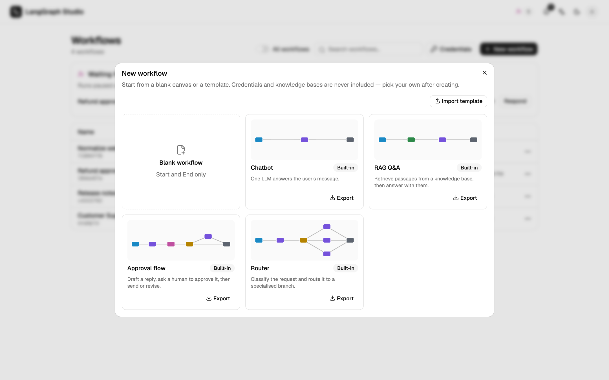
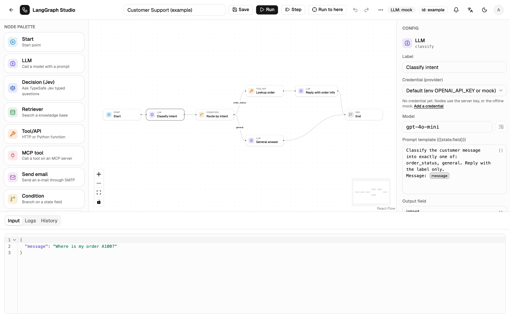

# Your first workflow

This walk-through builds a small graph that summarises a support ticket, runs
it, and reads the trace. It takes about five minutes and works with the
offline mock, so no model key is needed.

## 1. Create a blank workflow

On **Workflows**, choose **New workflow**. The gallery offers a blank graph,
four starters (Chatbot, RAG Q&A, Approval flow, Router), and saved templates.
Pick **Blank workflow**. It has a Start and an End node.



## 2. Declare the state

The state is the data the graph passes from node to node. In the left panel,
under **State schema**, set up two fields:

| Field | Type |
| --- | --- |
| `message` | `string` |
| `summary` | `string` |

Use **Add field** for the second one. Types are `string`, `number`,
`integer`, `boolean`, `object` and `list`.

## 3. Add an LLM node

Drag **LLM** from the **Node palette** onto the canvas. Connect it: drag from
the right handle of **Start** to the left handle of the LLM node, then from
the LLM node to **End**.

Select the LLM node. The right panel shows its config:

- **Label**: `Summarise ticket`
- **Model**: `gpt-4o-mini` (any model name works with the mock)
- **Prompt template**:

    ```text
    Summarise this support ticket in one sentence: {{state.message}}
    ```

    Type `{{` to pick a state field. References show as tags, and a field
    that is not in the state turns red.

- **Output field**: `summary`



## 4. Save and run

Press **Save** (++ctrl+s++ or ++cmd+s++). The backend validates the graph:
unreachable nodes, missing state fields, edges to nodes that do not exist.
Problems are listed before anything runs.

Open the **Input** tab at the bottom and enter:

```json
{"message": "My order A100 arrived broken and I want a refund."}
```

Press **Run** (++ctrl+enter++). The canvas marks each node as it starts and
finishes, and the **Logs** tab fills with one row per node step.


## 5. Read the trace

Each row shows the status, the node, its duration, a waterfall bar and the
tokens the model reported. The summary line totals duration, steps, tokens
and cost. Click a row, or the node on the canvas, to open **Input**,
**Output**, **State diff** and **Raw**.


**History** keeps every run of the workflow with its version, so you can
replay any of them.

## 6. Branch on the result

Add a **Condition** node after the LLM node and set **Field** to a state
field, for example `intent`. Label its outgoing edges with the values to
match, such as `refund` and `general`, and set a default edge. The seeded
**Customer Support** example shows the full pattern: classify, route, look up
the order, reply.

## Next steps

- [The editor](../guide/editor.md): layout, shortcuts, notes and the command palette.
- [Nodes](../guide/nodes.md): every node type and its settings.
- [API triggers](../run/api-triggers.md): call this workflow from another service.
