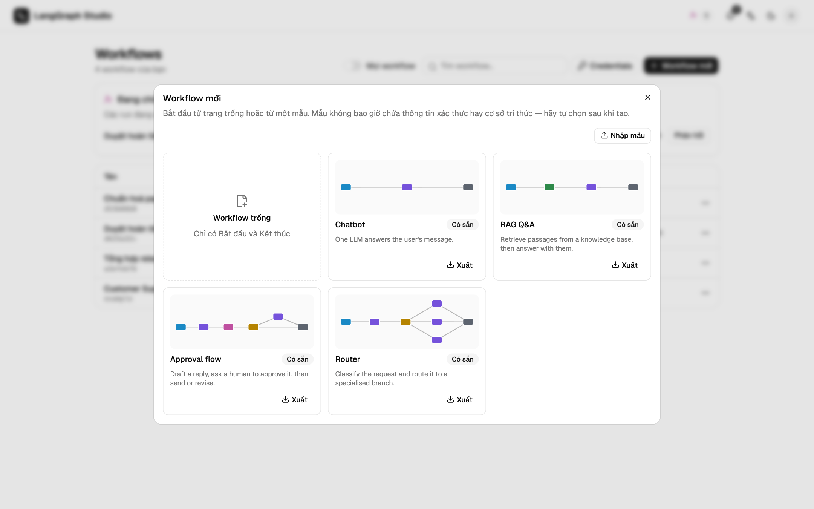
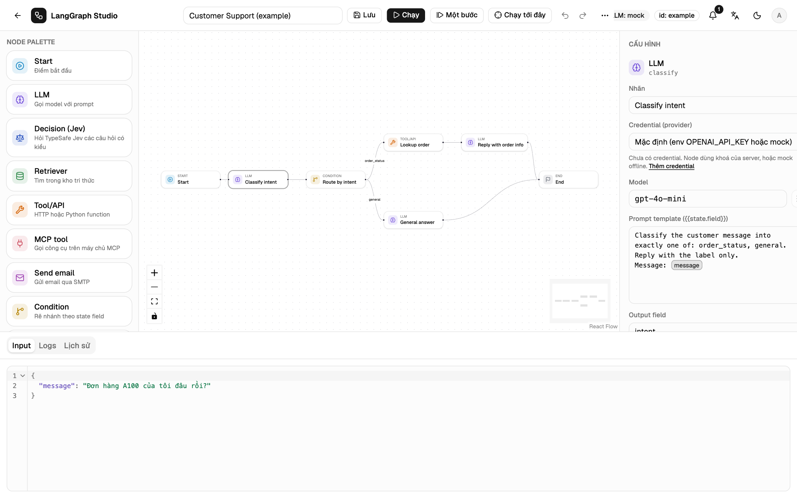
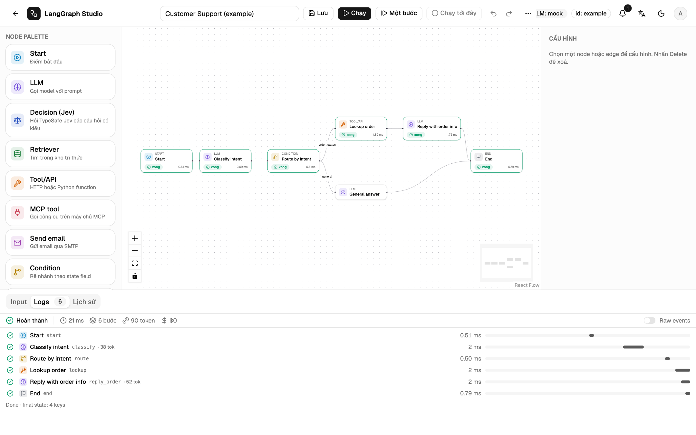

# Workflow đầu tiên

Phần này dựng một graph nhỏ tóm tắt ticket hỗ trợ, chạy nó và đọc trace. Mất
khoảng năm phút và chạy được với bản mock offline, không cần key của model.

## 1. Tạo workflow trống

Ở trang **Workflows**, chọn **Workflow mới**. Thư viện mẫu có graph trống,
bốn mẫu khởi đầu (Chatbot, RAG Q&A, Approval flow, Router) và các mẫu đã lưu.
Chọn **Workflow trống**: graph chỉ có node Start và End.



## 2. Khai báo state

State là dữ liệu graph truyền từ node này sang node khác. Ở panel trái, mục
**State schema**, tạo hai field:

| Field | Kiểu |
| --- | --- |
| `message` | `string` |
| `summary` | `string` |

Bấm **Thêm field** cho field thứ hai. Các kiểu có sẵn: `string`, `number`,
`integer`, `boolean`, `object` và `list`.

## 3. Thêm node LLM

Kéo **LLM** từ **Node palette** thả vào canvas. Nối node: kéo từ chấm bên phải
của **Start** sang chấm bên trái của node LLM, rồi từ node LLM sang **End**.

Chọn node LLM, panel phải hiện cấu hình:

- **Nhãn**: `Tóm tắt ticket`
- **Model**: `gpt-4o-mini` (với bản mock, tên model nào cũng được)
- **Prompt template**:

    ```text
    Tóm tắt ticket hỗ trợ này trong một câu: {{state.message}}
    ```

    Gõ `{{` để chọn field của state. Tham chiếu hiện thành tag, field không
    có trong state sẽ đỏ.

- **Output field**: `summary`



## 4. Lưu và chạy

Bấm **Lưu** (++ctrl+s++ hoặc ++cmd+s++). Backend kiểm tra graph: node không tới
được, field không có trong state, edge trỏ tới node không tồn tại. Lỗi được
liệt kê trước khi chạy.

Mở tab **Input** ở dưới và nhập:

```json
{"message": "Đơn A100 của tôi bị vỡ khi nhận, tôi muốn hoàn tiền."}
```

Bấm **Chạy** (++ctrl+enter++). Canvas đánh dấu từng node khi bắt đầu và khi
xong, tab **Logs** hiện mỗi bước của node thành một dòng.



## 5. Đọc trace

Mỗi dòng có trạng thái, node, thời gian, thanh thác nước và số token model trả
về. Dòng tóm tắt cộng tổng thời gian, số bước, token và chi phí. Bấm vào một
dòng, hoặc vào node trên canvas, để mở **Input**, **Output**, **State diff**
và **Raw**.


Tab **Lịch sử** giữ mọi run của workflow kèm phiên bản, xem lại run nào cũng
được.

## 6. Rẽ nhánh theo kết quả

Thêm node **Condition** sau node LLM và đặt **Field** là một field của state,
ví dụ `intent`. Đặt nhãn cho các edge đi ra bằng giá trị cần khớp, như
`refund` và `general`, rồi đặt một edge mặc định. Ví dụ **Customer Support**
có sẵn cho thấy đủ cả mẫu: phân loại, rẽ nhánh, tra đơn hàng, trả lời.

## Tiếp theo

- [Trình soạn thảo](../guide/editor.md): bố cục, phím tắt, ghi chú và bảng lệnh.
- [Các loại node](../guide/nodes.md): mọi loại node và cấu hình của chúng.
- [API trigger](../run/api-triggers.md): gọi workflow này từ một dịch vụ khác.
