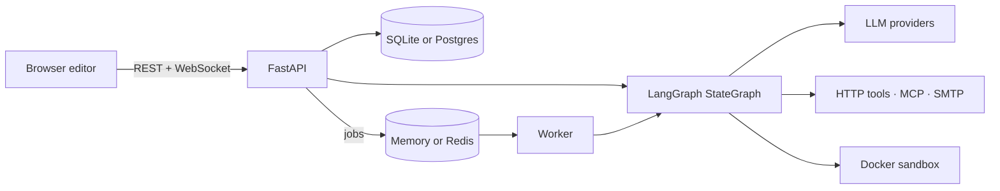

# Getting started

LangGraph Studio has three parts:

| Part | What it is |
| --- | --- |
| **Frontend** | React, TypeScript and Vite. React Flow draws the canvas; the UI uses shadcn/ui on Tailwind v4 and ships in English and Vietnamese. |
| **API** | FastAPI. It stores workflows, compiles them into a LangGraph `StateGraph`, runs them, and streams events over WebSocket. |
| **Worker** | Runs queued jobs: API-triggered runs, schedules, recovered runs and webhook deliveries. By default it runs inside the API process. |

A workflow is JSON: a state schema, nodes, and edges. The editor writes that
JSON and the backend validates it on every save and every run.

## Where to go next

-   :material-download:{ .lg .middle } **Install**

    ---

    Local development with `./dev.sh`, or the full Compose stack.

    [:octicons-arrow-right-24: Install](install.md)

-   :material-vector-polyline:{ .lg .middle } **Your first workflow**

    ---

    Build a two-node graph, run it, and read the trace.

    [:octicons-arrow-right-24: Your first workflow](first-workflow.md)

-   :material-lightbulb-outline:{ .lg .middle } **Concepts**

    ---

    State, nodes, edges, runs, supersteps and checkpoints.

    [:octicons-arrow-right-24: Concepts](concepts.md)

