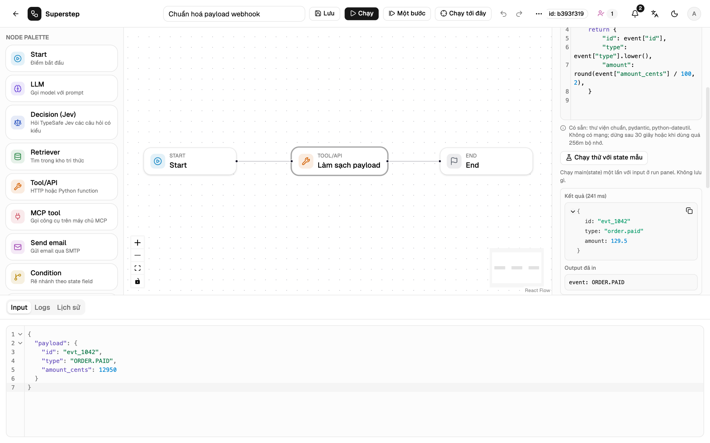

# Chế độ Code

Node Tool ở chế độ **Code** chạy đoạn Python hoặc TypeScript bạn viết ngay trong node.
Code định nghĩa hàm `main(state)`; giá trị trả về được ghi vào `output_field`
của node.

```python
def main(state):
    print("seen:", state["message"])   # hiện trong trace, không lưu vào state
    return state["message"].upper()
```



!!! info "Trước khi bắt đầu"
    Chế độ Code tắt cho tới khi server đặt `STUDIO_ENABLE_CODE_NODES=1` và có
    image sandbox. Việc này do admin làm: xem
    [Môi trường chạy Code](../operate/code-runtime.md). Khi còn tắt, workflow
    có node Code sẽ không qua được kiểm tra và báo rõ lý do.

## Viết và chạy thử

1. Chọn một node Tool, đặt **Chế độ** là **Code (Python)** hoặc
   **Code (TypeScript)**. Ô code bắt đầu bằng khung `main(state)` của ngôn ngữ
   đó (xem [TypeScript](#typescript)). Chế độ chỉ liệt kê những ngôn ngữ máy
   chủ này chạy được.
2. Dưới ô code, node liệt kê các package có trong image và các giới hạn.
3. Đặt input mẫu vào tab **Input** của panel run.
4. Bấm **Chạy thử với state mẫu**. Nút này chạy `main(state)` một lần với
   input đó và không lưu gì. Kết quả hiện giá trị trả về, phần đã in ra, và
   khi lỗi thì có traceback chỉ gồm các frame trong code của bạn.
5. Lưu và chạy như bình thường.

Chạy thử đi qua `POST /api/code/test`, tối đa
`STUDIO_CODE_TEST_PER_MINUTE` lần mỗi phút cho mỗi người (mặc định 20).

## Quy ước

| Quy tắc | Chi tiết |
| --- | --- |
| Điểm vào | Hàm tên `main` nhận một tham số là state. |
| Input | Bản sao JSON của state. Sửa nó không làm thay đổi run. |
| Output | Giá trị trả về, phải là JSON: dict, danh sách, string, số, bool hoặc `None`. |
| Phần in ra | `print()` và stderr hiện trong trace, tối đa 64 KB (dài hơn bị cắt). |
| Kích thước | Mã nguồn tối đa 64 KB; state và kết quả mỗi thứ tối đa 1 MB. |
| Package | Thư viện chuẩn cộng các package trong image: `pydantic` và `python-dateutil` với image mặc định. |
| Mạng, file | Không có. Container không có mạng, root chỉ đọc, `/tmp` 64 MB. |
| Thời gian | Timeout của node, không vượt quá mức tối đa của server (mặc định 30 giây). |

Code chỉ ảnh hưởng tới run qua giá trị trả về.

## TypeScript

Đặt **Chế độ** là **Code (TypeScript)**. Nếu bạn chưa sửa
code, khung mẫu đổi sang khung TypeScript; code đã sửa thì được giữ nguyên và
node nhắc bạn viết lại. Trên canvas, node có nhãn **TS**.

```ts
export function main(state: State) {
  console.log("seen:", state.message)   // hiện trong trace
  return (state.message ?? "").toUpperCase()
}
```

- **Hàm chính:** export một hàm `main`, đồng bộ hoặc `async`.
- **`State`:** kiểu được tạo từ schema của state, hiện phía trên ô code. Gõ
  `state.` để xem tên các trường. TypeScript chạy trên [Deno](https://deno.com),
  Deno bỏ kiểu đi mà không kiểm tra, nên lỗi kiểu không làm dừng run và bạn
  không cần khai báo `State`.
- **Output in ra:** `console.log` và các hàm `console` khác.
- **Kết quả:** phải là JSON. `undefined`, `BigInt`, hàm hoặc vòng tham chiếu
  cho lỗi `CODE_RESULT_NOT_JSON`.
- **Package:** Web API (trừ `fetch`, xem dưới), cộng các package máy chủ cho
  phép, import đúng như ghi trong danh sách dưới ô code, ví dụ
  `import { z } from "npm:zod"`. Image mặc định có `npm:zod` và
  `npm:date-fns`. Import khác cho lỗi `CODE_INVALID`.
- **Không có quyền nào:** đọc hay ghi file, mạng, biến môi trường, chạy tiến
  trình và thông tin hệ thống đều lỗi `NotCapable` (`CODE_FAILED`), trên mọi
  môi trường chạy.
- Giới hạn kích thước, thời gian và bộ nhớ giống Python.

## Lỗi

| Mã | Khi nào |
| --- | --- |
| `CODE_INVALID` | Lỗi cú pháp, hoặc không có hàm `main` gọi được. |
| `CODE_FAILED` | `main` ném lỗi. Trace hiện traceback. |
| `CODE_RESULT_NOT_JSON` | Giá trị trả về không phải JSON. |
| `CODE_TIMEOUT` | Chạy quá giới hạn thời gian. |
| `CODE_MEMORY` | Container chạm giới hạn bộ nhớ. |
| `CODE_TOO_LARGE` | Mã nguồn, state hoặc kết quả vượt giới hạn kích thước. |
| `CODE_RUNTIME_OFF`, `CODE_RUNTIME_UNAVAILABLE` | Chế độ Code đang tắt, hoặc thiếu Docker hay image. |
| `CODE_LANGUAGE_UNSUPPORTED` | Máy chủ này không cung cấp ngôn ngữ của node. |
| `CODE_WRITE_FORBIDDEN` | Bạn không có quyền `code.write`. Đổi ngôn ngữ cũng tính là sửa code. |

Cấu hình retry của node áp dụng cho các lỗi này. Huỷ run sẽ kill container
của nó.

## Ai được viết code

Chỉ vai trò có `code.write` (mặc định là admin) mới được thêm node Code hoặc
sửa code của nó, dù qua lưu, khôi phục phiên bản, hay nhập và dùng mẫu. Editor
vẫn mở, chạy, di chuyển, đổi tên, xoá node Code và nhân bản workflow có node
Code; với họ, code chỉ đọc và nút chạy thử bị ẩn.

## Trong trace

Dòng của node có `code_output`: phần in ra, runtime và thời gian chạy. Khi lỗi
thì có traceback. Mỗi lần gọi mất khoảng 0,3 giây khi image đã sẵn.
