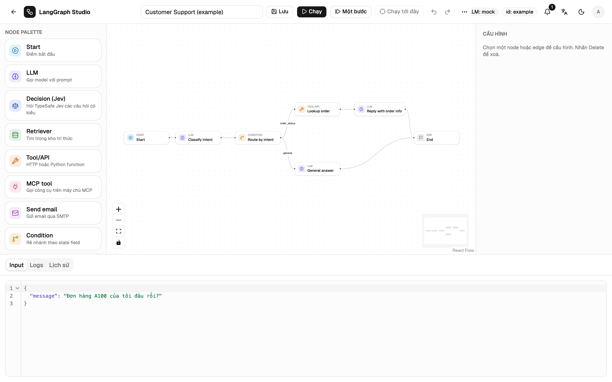
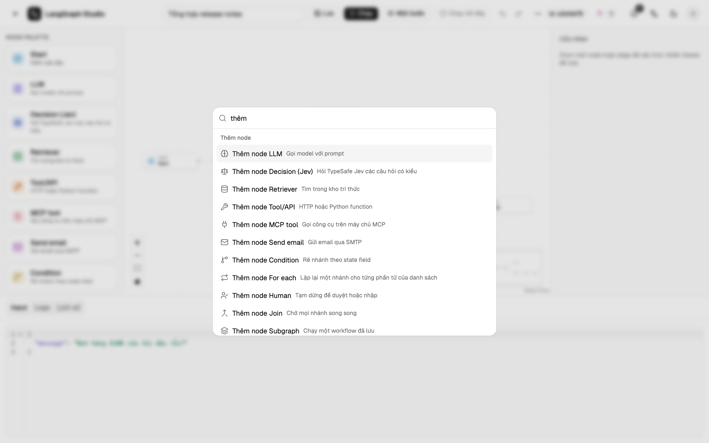
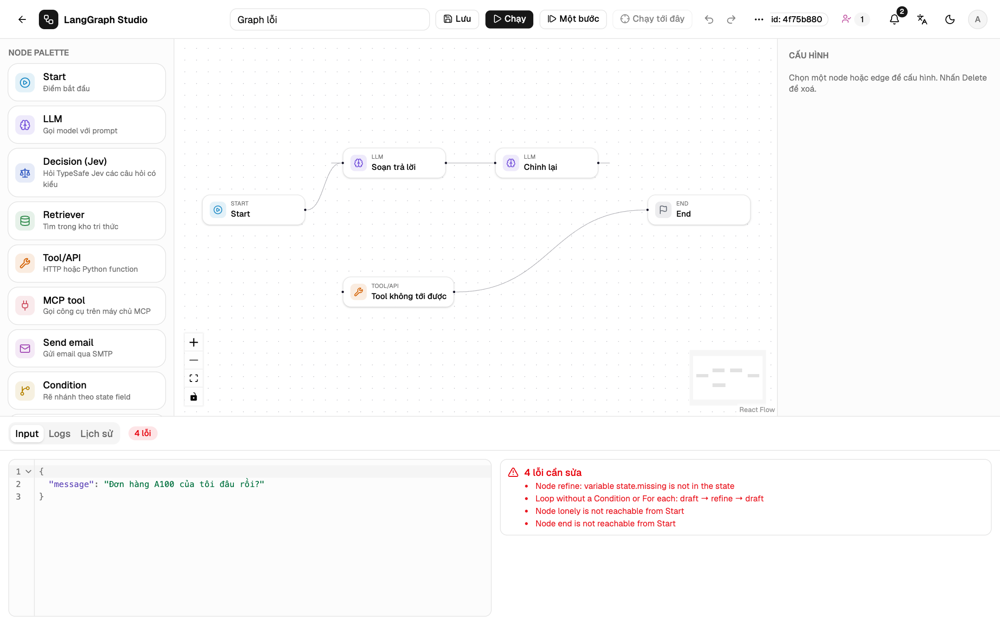
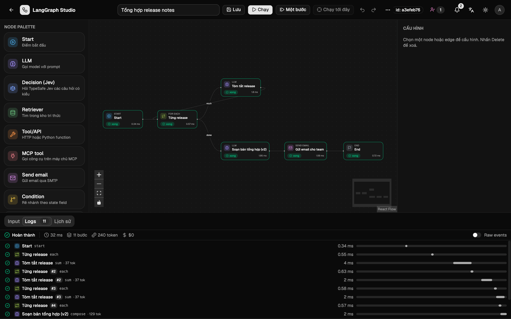

# Trình soạn thảo

## Bố cục

| Vùng | Chứa gì |
| --- | --- |
| Thanh trên | Tên, **Lưu**, **Chạy**, **Một bước**, **Chạy tới đây**, undo và redo. Mọi thứ khác nằm trong menu **⋯** (Thao tác khác): bố cục, phiên bản, lịch chạy, API, chia sẻ, lưu thành mẫu, chuyển quyền sở hữu, xoá. |
| Trái | **Node palette** và trình sửa **State schema**. |
| Giữa | Canvas React Flow. |
| Phải | **Cấu hình** của node hoặc edge đang chọn. |
| Dưới | **Input** (JSON), **Logs** (trace trực tiếp) và **Lịch sử**. |

Kéo viền của panel trái, phải hoặc dưới để đổi kích thước. Kích thước tối
thiểu lần lượt là 180 px, 260 px và 140 px, canvas luôn còn ít nhất
280 × 160 px. Kích thước lưu trong trình duyệt này
(`localStorage.lgs.editorPanels`), không lưu vào workflow.

## Sửa canvas

- **Thêm node:** kéo từ palette thả vào canvas, hoặc bấm ++ctrl+k++ rồi gõ
  **Thêm node …**.
- **Nối:** kéo từ chấm bên phải của một node sang chấm bên trái của node khác.
- **Nhãn edge:** chọn edge rồi gõ nhãn ở panel phải. Nhãn có ý nghĩa với edge
  của Condition và For each.
- **Xoá:** ++delete++ hoặc ++backspace++ xoá phần đang chọn. Không xoá được
  Start và End.
- **Ghi chú:** chuột phải lên canvas, chọn **Thêm ghi chú**. Ghi chú được lưu
  cùng workflow, không bị sắp xếp bố cục di chuyển, và run bỏ qua nó.

## Undo và clipboard

++ctrl+z++ để undo, ++ctrl+shift+z++ hoặc ++ctrl+y++ để redo, tối đa 100 bước.
Một lần kéo là một bước, gõ liên tục trong cùng một node cũng là một bước. Ô
nhập văn bản giữ undo riêng của trình duyệt. Nhãn **Unsaved changes** biến mất
khi bạn undo về đúng graph đã lưu.

++ctrl+c++, ++ctrl+x++, ++ctrl+v++ và ++ctrl+d++ để copy, cut, paste và nhân bản
node. Chỉ những edge nối giữa các node được chọn mới đi theo, node dán vào có
id mới. Start và End không bao giờ được copy. Clipboard nằm trong
`localStorage` (`langgraph-studio/nodes` v1), nên có thể dán sang workflow
khác trong cùng trình duyệt. Credential mà bạn không có quyền dùng sẽ bị xoá
khi dán.

## Sắp xếp bố cục

**Sắp xếp** trong menu **⋯**, hoặc ++shift+l++, dàn graph bằng dagre theo đúng
kích thước node. Mũi tên bên cạnh đổi giữa trái sang phải và trên xuống dưới.
Góc trên trái của graph giữ nguyên chỗ cũ, mỗi lần sắp xếp là một bước undo.
++shift+1++ thu graph vừa khung nhìn.

## Bảng lệnh

++ctrl+k++ mở bảng lệnh ở mọi trang, kể cả khi đang gõ trong ô nhập. Bảng lệnh
tìm gần đúng các thao tác của trình soạn thảo, **Thêm node**, **Đến node**,
**Mở workflow**, **Workflow mới** và các trang Cài đặt. Từ khoá tiếng Anh như
`retriever` hay `mcp` khớp ở cả hai ngôn ngữ.

++question++ hoặc ++ctrl+slash++ mở bảng phím tắt. Danh sách đầy đủ ở
[Phím tắt](../reference/shortcuts.md).

## Kiểm tra graph

Lưu và Chạy đều kiểm tra graph. Trình kiểm tra từ chối:

- edge trỏ tới node không tồn tại, id trùng, nhiều hơn một Start;
- edge tự nối vào chính nó (trừ ở Condition);
- vòng lặp không đi qua Condition hay For each;
- node không tới được;
- field được nhiều nhánh song song ghi mà không có reducer;
- tham chiếu `{{state.x}}` tới field không có, hoặc filter không tồn tại.

Lỗi hiện cạnh tab Input.

## Giao diện và ngôn ngữ

Nút mặt trăng/mặt trời lưu giao diện sáng/tối trong `localStorage`;
`?theme=dark` ép giao diện tối. Nút ngôn ngữ lưu lựa chọn trong
`localStorage.lang`; mặc định theo trình duyệt. Lỗi từ API được dịch theo
`error.code`.

