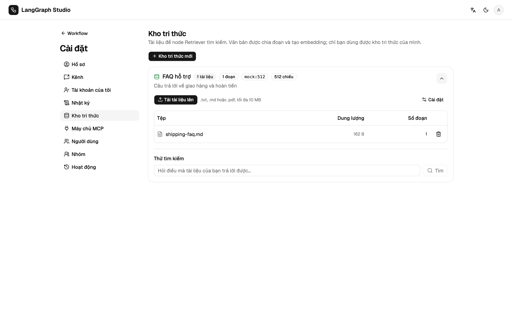

# Kho tri thức

Kho tri thức là tập tài liệu được chia đoạn và tạo embedding, để node
[Retriever](nodes.md#retriever) tìm kiếm.



## Trước khi bắt đầu

- Vai trò `admin` hoặc `editor` (`resources.manage`). Viewer không tạo được
  kho tri thức.
- Một model embedding. Khi chưa có credential, embedding dùng `mock:512`, một
  model offline so khớp theo từ chung, không theo nghĩa.

## Tạo kho

1. Mở **Cài đặt → Kho tri thức**, chọn **Kho tri thức mới**.
2. Đặt tên rồi bấm **Tạo**. **Cài đặt** trên thẻ để chọn **Model embedding**
   và **Khoá embedding** (một credential).
3. **Tải tài liệu lên** nhận `.txt`, `.md` và `.pdf`, mỗi file tối đa 10 MB.
4. Dùng ô **Thử tìm kiếm** trên thẻ để xem một câu hỏi trả về gì.

## Embedding

Embedding dùng credential của kho, rồi tới `OPENAI_API_KEY`, rồi tới bản mock
offline cố định (`mock:512`). Model mặc định của OpenAI là
`text-embedding-3-small`. Với Ollama, model mặc định ở máy là
`nomic-embed-text` (`ollama pull nomic-embed-text`). Anthropic không có API
embedding.

**Kiểm tra embedding** trên credential cho biết kích thước vector. Mỗi kho
lưu `dims` của nó. Vector khác kích thước sẽ lỗi
`KB_EMBEDDING_DIMENSION_MISMATCH`; lập chỉ mục lại kho để nhận kích thước mới.
Sau khi đổi model hoặc khoá trong **Cài đặt**, bấm **Lập chỉ mục lại**.

## Lưu trữ và tìm kiếm

| Database | Tìm kiếm |
| --- | --- |
| Postgres có pgvector (image Compose `pgvector/pgvector:pg17`) | Bằng SQL |
| Postgres thường, SQLite | Vector lưu dạng JSON, tính cosine trong Python |

Chỉ chủ kho dùng được kho trong run. Mã lỗi là `KB_*` trong
[Mã lỗi](../reference/errors.md).

## Dùng trong graph

```text
Start → Retriever (query: {{state.message}}, top_k: 4, output: context)
      → LLM (prompt: Trả lời {{state.message}} dựa vào {{state.context | json}})
      → End
```

Mẫu khởi đầu **RAG Q&A** có sẵn hình dạng này.
