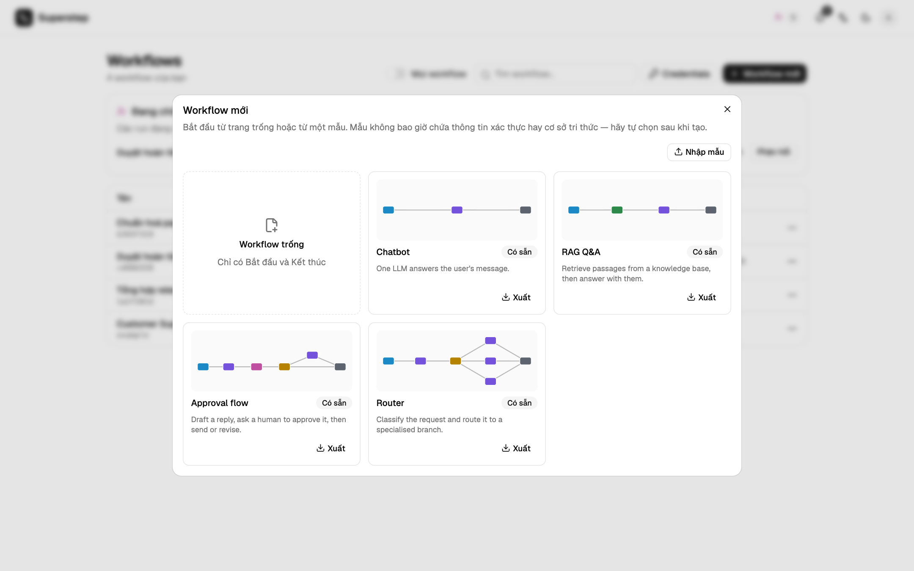

# Mẫu workflow

**Workflow mới** mở thư viện mẫu.



| Nhóm | Nội dung |
| --- | --- |
| Workflow trống | Chỉ có Start và End. |
| Có sẵn | **Chatbot**, **RAG Q&A**, **Approval flow**, **Router**. |
| Chỉ mình tôi | Các mẫu bạn đã lưu. |
| Toàn tổ chức | Các mẫu chia sẻ cho mọi người. |

Mỗi thẻ có bản xem trước của graph. Tạo từ mẫu sẽ chép nó thành một workflow
mới do bạn sở hữu.

## Lưu thành mẫu

**⋯ → Lưu thành mẫu** chép **phiên bản đã lưu gần nhất** của workflow (muốn có
các sửa đổi chưa lưu thì lưu trước). Chọn tên, mô tả và ai được thấy. Phạm vi
tổ chức cần quyền `org.manage`.

Mẫu không bao giờ mang theo credential, kho tri thức, máy chủ MCP, kênh duyệt,
liên kết subgraph, header hay API key. Các field đó được để trống, sau khi tạo
bạn tự chọn lại.

## Xuất và nhập

**Xuất** trên một thẻ ghi ra file `*.template.json`:

```json
{"format": "superstep/template", "version": 1,
 "name": "…", "description": "…", "workflow": {"state": [], "nodes": [], "edges": []}}
```

**Nhập mẫu** trong thư viện đọc lại file đó. Mẫu có node Code cần quyền
`code.write` để nhập hoặc dùng.

Xoá mẫu cần gõ đúng tên mẫu. Các workflow đã tạo từ mẫu không bị ảnh hưởng.
