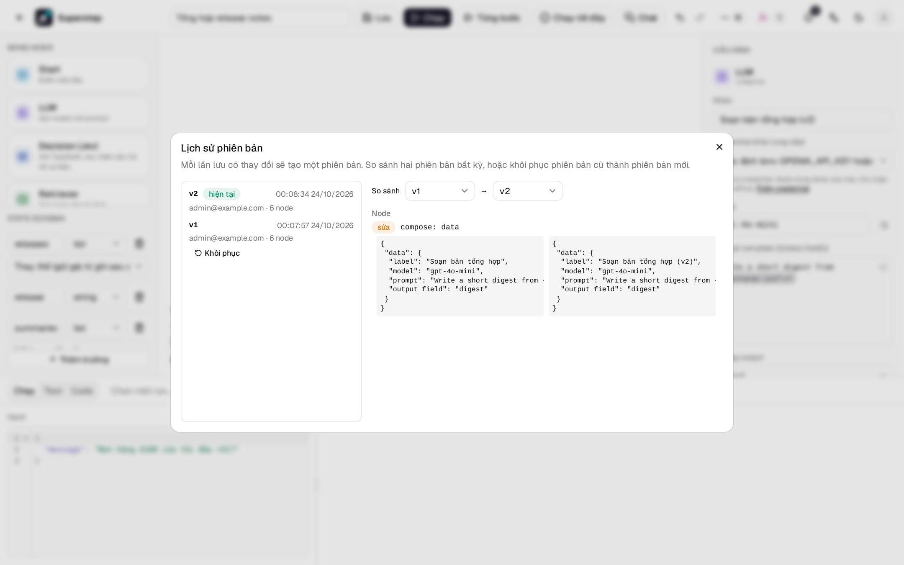

# Phiên bản

Lưu có thay đổi graph, đổi tên, nhân bản hay import đều ghi một phiên bản bất
biến kèm người sửa và thời điểm. Lưu mà không có thay đổi thì không ghi gì, và
chỉ di chuyển node mà không đổi graph thì không tính là thay đổi. Graph có từ
trước khi có tính năng phiên bản được tính là v1.



## So sánh và khôi phục

**⋯ → Phiên bản** liệt kê các phiên bản. **So sánh** hiện khác biệt giữa hai
bản bất kỳ. **Khôi phục** chép graph cũ thành phiên bản mới nhất và giữ tên
hiện tại; các phiên bản cũ vẫn còn. Khôi phục nội dung đã giống hệt thì không
làm gì.

## Run và phiên bản

Mỗi run trong lịch sử run (**Xem tất cả**) có nhãn `vN`, hoặc **chưa lưu** khi trình soạn thảo
đang có sửa đổi chưa lưu. Phiên bản đã được run dùng thì không bao giờ bị xoá.

## Giữ lại bao nhiêu

`STUDIO_VERSION_KEEP=N` giữ N phiên bản mới nhất (0, mặc định, giữ tất cả).
Phiên bản đã được run dùng luôn được giữ.

## API

```text
GET  /api/workflows/{wid}/versions?limit=50&offset=0
GET  /api/workflows/{wid}/versions/{n}
GET  /api/workflows/{wid}/versions/diff?a=1&b=2
POST /api/workflows/{wid}/versions/{n}/restore
```

Phiên bản không tồn tại trả về `404 VERSION_NOT_FOUND`.
