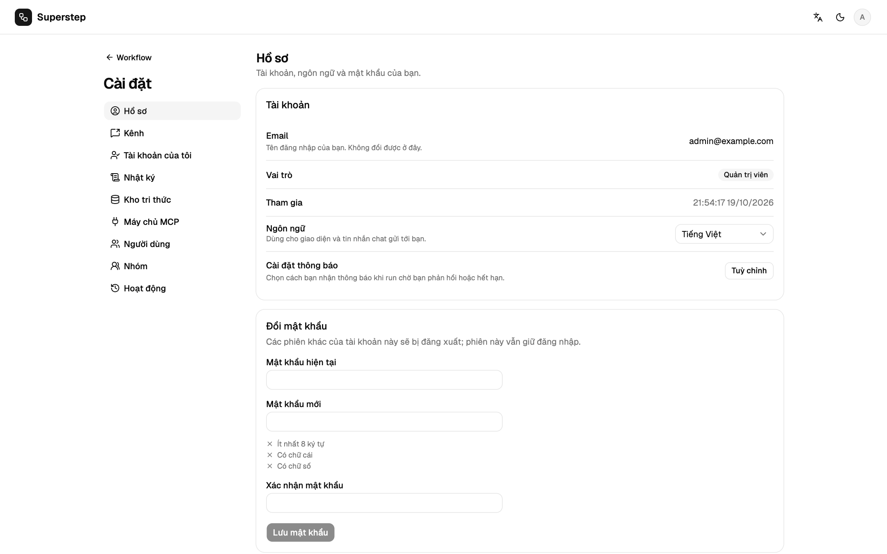

# Tài khoản và bảo mật

## Đăng nhập và phiên

Mật khẩu được băm bằng PBKDF2-SHA256 (200 000 vòng, salt riêng). Đăng nhập trả
về một JWT HS256 có hạn `JWT_TTL_SECONDS` (mặc định 86400, tức 24 giờ).

| Client | Gửi gì | Ghi chú |
| --- | --- | --- |
| Trình duyệt | Cookie HttpOnly `studio_session` (`SameSite=Lax`, `Secure` trong production hoặc khi đặt `STUDIO_COOKIE_SECURE`) | Script trên trang không đọc được cookie. Request ghi phải gửi `X-Requested-With: studio`, `lib/api.ts` đã làm việc này. Socket dùng cùng cookie và phải tới từ chính host của server. |
| Client API | `Authorization: Bearer <token>` | Không cần header CSRF. Socket: `ws://…/ws/run?token=<token>`; log của uvicorn ghi thành `token=***`. |

Đăng nhập và đăng ký trả `token` và `expires_at` trong body.
`POST /api/auth/logout` xoá cookie. Token hết hạn hoặc sai sẽ đăng xuất UI và
quay về `/login?expired=1&next=…`.

## Đăng ký

Mật khẩu dài 8–128 ký tự, có ít nhất một chữ cái và một chữ số. Email được bỏ
khoảng trắng và chuyển về chữ thường. Tài khoản mới nhận một bản sao của
workflow ví dụ và vai trò trong `STUDIO_DEFAULT_ROLE` (`editor`, trừ khi đặt
là `viewer`). Workflow thuộc về người tạo ra nó.

## Khoá tạm

Năm lần đăng nhập sai trong 15 phút sẽ khoá email đó trong 15 phút, kể cả khi
nhập đúng mật khẩu (`AUTH_LOCKED`). Địa chỉ không tồn tại cũng được đếm như
vậy, nên việc bị khoá không để lộ tài khoản có tồn tại hay không. Đăng nhập sai
luôn báo là email hoặc mật khẩu không đúng.

| Biến | Mặc định |
| --- | --- |
| `STUDIO_LOGIN_MAX_FAILURES` | 5 |
| `STUDIO_LOGIN_WINDOW` | 900 giây |
| `STUDIO_LOGIN_LOCK` | 900 giây |

## Đặt lại mật khẩu

Admin mở **Cài đặt → Người dùng**, tạo link dùng một lần (biểu tượng chìa
khoá), rồi gửi cho người dùng. Khi đã đặt `SMTP_HOST` và `STUDIO_PUBLIC_URL`,
**Quên mật khẩu?** ở trang đăng nhập sẽ gửi link qua e-mail, và trả lời giống
nhau với mọi địa chỉ. Link dùng được một lần, trong
`STUDIO_PASSWORD_RESET_TTL` giây (mặc định 3600). Đặt mật khẩu mới sẽ đăng xuất
mọi phiên cũ của tài khoản và gỡ khoá tạm.

## Hồ sơ và đổi mật khẩu

**Cài đặt → Hồ sơ** (cũng có trong menu người dùng) hiện email, vai trò, ngày
tham gia, ngôn ngữ và cài đặt thông báo.

**Đổi mật khẩu** cần mật khẩu hiện tại. Nhập sai mật khẩu hiện tại sẽ tính vào
khoá tạm (`AUTH_PASSWORD_WRONG`, rồi `AUTH_LOCKED`), và mật khẩu mới phải theo
đúng quy tắc và khác mật khẩu cũ (`AUTH_PASSWORD_SAME`). Đổi mật khẩu sẽ đăng
xuất mọi phiên khác, giữ trình duyệt này đăng nhập bằng một phiên mới, huỷ các
link đặt lại đang mở, và được ghi vào nhật ký hoạt động là
`user.password_changed`. Không đổi được địa chỉ email.

## Production

Với `STUDIO_ENV=production`, backend không chịu khởi động khi `JWT_SECRET` vẫn
là giá trị mẫu (ngoài production chỉ ghi cảnh báo). Tài khoản demo không được
tạo; nếu đã có và vẫn dùng mật khẩu demo thì bị vô hiệu hoá khi khởi động.
Dùng `STUDIO_ADMIN_EMAILS` để tạo admin đầu tiên.

## CORS

`STUDIO_CORS_ORIGINS` (cách nhau bằng dấu phẩy) liệt kê các origin trình
duyệt được gọi API. Không đặt thì môi trường phát triển cho phép `*`, còn
production không cho origin nào, vì UI được phục vụ từ cùng origin.

## Secret khi lưu trữ

Key của nhà cung cấp, mật khẩu SMTP, header MCP và token của kênh duyệt được
mã hoá bằng Fernet (`STUDIO_SECRET_KEY`, hoặc file sinh ra
`~/.superstep/secret.key` / `STUDIO_SECRET_KEY_FILE`, quyền 0600). API
chỉ trả về bốn ký tự cuối của key.
