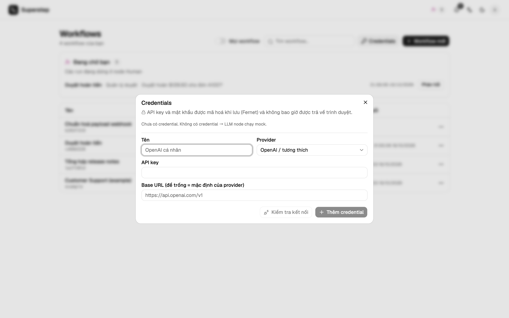

# Nhà cung cấp LLM

**Credentials** (ở trang danh sách workflow) lưu key của các nhà cung cấp. Mỗi
nhà cung cấp là một class nhỏ trong `backend/app/engine/providers.py`.

| Nhà cung cấp | Base URL mặc định | API key | Danh sách model |
| --- | --- | --- | --- |
| Ollama | `http://localhost:11434` | không cần | `/api/tags` |
| LM Studio | `http://localhost:1234/v1` | không cần | `/v1/models` |
| Tương thích OpenAI (vLLM, llama.cpp, LocalAI) | `http://localhost:8000/v1` | tuỳ server | `/v1/models` |
| OpenRouter | `https://openrouter.ai/api/v1` | bắt buộc, thêm `HTTP-Referer` và `X-Title` nếu muốn | `/api/v1/models` |
| OpenAI | mặc định của nhà cung cấp | bắt buộc | `/models` |
| Anthropic | mặc định của nhà cung cấp | bắt buộc | `/v1/models` |
| TypeSafe (Jev), cho node Decision | `https://api.typesafe.ai` | bắt buộc | không có: **Kiểm tra kết nối** gửi một câu hỏi nhỏ |
| SMTP, cho node Send email | host, port và kiểu bảo mật trong form, có sẵn cấu hình cho Gmail, Outlook, SendGrid, Resend và Mailgun | mật khẩu, tuỳ chọn | không có: **Kiểm tra kết nối** đăng nhập rồi thoát, không gửi thư |

## Thêm credential

1. Mở **Credentials**, chọn **Thêm credential**.
2. Chọn nhà cung cấp. Sau khi tạo thì không đổi nhà cung cấp được.
3. Điền base URL và key.
4. **Kiểm tra kết nối** liệt kê các model, trước hoặc sau khi lưu.
5. Chọn credential ở node LLM (hoặc ở kho tri thức để tạo embedding).

Để trống ô key trong form sửa thì key đã lưu được giữ nguyên.

## Thứ tự dự phòng

| Node có | Dùng |
| --- | --- |
| Một credential | Nhà cung cấp đó |
| Không có credential, có `OPENAI_API_KEY` | OpenAI (`OPENAI_BASE_URL` tuỳ chọn) |
| Không có cả hai | Bản mock offline cho kết quả cố định |

`GET /api/health` cho biết `llm_mode`.

## Lỗi

| Mã | Khi nào |
| --- | --- |
| `PROVIDER_UNREACHABLE` | Base URL không phản hồi. |
| `PROVIDER_AUTH_FAILED` | Key bị từ chối. Trả về HTTP 400 để UI không coi đó là phiên hết hạn. |
| `PROVIDER_BAD_RESPONSE` | Server trả về dữ liệu không như mong đợi. |
| `MODEL_NOT_FOUND` | Server không có model đó. |

Trong lúc chạy, lỗi từ nhà cung cấp thành sự kiện `error` của node.

## Cách gọi chat

Chat dùng LangChain (`ChatOllama`, hoặc `ChatOpenAI` với `base_url`), nên
stream và tool calling chạy được khi model hỗ trợ. Chat với OpenAI và
Anthropic đi theo đường HTTP thuần của chúng.

## Model chạy ở máy

Trong Compose, dùng `http://host.docker.internal:11434` cho Ollama và
`http://host.docker.internal:1234/v1` cho LM Studio. Xem
[Triển khai bằng Compose](deploy.md#model-chay-o-may-khi-dung-compose).

## Embedding

Embedding của kho tri thức dùng cùng các credential. **Kiểm tra embedding** cho
biết kích thước vector. Model mặc định ở máy cho Ollama là `nomic-embed-text`.
Anthropic không hỗ trợ embedding. Xem [Kho tri thức](../guide/knowledge.md).

## Lưu key

Key được mã hoá bằng Fernet (`STUDIO_SECRET_KEY`, hoặc file sinh ra
`~/.superstep/secret.key` / `STUDIO_SECRET_KEY_FILE`, quyền 0600). API
chỉ trả về bốn ký tự cuối. Mất khoá thì credential cũ không đọc được nữa.
