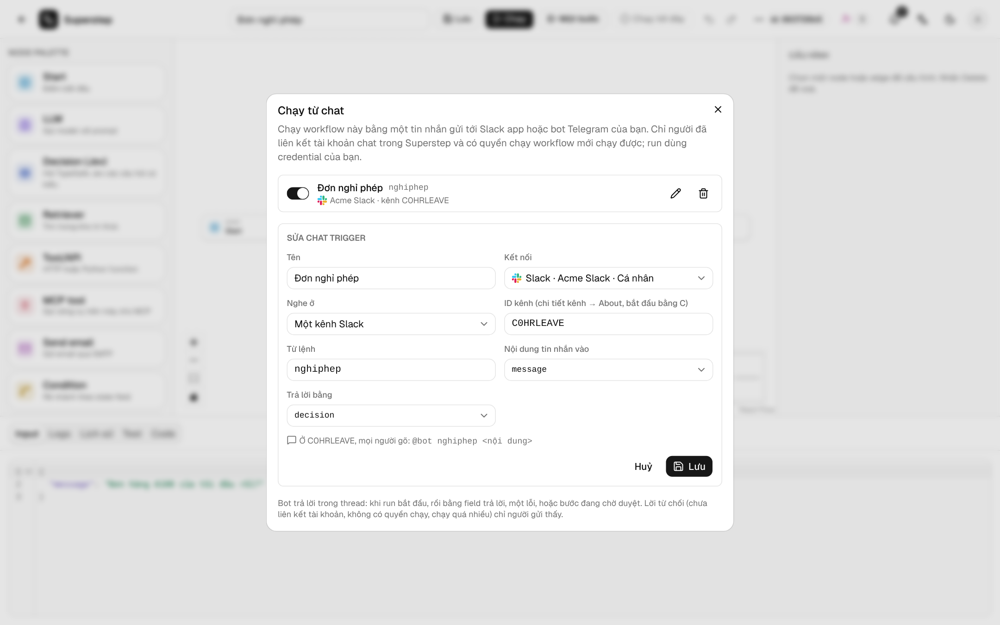

# Chạy từ chat

**⋯ → Chạy từ chat** trong trình soạn thảo chạy workflow bằng một tin nhắn gửi
tới Slack app hoặc bot Telegram của bạn. Một từ lệnh chọn workflow, phần còn
lại của tin nhắn điền vào một trường input, và bot trả lời trong thread bằng
một trường của state.



```text
@bot nghiphep 2 ngày tuần sau về quê
     ^^^^^^^^ ^^^^^^^^^^^^^^^^^^^^^^^
      từ lệnh  vào field input
```

## Trước khi bắt đầu

- Quyền chủ trên workflow (chủ workflow hoặc admin).
- Một kết nối Slack hoặc Telegram ở **Cài đặt → Kênh** mà bạn được dùng (của
  riêng bạn, hoặc kết nối của tổ chức khi vai trò của bạn được dùng chúng).
  Xem [Kênh duyệt](../operate/channels.md).
- `STUDIO_PUBLIC_URL` HTTPS công khai và worker đang chạy: tin nhắn được đưa
  vào hàng đợi thành job.
- Mọi người sẽ nhắn cho bot phải liên kết và xác minh tài khoản chat ở **Cài
  đặt → Tài khoản của tôi**, và có quyền chạy workflow: chủ workflow, admin,
  hoặc người được chia sẻ workflow (xem
  [Vai trò và chia sẻ](../operate/access.md)).

## Thiết lập Slack

Kết nối tạo trước khi có tính năng chạy từ chat cần làm các bước này một lần.

1. Trong **OAuth & Permissions** của app, thêm các bot scope
   `app_mentions:read` (nhắc tới bot trong kênh) và `im:history` (tin nhắn
   riêng). **Add to Slack** đã xin sẵn các quyền này.
2. Trong **Event Subscriptions**, bật sự kiện và dán **Request URL cho Event
   Subscriptions** hiện trên kết nối ở **Cài đặt → Kênh**:
   `{STUDIO_PUBLIC_URL}/api/channels/events/slack`. Slack kiểm tra URL ngay. Một
   URL dùng cho mọi workspace (định tuyến theo `team_id`).
3. Ở **Subscribe to bot events**, thêm `app_mention` và `message.im`.
4. Để nhận tin nhắn riêng, trong **App Home** cho phép người dùng gửi tin nhắn
   từ tab Messages.
5. Cài lại app vào workspace, rồi bấm **Kiểm tra kết nối**. Khi phép kiểm tra
   thấy thiếu quyền, kết nối hiện cảnh báo, và trigger trên nó chỉ lưu được ở
   trạng thái tắt.
6. Mời bot vào từng kênh mà nó cần nghe.

## Thiết lập Telegram

1. Bấm **Đăng ký webhook** trên kết nối một lần nữa. Khi đó bot nhận cả tin
   nhắn lẫn lượt bấm nút, cùng một callback URL.
2. Trong nhóm, bot chỉ thấy tin nhắn bắt đầu bằng `/` (privacy mode). Mọi người
   gõ `/nghiphep …`, hoặc bạn tắt privacy mode bằng `/setprivacy` ở
   @BotFather.
3. Thêm bot vào nhóm. ID nhóm là số âm (ví dụ `-1001234567890`): mở nhóm trên
   Telegram Web, ID là con số sau `#` trên thanh địa chỉ.

## Thêm trigger

| Trường | Ý nghĩa |
| --- | --- |
| Tên | Hiện trong danh sách và trong Lịch sử. |
| Kết nối | Một Slack app hoặc bot Telegram ở **Cài đặt → Kênh**. |
| Nghe ở | **Tin nhắn riêng gửi bot**, **Một kênh Slack** (ID của kênh, `C…`, ở chi tiết kênh → About) hoặc **Một nhóm Telegram** (ID của nhóm, `-…`). |
| Từ lệnh | Một từ: chữ, số, `-` hoặc `_`, tối đa 32 ký tự. Không phân biệt hoa thường; dấu `/` ở đầu được bỏ đi. |
| Nội dung tin nhắn vào | Trường input nhận phần còn lại của tin nhắn. Trường kiểu danh sách nhận một danh sách một phần tử. |
| Trả lời bằng | Trường của state mà bot hiện khi run kết thúc. |

Hộp thoại hiện mẫu tin nhắn mọi người sẽ gõ. Mỗi nơi chỉ một trigger trả lời
một lệnh: cùng từ đó trên cùng kết nối và cùng nơi sẽ bị từ chối
(`CHAT_TRIGGER_COMMAND_TAKEN`), nhưng dùng được ở kênh, nhóm hoặc kết nối khác.
Công tắc trên mỗi dòng tắt trigger mà không xoá nó. Một workflow có tối đa 20
chat trigger.

## Mọi người gõ gì

| Ở đâu | Tin nhắn |
| --- | --- |
| Kênh Slack | `@bot nghiphep 2 ngày tuần sau` |
| Tin nhắn riêng Slack | `nghiphep 2 ngày tuần sau` |
| Nhóm Telegram | `/nghiphep 2 ngày tuần sau` (hoặc `/nghiphep@bot_cua_ban …`) |
| Tin nhắn riêng Telegram | `nghiphep 2 ngày tuần sau` hoặc `/nghiphep …` |

Dấu hai chấm hoặc dấu phẩy sau lệnh cũng được (`nghiphep: 2 ngày`). Tin nhắn
của bot, tin đã sửa, thông báo vào nhóm và file bị bỏ qua, cũng như tin nhắn
mà từ đầu tiên không phải lệnh của nơi đó.

## Bot trả lời gì

Trong thread của tin nhắn (ở tin nhắn riêng Slack thì ngay trong hội thoại; ở
Telegram là trả lời tin nhắn đó):

- **Bắt đầu:** `▶️ Đã chạy Đơn nghỉ phép (lượt chạy 1a2b3c4d5e)` ngay khi run
  vào hàng đợi.
- **Xong:** `✅ Đơn nghỉ phép đã xong: …` kèm trường trả lời, cắt còn 3000 ký
  tự.
- **Lỗi:** `❌ … bị lỗi: …` kèm thông báo lỗi.
- **Đang chờ:** `⏸ … đang chờ phê duyệt ở Quản lý duyệt` khi một node Human
  dừng run. Yêu cầu duyệt đi tới nơi node đó gửi; sau khi duyệt, bot trả lời
  lại bằng kết quả.
- **Dừng:** `⏹ … đã dừng (cancelled)`.

Mỗi câu trả lời có link tới run khi đã đặt `STUDIO_PUBLIC_URL`. Run hiện trong
Lịch sử với nhãn **Chat**, logo của nền tảng, người gửi và tên trigger. Bot
viết bằng ngôn ngữ của tài khoản studio của người gửi.

## Lời từ chối

Tin nhắn bị từ chối không chạy gì. Lý do chỉ gửi cho người gửi: một tin nhắn
Slack chỉ họ thấy, hoặc tin nhắn riêng Telegram (gửi vào nhóm nếu họ chưa từng
bấm Start với bot). Mỗi lời từ chối được ghi vào **Cài đặt → Nhật ký** là
`chat_refused`; run đã chạy được ghi là `chat_started`.

| Lý do | Mã |
| --- | --- |
| Tài khoản chat chưa liên kết | `CHAT_IDENTITY_UNKNOWN` |
| Tài khoản chat đã liên kết nhưng chưa xác minh | `CHAT_IDENTITY_UNVERIFIED` |
| Người dùng đã liên kết không có quyền chạy workflow | `CHAT_FORBIDDEN` |
| Trigger đang tắt | `CHAT_TRIGGER_OFF` |
| Người gửi chạy lệnh này quá nhiều lần | `RATE_LIMITED` |
| Tin nhắn lớn hơn `STUDIO_INPUT_MAX_BYTES` | `RUN_INPUT_TOO_LARGE` |
| Workflow đã bị xoá | `WORKFLOW_NOT_FOUND` |

## Bảo mật và giới hạn

- **Ai được chạy:** chỉ người gửi có tài khoản chat đã liên kết và xác minh, và
  người dùng studio của họ có quyền chạy. Run thuộc về người dùng đó.
- **Dùng tài nguyên của ai:** run dùng credential, kho tri thức và MCP server
  của chủ workflow, như mọi run của workflow đã lưu.
- **Request:** sự kiện Slack được kiểm tra bằng signing secret, update Telegram
  bằng secret token của webhook. Một lần gửi lại của nền tảng không chạy thêm
  gì.
- **Giới hạn tần suất:** `STUDIO_CHAT_TRIGGER_RATE_LIMIT` run cho mỗi người gửi
  và trigger (mặc định 60, `0` là tắt) trong mỗi `STUDIO_TRIGGER_RATE_WINDOW`
  giây (mặc định 60).
- **Dừng:** xoá kết nối sẽ tắt các trigger của nó; trigger cũng tự tắt khi
  người tạo không còn quản lý workflow. Xoá workflow sẽ xoá các trigger của
  nó.

## API

```text
GET|POST     /api/workflows/{wid}/chat-triggers
PATCH|DELETE /api/workflows/{wid}/chat-triggers/{tid}
POST         /api/channels/events/slack
```
