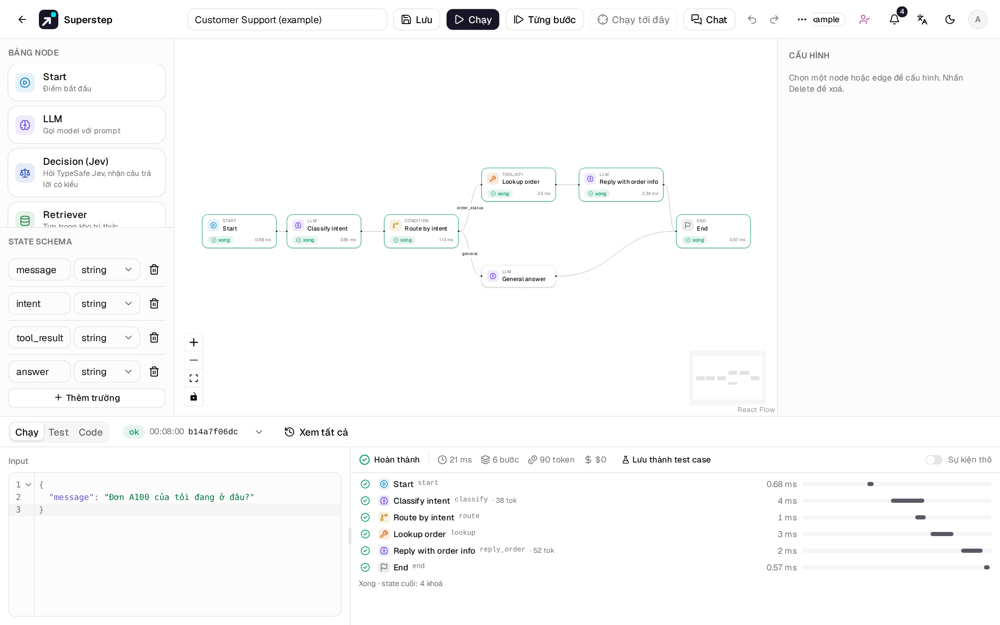
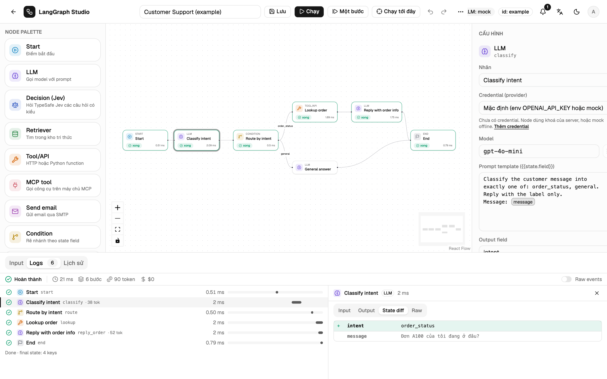

# Run và trace

## Timeline Logs

Tab **Logs** có mỗi bước của node là một dòng: trạng thái, tên, loại, thời
gian, thanh thác nước, và số token khi model trả về. Vòng lặp hiện `#2`, `#3`,
… Dòng tóm tắt cho biết trạng thái run, thời gian, số bước, token input và
output, chi phí và số lỗi.

Bấm vào một dòng, hoặc vào node trên canvas, để mở chi tiết:

| Tab | Hiện |
| --- | --- |
| Input | State mà node nhận vào |
| Output | Kết quả node trả về (token đang stream nếu là node LLM đang chạy) |
| State diff | Các trường mà bước này thêm, đổi hoặc xoá |
| Raw | Sự kiện gốc của bước |

**Raw events** chuyển cả tab sang luồng sự kiện gốc. **Lịch sử** phát lại bất
kỳ run nào trước đó trên cùng timeline, kèm nhãn phiên bản.

## Chạy từng bước

| Nút | Tác dụng |
| --- | --- |
| **Một bước** | Chạy một superstep rồi dừng chính run đó (trạng thái `paused`). |
| **Chạy tiếp** | Chạy phần còn lại. |
| **Chạy tới đây** | Chọn một node trước. Chạy tới khi node đó xong rồi dừng. Nếu đường đi không bao giờ tới node đó, run chạy hết và báo lại. |

Dừng kiểu này không phải là duyệt bởi người. Superstep chỉ có Start không tính
là một bước.

## Huỷ

**Huỷ** (++ctrl+period++) gửi `{"type": "cancel"}`. Đóng tab cũng huỷ run. Huỷ
mang tính hợp tác: run dừng giữa các bước, nên lời gọi LLM hay HTTP đang chạy
có thể vẫn chạy xong. Container của node Code bị kill.

## Trạng thái

| Trạng thái | Nghĩa |
| --- | --- |
| `ok` | Đã tới End. |
| `error` | Một node lỗi sau khi đã retry, hoặc graph không qua kiểm tra. |
| `cancelled` | Bị người huỷ hoặc tab bị đóng. |
| `timeout` | Chạy quá `STUDIO_RUN_TIMEOUT`. |
| `paused` | Dừng bởi Một bước hoặc Chạy tới đây. |
| `waiting` | Đang ở node Human. |
| `expired` | Chờ lâu hơn `STUDIO_WAIT_TTL`. |

Lỗi gói trong một dòng, `sk-…`, `Bearer …` và `api_key=…` được che đi.

## Giới hạn

| Biến | Mặc định | Nghĩa |
| --- | --- | --- |
| `STUDIO_RECURSION_LIMIT` | 25 | Số bước tối đa mỗi run. Vòng lặp không bao giờ đi qua Condition sẽ dừng với lỗi. Bước của For each không tính. |
| `STUDIO_RUN_TIMEOUT` | 120 giây | Thời gian tối đa của run, quá thì `timeout`. Thời gian chờ ở node Human không tính. |
| `STUDIO_EVENT_MAX_BYTES` | 262144 | Kích thước tối đa của một sự kiện. Trường quá lớn thành `{"_truncated": true, …}`. |
| `STUDIO_RUN_MAX_BYTES` | 2097152 | Dung lượng sự kiện tối đa lưu cho một run. Phần giữa được thay bằng `{"type": "truncated", "dropped": n}`. |
| `STUDIO_INPUT_MAX_BYTES` | 262144 | Input tối đa của run. |
| `STUDIO_WORKFLOW_MAX_BYTES` | 1048576 | JSON workflow tối đa. Lưu lớn hơn trả về HTTP 413. |

Timeline còn cắt `input` và `delta` ở 16 000 ký tự JSON để trang nhẹ.

## Token và chi phí

Chi phí tính từ số token và bảng giá trong `backend/app/engine/usage.py`. Bản
mock ước lượng token và tính `$0`. Model không có trong bảng hiện `—`. Ghi đè
giá (USD cho mỗi triệu token) bằng `STUDIO_PRICES='{"my-model": [1.0, 2.0]}'`
(input, output) hoặc `STUDIO_PRICES_FILE`; tiền tố khớp dài nhất thắng.

## Xuất ra hệ thống trace

Mỗi run cũng có thể thành một trace OpenTelemetry trong Jaeger, Tempo hoặc
LangSmith, có link **Mở trace** trong timeline. Xem
[Quan sát hệ thống](../operate/observability.md).
