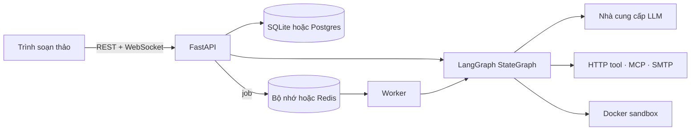

# Bắt đầu

!!! tip "Demo trực tuyến"
    Dùng thử Superstep mà không cần cài gì tại [superstep-demo.onrender.com](https://superstep-demo.onrender.com): bấm **Dùng thử demo**. Bản demo chạy trên gói miễn phí nên lần tải đầu có thể mất khoảng 30 giây, dữ liệu được đặt lại mỗi khi máy chủ nghỉ, và thay đổi không được lưu. Node Code, HTTP và Send email đang tắt, model trả lời bằng mock ([cách bản demo hoạt động](https://github.com/quinguyen1502/superstep/blob/develop/docs/deploy/demo.vi.md)).

Superstep gồm ba phần:

| Phần | Là gì |
| --- | --- |
| **Frontend** | React, TypeScript và Vite. React Flow vẽ canvas; giao diện dùng shadcn/ui trên Tailwind v4, có tiếng Anh và tiếng Việt. |
| **API** | FastAPI. Lưu workflow, biên dịch thành `StateGraph` của LangGraph, chạy và đẩy sự kiện qua WebSocket. |
| **Worker** | Chạy các job trong hàng đợi: run gọi qua API, lịch chạy, run được khôi phục và việc gửi webhook. Mặc định worker chạy ngay trong process API. |

Workflow là JSON gồm state schema, các node và các edge. Trình soạn thảo ghi
JSON đó, và backend kiểm tra lại mỗi lần lưu và mỗi run.

## Đọc tiếp

-   :material-download:{ .lg .middle } **Cài đặt**

    ---

    Phát triển ở máy với `./dev.sh`, hoặc chạy đủ bộ bằng Compose.

    [:octicons-arrow-right-24: Cài đặt](install.md)

-   :material-vector-polyline:{ .lg .middle } **Bắt đầu nhanh**

    ---

    Dựng, chạy, duyệt và gọi một workflow qua HTTP trong mười phút.

    [:octicons-arrow-right-24: Bắt đầu nhanh](quickstart.md)

-   :material-lightbulb-outline:{ .lg .middle } **Khái niệm**

    ---

    State, node, edge, run, superstep và checkpoint.

    [:octicons-arrow-right-24: Khái niệm](concepts.md)

